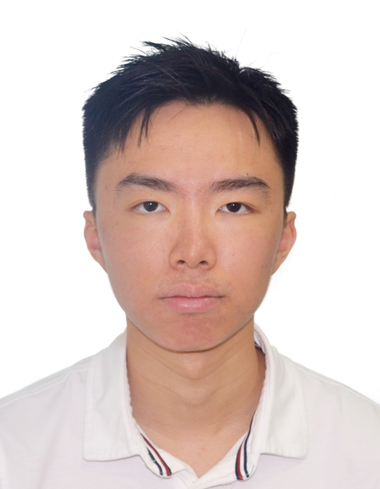
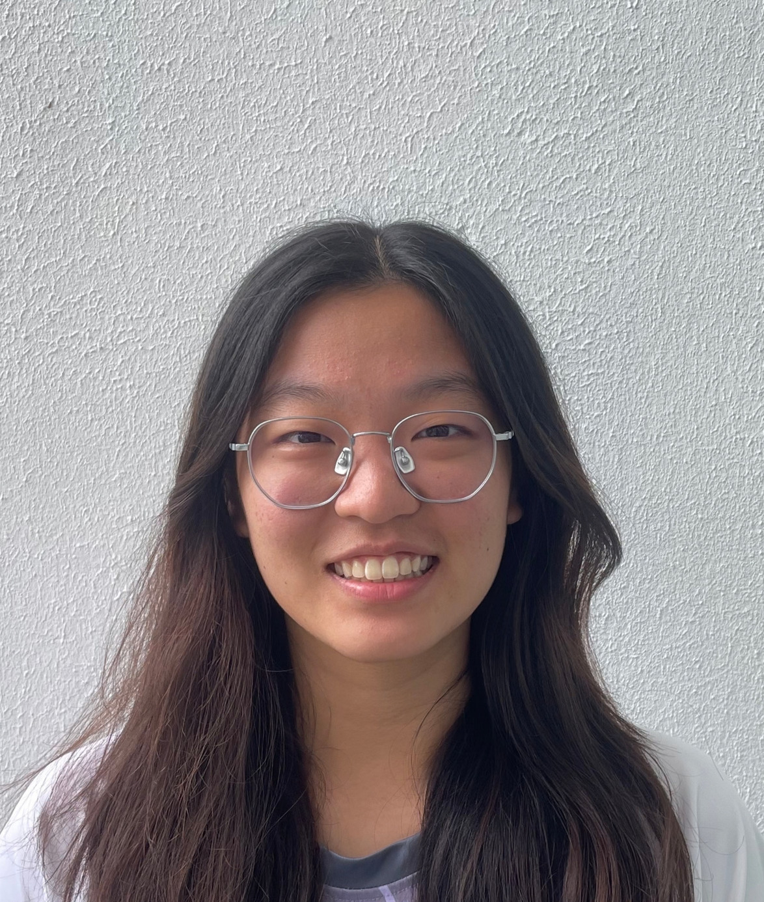
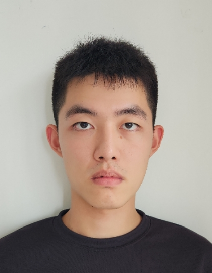

We are a team based in the [School of Computing, National University of Singapore](https://www.comp.nus.edu.sg).

## Project team

### Roger Zhang

[[homepage](https://rogerzhang888.github.io)]
[[github](https://github.com/rogerzhang888)]

* Role: Developer
* Responsibilities: Developer Guide and UML diagrams

### Gerald Fong Shao En

[[github](https://github.com/geraldFSE)]

* Role: Team Lead
* Responsibilities: Session notes and command box

### Sarah Chau

[[github](https://github.com/chausarahnusitems-tech)]

* Role: Product Manager
* Responsibilities: User research, student editing and deletion

### Praneeth Suresh

[[github](https://github.com/Praneeth-Suresh)]
[[homepage](https://notes.praneeth-suresh-s.workers.dev/)]

* Role: Developer
* Responsibilities: DevOps, command parsing and user stories

### Wang Jiahua

[[github](https://github.com/jiahw4ng)]

* Role: Developer
* Responsibilities: UI and data storage
