* Table of Contents
{:toc}

--------------------------------------------------------------------------------------------------------------------

## **Acknowledgements**

* _{List the sources of reused or adapted ideas, code, documentation, and third-party libraries here, with links to the originals.}_

--------------------------------------------------------------------------------------------------------------------

## **Setting up, getting started**

Refer to the guide [_Setting up and getting started_](SettingUp.md).

--------------------------------------------------------------------------------------------------------------------

## **Design**

<div markdown="span" class="alert alert-primary">

:bulb: **Tip:** The `.puml` files used to create diagrams are in `docs/diagrams`. Refer to the [_PlantUML Tutorial_ at se-edu/guides](https://se-education.org/guides/tutorials/plantUml.html) to learn how to create and edit diagrams.
</div>

### Architecture


The ***Architecture Diagram*** given above explains the high-level design of the App.

The following provides a quick overview of the main components and their interactions.

**Main components of the architecture**

**`Main`** (consisting of classes [`Main`](https://github.com/se-edu/addressbook-level3/tree/master/src/main/java/seedu/address/Main.java) and [`MainApp`](https://github.com/se-edu/addressbook-level3/tree/master/src/main/java/seedu/address/MainApp.java)) is in charge of the app launch and shut down.

* At app launch, it initializes the other components in the correct sequence, and connects them up with each other.
* At shut down, it shuts down the other components and invokes cleanup methods where necessary.

The bulk of the app's work is done by the following four components:

* [**`UI`**](#ui-component): The UI of the App.
* [**`Logic`**](#logic-component): The command executor.
* [**`Model`**](#model-component): Holds the data of the App in memory.
* [**`Storage`**](#storage-component): Reads data from, and writes data to, the hard disk.

[**`Commons`**](#common-classes) represents a collection of classes used by multiple other components.

**How the architecture components interact with each other**

The *Sequence Diagram* below shows how the components interact when the user previews deletion with `delete 1` and then completes it with `delete 1 /confirm`.

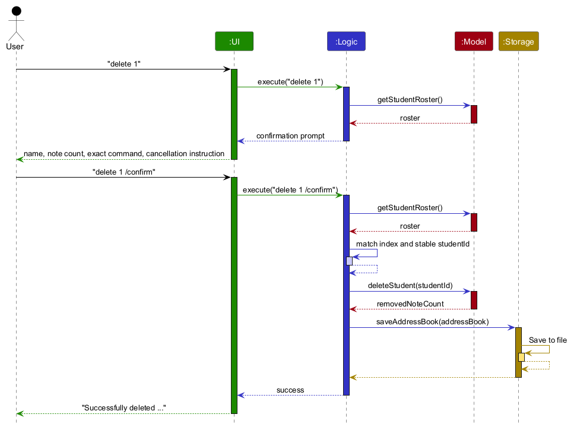

Each of the four main components (also shown in the diagram above),

* defines its *API* in an `interface` with the same name as the Component.
* provides its functionality through a concrete `{Component Name}Manager` class that implements the corresponding API interface.

For example, the `Logic` component defines its API in `Logic.java` and implements it in `LogicManager.java`. Other components interact with a component through its interface rather than its concrete class, preventing them from coupling to that component's implementation, as illustrated in the following partial class diagram.


The sections below give more details of each component.

### UI component

The **API** of this component is specified in [`Ui.java`](https://github.com/se-edu/addressbook-level3/tree/master/src/main/java/seedu/address/ui/Ui.java)

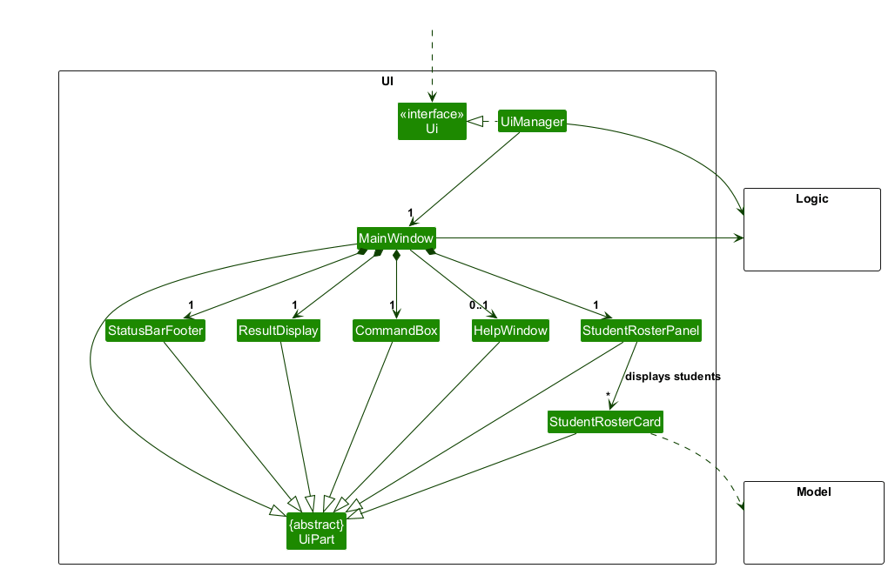

The UI consists of a `MainWindow` and its parts, such as `CommandBox`, `ResultDisplay`, `StudentRosterPanel`, and `StatusBarFooter`. All of these, including `MainWindow`, inherit from the abstract `UiPart` class, which captures common behavior among classes that represent visible GUI parts.

The `UI` component uses the JavaFX UI framework. The layouts of these UI parts are defined in matching `.fxml` files in `src/main/resources/view`. For example, [`MainWindow.fxml`](https://github.com/se-edu/addressbook-level3/tree/master/src/main/resources/view/MainWindow.fxml) specifies the layout of [`MainWindow`](https://github.com/se-edu/addressbook-level3/tree/master/src/main/java/seedu/address/ui/MainWindow.java).

`CommandBox` keeps up to 100 non-blank submitted commands in memory for the current app session. It records a submission before delegating execution to `Logic`, so successful commands, failed commands, duplicates, and edited recalled commands are all retained. `Up` and `Down` move through the retained commands, while `CommandBox` separately keeps the draft that must be restored after the user moves past the newest entry. `CommandBox` does not send the history to `Logic`, `Model`, or `Storage`, and it does not log the history.
`TutorTrackTheme.css` defines the shared light visual system: neutral surfaces, teal accents, system-font typography, borders, hover states, keyboard-focus states, and error states. The main window, Help window, and alert dialogs load this stylesheet so that secondary UI surfaces remain visually consistent without an external styling dependency. The theme is applied to the existing FXML layout and does not change command, keyboard, model, or persistence behavior.

The `UI` component,

* executes user commands using the `Logic` component.
* listens for changes to `Model` data so that the UI can be updated with the modified data.
* keeps a reference to the `Logic` component, because the `UI` relies on the `Logic` to execute commands.
* depends on `Logic#getStudentRoster()` and immutable `StudentRosterEntry` values because it displays TutorTrack student data.

### Logic component

**API** : [`Logic.java`](https://github.com/se-edu/addressbook-level3/tree/master/src/main/java/seedu/address/logic/Logic.java)

Here's a (partial) class diagram of the `Logic` component:

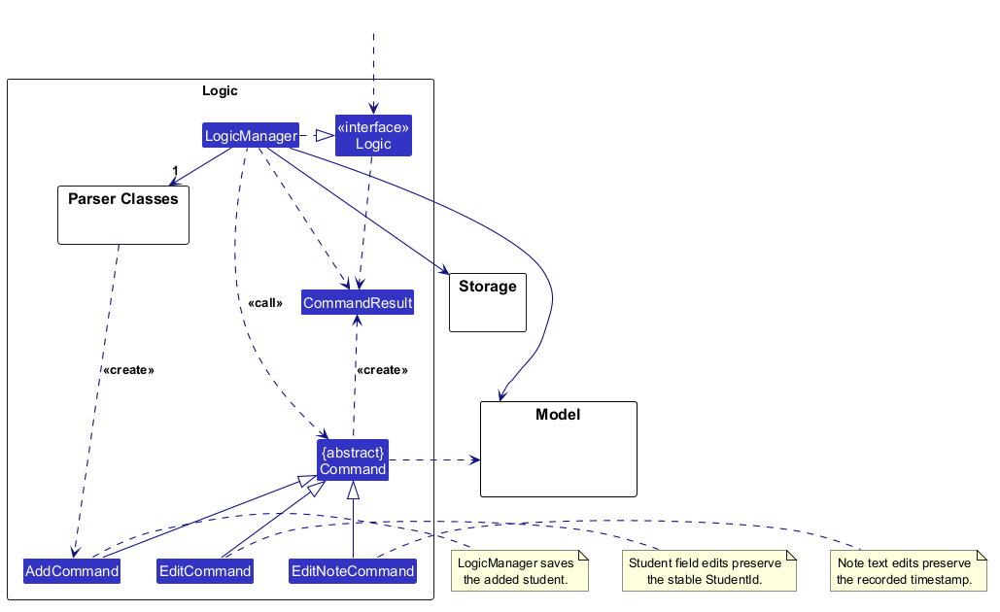

The sequence diagram below illustrates the interactions within the `Logic` component for the two-command confirmed-deletion workflow shared by student and session-note deletion.

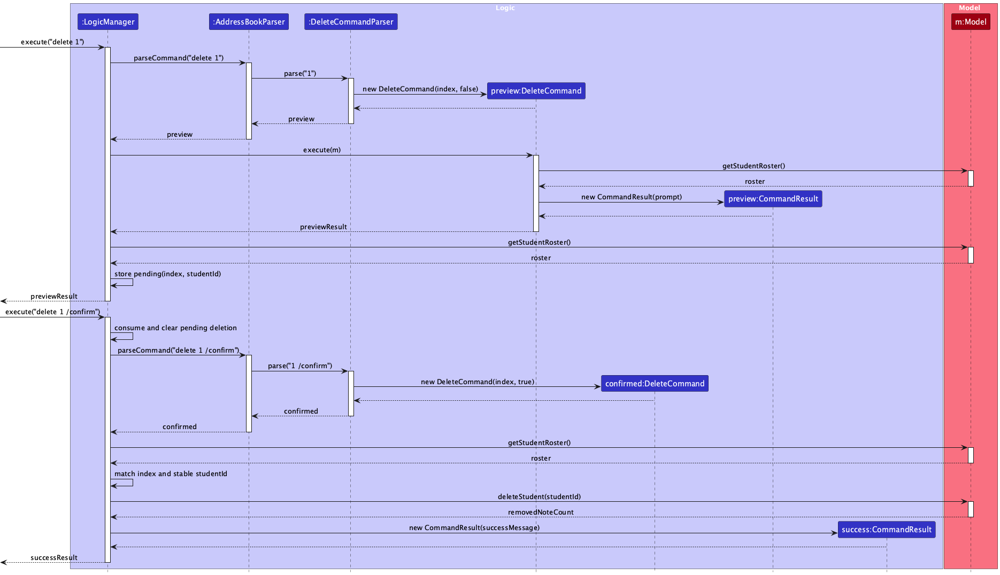

How the `Logic` component works:

1. When `Logic` is called upon to execute a command, the command is passed to an `AddressBookParser` object, which in turn creates a parser that matches the command (e.g., `DeleteCommandParser`) and uses it to parse the command.
1. This results in a `Command` object (more precisely, an object of one of its subclasses e.g., `DeleteCommand` or `DeleteSessionNoteCommand`) which is coordinated by the `LogicManager`.
1. An unconfirmed deletion command resolves its student or session-note target and returns a preview. `LogicManager` retains at most one pending deletion in memory and returns without saving because no model data changed.
1. At the start of the next command, `LogicManager` consumes and clears the pending deletion. A matching confirmed command must still resolve to the same stable student and, for a session note, the same immutable history snapshot before the applicable model deletion operation can run.
1. Commands that enter the persistence path and change the address book are saved by `LogicManager`; commands that leave it unchanged, such as `view`, `help`, and `exit`, are not saved. If saving fails, it restores the address book as it was before the command (see [Save-failure rollback](#save-failure-rollback)) and reports the error.
1. The result of the command execution is encapsulated as a `CommandResult` object which is returned from `Logic`.

Here are the other classes in `Logic` (omitted from the class diagram above) that are used for parsing a user command:

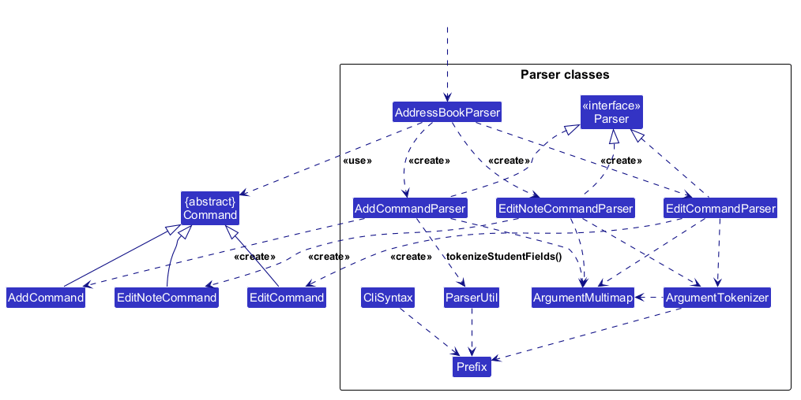

How the parsing works:

* For `add`, `AddressBookParser` creates an `AddCommandParser`. That parser checks the supported prefixes and required fields, builds a validated `Student`, and returns an `AddCommand` as a `Command` object. The diagram shows this route explicitly.
* `AddCommandParser` and the other command parsers implement the `Parser` interface so they can be treated similarly where appropriate, for example during testing.

### Model component

**API** : [`Model.java`](https://github.com/se-edu/addressbook-level3/tree/master/src/main/java/seedu/address/model/Model.java)

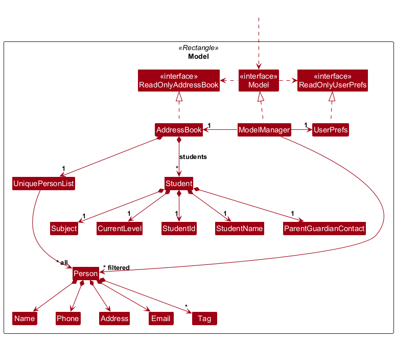

The `Model` component,

* stores the address book data i.e., all `Person` objects (which are contained in a `UniquePersonList` object).
* stores added `Student` records in `AddressBook`; each student has a stable `StudentId`, name, parent or guardian contact, subject, and current level. The diagram shows these student relationships alongside the inherited person model.
* stores the `Person` objects selected by the current filter, such as search results, in a separate _filtered_ list. It exposes this list as an unmodifiable `ObservableList<Person>` that the UI can observe and bind to, so the UI updates when the list changes.
* stores a `UserPrefs` object that represents the user’s preferences (currently, just the GUI settings). This is exposed to the outside as a `ReadOnlyUserPrefs` object.
* does not depend on any of the other three components (as the `Model` represents data entities of the domain, they should make sense on their own without depending on other components)

<div markdown="span" class="alert alert-info">:information_source: **Note:** The alternative, arguably more object-oriented, design below keeps a unique list of tags in `AddressBook`, and each `Person` references tags from that list. This lets `AddressBook` maintain one `Tag` object per unique tag instead of each `Person` holding its own `Tag` objects.<br>


</div>


### Storage component

**API** : [`Storage.java`](https://github.com/se-edu/addressbook-level3/tree/master/src/main/java/seedu/address/storage/Storage.java)

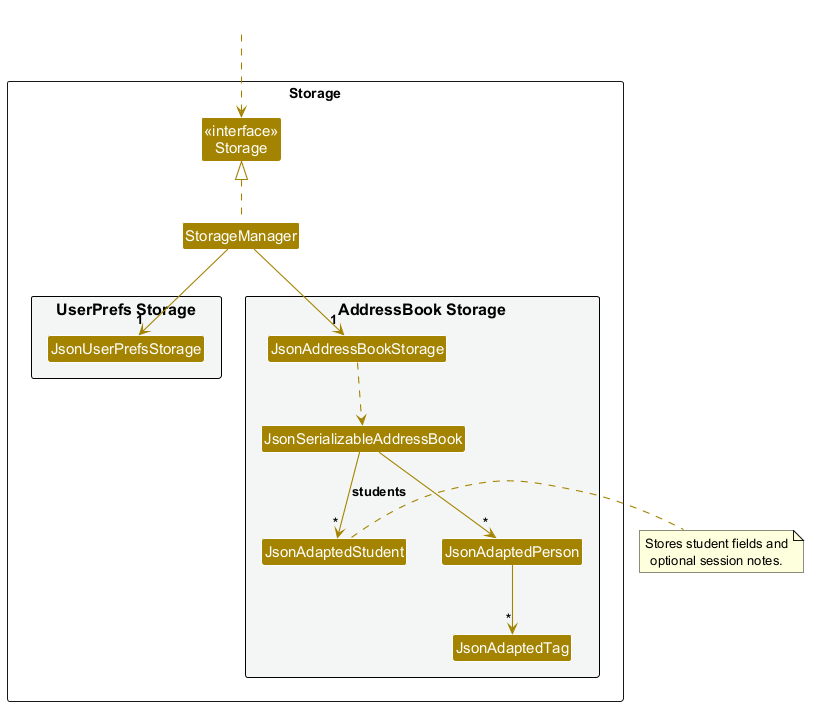

The `Storage` component,

* can save both address book data and user preference data in JSON format, and read them back into corresponding objects.
* is implemented by `StorageManager`, which delegates the actual JSON file access to `JsonAddressBookStorage` and `JsonUserPrefsStorage` (one class per data file).
* serializes added students through `JsonSerializableAddressBook` and `JsonAdaptedStudent`, including their optional session notes.
* depends on some classes in the `Model` component (because the `Storage` component's job is to save/retrieve objects that belong to the `Model`)

#### Data-file format and recovery

TutorTrack stores application data in `data/tutortrack.json` relative to the application's working directory. Each student record contains an immutable `studentId`, the student details, and an optional `sessionNotes` list. Each session note stores `recordedAt` as an offset date-time, such as `2026-09-18T18:35:00+08:00`, together with its `text`. Displayed note numbers and pending deletion confirmations are transient UI and command state; they are not persisted.

The storage adapter validates manually edited records by rebuilding the corresponding domain value types. A timestamp without a UTC offset, such as `2026-09-18T18:35:00`, is invalid. An invalid data file causes TutorTrack to start with an empty roster and show a data-load error. Before a later command can replace that file, storage preserves the unreadable content in a uniquely named sibling backup such as `data/tutortrack.json.backup-<unique>.bak`.

Direct data-file editing is an advanced recovery or migration technique, not a normal user workflow. Any edit must preserve each student's unique `studentId` and the persisted field and validation rules; otherwise the file may fail to load or produce behavior that the command interface would have rejected. The User Guide intentionally omits these implementation details.

### Common classes

Classes used by multiple components are in the `seedu.address.commons` package.

--------------------------------------------------------------------------------------------------------------------

## **Implementation**

This section describes some noteworthy details on how certain features are implemented.

### TutorTrack command routing

`AddressBookParser` registers the TutorTrack domain commands `add`, `edit`, `edit note`, `view`, `note`, and `delete`, together with the application-level `help` and `exit` commands. The inherited AB3 `find`, `clear`, and removed TutorTrack `list` words have no routes and produce the standard unknown-command error. TutorTrack's `edit` route dispatches `edit note` to `EditNoteCommandParser` and all other edit arguments to `EditCommandParser`, so it can update either a session note or a student record without exposing the inherited person edit behavior. The student add and edit parsers accept only the fields documented in the User Guide, so inherited person parameters such as `a/ADDRESS` and `t/TAG` are rejected before they can mutate or save data. A brand-new installation with no data file starts with an empty address book, so it does not create inaccessible legacy person records. Legacy person data types remain only for persisted-data compatibility; they are not part of TutorTrack's command surface.

### Adding a student

The following sequence shows only the main successful `add` path. `AddressBookParser` delegates to `AddCommandParser`, which constructs a validated `Student`. `AddCommand` checks duplicate identity through `Model#hasStudent` before calling `Model#addStudent`, and `LogicManager` saves the changed address book. Invalid, missing, repeated, or unsupported parameters produce a parse error; a duplicate produces a command error. If saving fails, `LogicManager` restores its pre-command snapshot. After a successful save, the UI refreshes the roster.

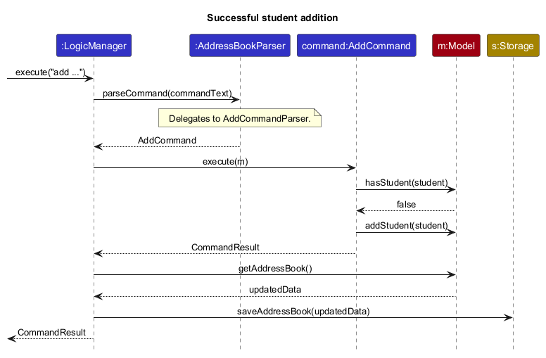

The class diagrams in [Logic](#logic-component), [Model](#model-component), [Storage](#storage-component), and [UI](#ui-component) show the corresponding relationships. A newly added student appears in `StudentRosterPanel` as a `StudentRosterCard`; `JsonAdaptedStudent` stores the student when the address book is saved.

### Student identity

TutorTrack's first student-domain slice introduces immutable `Student`, `StudentName`, `ParentGuardianContact`, `Subject`, and `CurrentLevel` value types. The `StudentIdentity` value object is the single source of truth for duplicate detection. It compares a student's name after trimming, collapsing internal whitespace, and converting it to lower case with the parent or guardian phone number after removing spaces and hyphens. Subject, current level, and parent email do not affect identity, so siblings may share a parent phone number.

The command and storage layers will construct `Student` values and delegate duplicate comparisons to `StudentIdentity`; they must not reproduce this normalization logic. This keeps the same duplicate outcome for typed commands and manually edited persisted data.

Student JSON uses `studentId`, `name`, `parentPhone`, optional `parentEmail`, `subject`, `currentLevel`, and optional `sessionNotes` fields. `StudentId` is an immutable UUID-backed identifier that is generated when a student is created and preserved when the record is saved and reloaded. For older files without `studentId`, `JsonAdaptedStudent` derives a deterministic migration ID from the existing `StudentIdentity`, so legacy data remains loadable and receives a stable ID. `JsonAdaptedStudent` validates every persisted value by rebuilding the corresponding domain types. `JsonSerializableStudentRoster` then checks each loaded Student through `Student#hasSameIdentity`, so JSON data cannot bypass the duplicate rule.

### Student editing

`edit INDEX [n/NAME] [p/PARENT_PHONE] [e/PARENT_EMAIL] [sub/SUBJECT] [l/CURRENT_LEVEL]` is parsed by `EditCommandParser`. The parser requires exactly one positive roster index and at least one supplied edit, rejects repeated or unknown prefixes, and applies the same student value-object validation used by addition and storage. `ParserUtil#tokenizeStudentFields` gives add and edit one shared tokenization set, including legacy person prefixes that must be recognized and rejected consistently. An empty `e/` has deliberate command semantics: the edit descriptor records that email was supplied separately from its optional value, so `e/` removes the email while an omitted email retains it. Empty values for required fields remain invalid.

The sequence below shows how a student edit resolves the displayed roster index to a stable `StudentId`, replaces only the supplied fields, saves the updated address book, and refreshes the roster and profile.

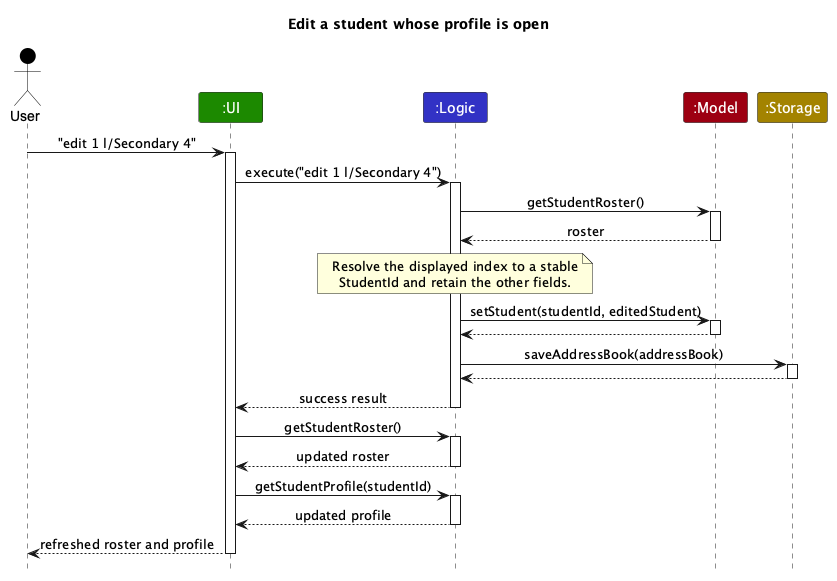

`EditCommand#execute` resolves the displayed index once through `Model#getStudentRoster()` and then works with the selected student's stable `StudentId`. It reads the immutable roster record through `Model#getStudent(StudentId)` rather than the presentation-facing `StudentProfile`, then composes a replacement immutable `Student` that retains every omitted field and the original ID. `Model#findConflictingStudent(StudentId, Student)` delegates to the roster's single duplicate-conflict lookup so the command can format a useful error without reproducing identity rules. `Model#setStudent(StudentId, Student)` uses the same lookup authoritatively while also checking that the target exists and the replacement retains its ID. `AddressBook` replaces only the roster entry, so the session history keyed by the same ID is untouched.

Changing a name or phone may reorder the roster. `MainWindow` retains an open profile by stable ID, so the highlighted card and profile move to the edited student's new index and show the replacement details after the successful command. `LogicManager` uses its normal persistence snapshot and rollback path; a failed save restores the original student and session history. Edit command string representations and command-routing logs omit supplied field values because contact and lesson context can contain private information.

### Student roster contract

`Model#getStudentRoster()` returns an immutable `StudentRoster` snapshot. The roster sorts students by normalized name, then normalized parent or guardian phone number, assigns one-based indices after sorting, and exposes immutable `StudentRosterEntry` values containing the stable ID, name, subject, current level, and session-note count. Student ID is the final tie-breaker for students with equal names and normalized parent or guardian phone numbers. Note counts are supplied as projection data so the student-roster context does not own session-note storage; `Model#getStudentRoster()` takes each student's count from that student's session history.

`Model#getStudentRoster()` obtains a fresh immutable roster snapshot for the JavaFX presentation. `Model#getStudent(StudentId)` returns the immutable student-domain record used by roster operations, while `Model#findConflictingStudent(StudentId, Student)` applies duplicate detection excluding the record being replaced. `Model#setStudent(StudentId, Student)` replaces one record without changing its stable identity or session history. `MainWindow` creates the roster panel from a roster snapshot during launch, and refreshes it after every successful command, so no separate roster command is needed. The panel reports an actionable add-student message when the snapshot is empty.

### Student roster UI

`StudentRosterPanel` copies the immutable roster entries into a JavaFX `ListView`, which provides scrolling for larger rosters. Each cell creates a wrapping `StudentRosterCard` from one `StudentRosterEntry`; the card displays the one-based index, name, subject, current level, and session-note count. When the snapshot is empty, the panel hides the list cells and shows an actionable message explaining how to add a student. `MainWindow` refreshes the panel from `Logic#getStudentRoster()` after each successful command.

The panel keeps the displayed-profile selection by stable `StudentId`, not by roster index. A dedicated `profile-selected` cell state renders that selection independently from JavaFX's temporary pointer or keyboard focus, so moving focus does not imply that another profile is open. Roster interaction selectors are scoped to `student-roster-list`, preventing hover or selection styling from leaking into session-note cells.

### Roster listing integration

`RosterListingIntegrationTest` adds students through `LogicManager`, verifies the saved JSON can be reloaded, and checks normalized ordering, one-based indices, and stable IDs across the reload. It also verifies the roster projection's note-count input. Newly added students report zero notes; `ModelManagerTest` covers non-zero counts from recorded session notes, and `SessionNoteIntegrationTest` checks that notes added with `note` are saved, reloaded, and counted.

### Session note types

Session notes live in the `seedu.address.model.session` package, separate from `seedu.address.model.student`, because the student roster only consumes note counts and does not own session-note data.

`SessionNote` is an immutable value holding the note text and the `OffsetDateTime` at which it was recorded. Its text is stripped of surrounding whitespace, while internal spaces are kept exactly as typed. Valid text has 1 to 500 characters, counted as Unicode code points so that an emoji counts as one character, and contains no control characters (such as line breaks or tabs) or Unicode line and paragraph separators. Identical text may be recorded more than once because each note describes a separate lesson. `SessionNote` does not read the clock itself; the caller supplies `recordedAt`, which keeps the type deterministic to test and lets the model decide when a note is timestamped.

`SessionHistory` is the immutable, newest-first collection of one student's notes. `SessionHistory#empty()` returns a history without notes, and `SessionHistory#withNote(SessionNote)` returns a new history with the note inserted, leaving the original unchanged. Notes are ordered by the instant they were recorded rather than by their local clock reading, so notes recorded with different time-zone offsets still appear in the correct order. Because timestamps are truncated to whole seconds, two notes can share an instant; `withNote` places the added note before notes with an equal instant, so it is treated as the newer one and notes are numbered in the order they were added. `SessionHistory#of(List<SessionNote>)` builds a history from a list in one step, sorting it newest first with a stable sort so that notes with equal instants keep their given order. `SessionHistory#getNotes()` returns an unmodifiable list, and `SessionHistory#size()` provides the note count shown in the roster. `SessionHistory#getNote(Index)` and `SessionHistory#withoutNote(Index)` accept the chronological note number shown to the user, where one identifies the oldest note. They convert it to the newest-first list position with `history size - NOTE_NUMBER`; removing a note returns a new history and leaves the original snapshot unchanged.

### Session note model integration

`AddressBook` stores session histories in a `StudentSessionHistories` object, which maps each `StudentId` to that student's `SessionHistory`, in the same way that it delegates person rules to `UniquePersonList`. Students without notes have no stored entry and report an empty history. Histories are kept beside the student list rather than inside `Student`, so adding a note does not replace the `Student` or change its equality, and the roster, duplicate detection, and student JSON are unaffected by notes.

`AddressBook#addSessionNote(StudentId, SessionNote)` rejects a note for a student who is not in the roster, so every stored history belongs to an existing student. `AddressBook#resetData` copies the history of each student it copies, so `Model#setAddressBook` and `new AddressBook(ReadOnlyAddressBook)` keep session notes. `ReadOnlyAddressBook#getSessionHistory(StudentId)` exposes a read-only history for each student.

The `Model` API offers five session-note operations:

* `Model#addSessionNote(StudentId, String)` validates the text, timestamps it, stores the note, and returns it. `ModelManager` reads the time from an injected `java.time.Clock`, which defaults to the system clock, and truncates it to whole seconds. Tests supply a fixed clock to keep timestamps deterministic.
* `Model#getSessionHistory(StudentId)` returns a student's newest-first history, which the student profile uses to display notes.
* `Model#editSessionNote(StudentId, Index, String)` replaces one note's text while preserving its recorded timestamp and chronological number.
* `Model#deleteSessionNote(StudentId, Index)` removes and returns one note selected by its chronological note number while preserving the student and every other session note.
* `Model#removeSessionHistory(StudentId)` removes a student's history and returns the number of notes removed.

Student deletion crosses the roster and session-history contexts through one model boundary. `Model#deleteStudent(StudentId)` validates that the stable ID identifies a roster student, then removes the student and session history together and returns the removed-note count. Keeping this coordination inside the model prevents commands from leaving an orphaned student or history if validation fails.

### Student profile projection

`Model#getStudentProfile(StudentId)` composes one immutable `StudentProfile` from the student record and that student's newest-first session history. The projection exposes domain value objects and an immutable note list, but no JavaFX controls, storage DTOs, or mutable collections. `Logic#getStudentProfile(StudentId)` delegates to the model so UI code stays behind the Logic boundary. An unknown or deleted student ID returns an empty optional, allowing a displayed profile to be cleared safely when its student no longer exists.

The `view INDEX` command resolves the chosen roster entry to its stable `StudentId` and carries that ID in `CommandResult`. `MainWindow` retains that stable ID, asks `Logic` for a fresh profile snapshot after every successful command, passes it to `StudentProfilePanel`, and asks `StudentRosterPanel` to highlight the matching card; the command layer does not depend on JavaFX, and the UI does not reach into storage or mutable model state. A failed command leaves the rendered snapshot and roster highlight unchanged. If the retained ID no longer identifies a student after a successful command, `MainWindow` clears both states.

`StudentProfilePanel` preserves the model's newest-first note order. It labels the oldest note `[1]` and assigns each newer note the next number, so the newest note appears first with the history size as its number. These numbers are current-display selectors rather than persisted identifiers and are reassigned consecutively after a deletion. Its bounded label column and growing value column allow names, contact details, subjects, and current levels to wrap without forcing the profile wider. Each `SessionNoteCard` formats the recorded local date and time for readability while displaying the saved UTC offset explicitly. The notes use wrapping cards inside a `ListView`, so long timestamps and text remain within the profile column and longer histories scroll.

`MainWindow` clamps a restored window size to the usable bounds of the screen containing its saved origin. The FXML keeps flexible result, roster, and profile constraints so the command box, feedback, workspace, and status bar remain reachable when the window is reduced for the supported high-scaling environment.

### Session note persistence

Each student's session notes are saved inside that student's JSON record as a `sessionNotes` list, newest first:

```json
"sessionNotes": [ { "recordedAt": "2026-09-18T18:35:00+08:00", "text": "Reviewed factorisation." } ]
```

Notes are nested in the student record so that the data file stays easy to read and edit by hand, even though the model keeps histories beside the student list. `JsonSerializableAddressBook` writes each student with `ReadOnlyAddressBook#getSessionHistory(StudentId)`, and when loading, it adds each student first and then sets that student's whole history through `AddressBook#setSessionHistory`. Loading builds the history with `SessionHistory#of` instead of adding the saved notes one by one with `withNote`, which would treat each later-loaded note as newer and reverse notes with equal timestamps on every reload.

`JsonAdaptedSessionNote` writes `recordedAt` with `DateTimeFormatter.ISO_OFFSET_DATE_TIME`, which always includes seconds; `OffsetDateTime#toString()` would leave out seconds that are zero. Loading rebuilds each note through `SessionNote`, so persisted notes follow the same validation as notes entered through the app. Notes with equal timestamps keep their saved order, and notes in a hand-edited file are sorted newest first when loaded.

A student record without a `sessionNotes` field loads with an empty history, so data files saved before session notes existed remain loadable. A missing `recordedAt` or `text`, a timestamp without an offset (such as `2026-09-18T18:35:00`), invalid note text, or an empty list entry is a load error, which follows the same recovery path as an invalid student field.

### Session note command

`note INDEX nt/NOTE` is parsed by `NoteCommandParser`, which recognizes only the `nt/` prefix, so other prefix-like text stays part of the note. A missing index or several words before `nt/` are reported as an invalid command format. A single word that is not a positive integer, such as `0`, `x`, or a number too large for an index, is reported as an invalid `INDEX`, as `DeleteCommandParser` does for `delete note`, and the note text is checked with `SessionNote#isValidText` before a `NoteCommand` is created.

`NoteCommand#execute` resolves `INDEX` against `Model#getStudentRoster()`, the same sorted roster that the roster panel shows, and then works with the selected student's `StudentId`. It adds the note through `Model#addSessionNote`, which timestamps it. `LogicManager` then saves the address book, and `MainWindow` refreshes the roster panel, which shows the new note count. An index beyond the roster raises a `CommandException` before the model changes.

`NoteCommand#toString` omits the note text, because notes may contain private lesson details.

### Confirmed deletion

`DeleteCommandParser` supports `delete STUDENT_INDEX [/confirm]` for a whole student and `delete note STUDENT_INDEX NOTE_NUMBER [/confirm]` for one session note. `/confirm` is an exact, case-sensitive terminal token. Duplicated, misplaced, differently cased, concatenated, or value-bearing confirmation tokens are rejected during parsing, before the model can change. The parser creates either a `DeleteCommand` or `DeleteSessionNoteCommand` containing the parsed selectors and whether confirmation was supplied.

#### Preview and pending target

For `delete STUDENT_INDEX`, `DeleteCommand#execute` resolves the index against `Model#getStudentRoster()`, the same sorted snapshot displayed by the roster panel. It returns the student's name, session-note count, exact confirmation command, and the instruction `To cancel, enter any other command.` without changing or saving the model. After a successful preview, `LogicManager` retains a `PendingStudentDeletion` containing the displayed index and resolved stable `StudentId`.

For `delete note STUDENT_INDEX NOTE_NUMBER`, `DeleteSessionNoteCommand#execute` resolves the same sorted roster and checks that the selected student has the displayed note number. After returning the preview and exact confirmation command, `LogicManager` retains a `PendingSessionNoteDeletion` containing the student index, stable `StudentId`, chronological note number, and exact immutable `SessionHistory` snapshot. The note number maps to the internal newest-first list position with `history size - NOTE_NUMBER`; because it is a display selector rather than a stored note ID, the remaining notes are numbered consecutively after deletion.

Both pending types occupy the same single `PendingDeletion` slot in `LogicManager`. Starting either valid preview after another preview consumes the earlier pending state and replaces it with the new target. Pending state contains no private student fields, is not part of the model or JSON schema, and is never persisted.

#### Confirmation, cancellation, and mutation

At the start of the next `LogicManager#execute` call, the pending deletion is copied locally and cleared before the new input is parsed. Any other submitted command, including malformed input, therefore cancels the pending deletion before that input is processed. A direct or repeated confirmation has no pending target and is rejected. A confirmation for the wrong deletion type or different selectors is a mismatch and is also rejected without mutation.

A student confirmation must use the pending index, and that index must still resolve to the pending stable `StudentId`. A session-note confirmation must additionally use the pending note number and find the same immutable history object for that student. These checks prevent a roster reorder or session-history change from redirecting confirmation to a different target even when the displayed numbers are reused.

After a match, `LogicManager` snapshots the address book and calls either `Model#deleteStudent(StudentId)` or `Model#deleteSessionNote(StudentId, Index)`. Student deletion removes the student and complete history atomically; session-note deletion removes only the selected note and preserves the student and every other note. `LogicManager` then saves the complete address book. A save failure restores the snapshot and leaves no confirmation pending, so the user must preview again. No storage-schema change is needed because the existing `sessionNotes` list stores the updated history, while note numbers and pending state remain transient.

After a successful student deletion, `MainWindow` requests a fresh roster snapshot, assigns consecutive student indices, and closes the profile if it belonged to the deleted student. After a successful note deletion, it refreshes an open profile so the remaining newest-first notes and their reassigned numbers are visible. A preview or rejected confirmation leaves the roster and profile unchanged.

**Design considerations:**

* **Trailing `/confirm` flag (current choice):** The confirmation repeats the complete destructive command and target in the same `word /clause` style as other TutorTrack commands. It remains keyboard-first, requires no extra command vocabulary, and lets the parser reject malformed confirmation placement. The cost is that the user must retype or recall the command exactly.
* **Standalone `confirm` and `cancel` commands:** Separate commands would require `ConfirmCommand`, `CancelCommand`, parser routes, help text, and another way to show which target `confirm` means. TutorTrack instead treats any other submitted command as cancellation and keeps the exact target visible in the confirmation command.
* **JavaFX confirmation dialog:** A modal dialog would duplicate the command path, introduce mouse-oriented UI state, and make parser and end-to-end testing less representative of the fast-typing workflow.
* **Persistent session-note IDs:** A stored ID would require a schema and migration change. Chronological display numbers are sufficient because the pending deletion also binds the immutable history snapshot, making a stale number fail safely.
* **Separate student and note coordinators:** Both operations have the same preview, pending match, save, and rollback lifecycle. One pending-deletion slot prevents simultaneous ambiguous confirmations while the two model operations retain their distinct domain responsibilities.

### Edit note command

The `edit note` command replaces the text of one existing session note without changing when it was recorded. Its format is `edit note STUDENT_INDEX NOTE_NUMBER nt/NEW_NOTE`, where `STUDENT_INDEX` selects a student in the current roster and `NOTE_NUMBER` selects a note in that student's displayed chronological numbering.

The sequence below shows how the command preserves the selected note's timestamp while saving the replacement text and refreshing the displayed profile.

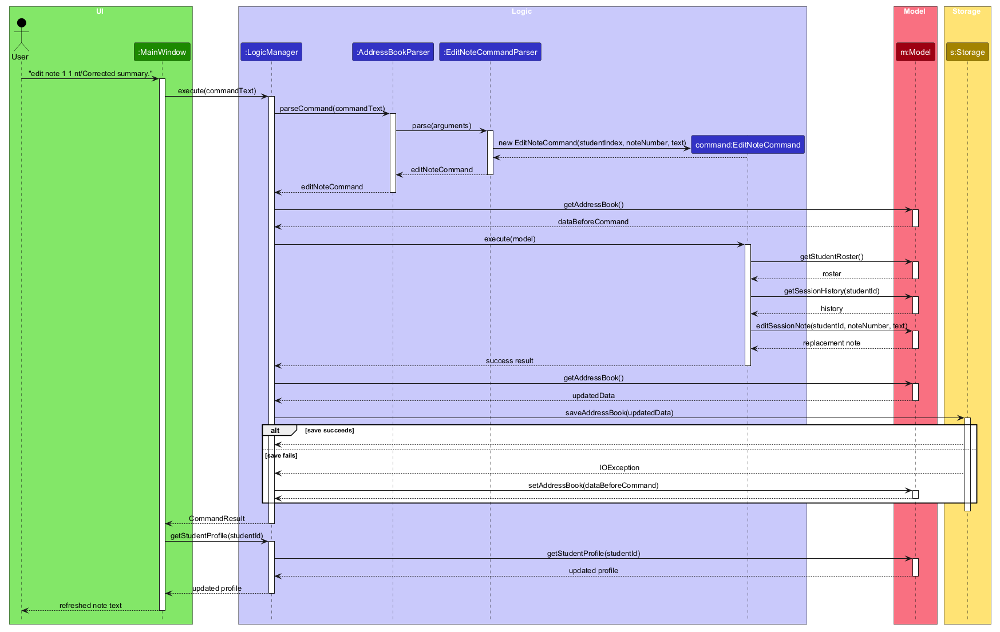

`EditNoteCommandParser` validates the student index, note number, `nt/` prefix, and new note text before creating an `EditNoteCommand`. The parser rejects a missing or malformed selector, an empty or overlong replacement, control characters, and duplicate `nt/` prefixes without changing the model. The command resolves the roster index to the student's stable `StudentId`, just as the existing note and deletion commands do.

The model operation creates a new immutable `SessionNote` with the replacement text and the original note's `recordedAt` value, then replaces the selected entry in the student's immutable `SessionHistory`. Keeping the original timestamp preserves the note's chronological position and means that editing does not renumber the remaining notes or alter the roster's note count. The operation crosses the model boundary through the student's `StudentId`; command code does not mutate a history or a storage DTO directly.

`LogicManager` snapshots the address book before the edit, saves the updated data through the existing persistence path, and restores the snapshot if saving fails. No storage-schema change is required because the existing `sessionNotes` entry is rewritten with the same `recordedAt` and the new `text`. After a successful edit, `MainWindow` refreshes the open profile so the updated text is visible while the note number and timestamp remain unchanged. A failed validation or save leaves the profile, roster, in-memory model, and data file unchanged.

**Design considerations:**

* **Preserve the original timestamp (current choice):** Editing corrects the note's text while retaining its lesson context and chronological position. The replacement is reconstructed with the old `recordedAt` value rather than being treated as a new lesson note.
* **Delete and add a new note:** This would reuse existing operations, but it would assign a new timestamp and could move the edited note in the history. It would also make an edit look like a second lesson, so it is not suitable.
* **Use a persistent note ID:** A stored ID would require a storage-schema and migration change. The current chronological note number is sufficient when paired with the current roster context and the immutable history used for the edit operation.

### Save-failure rollback

A failed save must leave the model unchanged, so that a command reported as failed does not take effect and is not written to the file by a later save. Before running a command on the persistence path, `LogicManager` copies the address book with `new AddressBook(model.getAddressBook())`. After the command runs, `LogicManager` compares the copy with the model's address book and skips saving when they are equal, so commands that change no data, such as `view`, `help`, and `exit`, still work when the data file cannot be written, and never overwrite a data file that failed to load. Otherwise, if `Storage#saveAddressBook` throws an `IOException`, `LogicManager` restores the copy with `Model#setAddressBook`, logs a warning without any student data, and throws a `CommandException` that names the data file from `Storage#getAddressBookFilePath()`; the exception itself may name the temporary file used for the write. A deletion preview bypasses this path because it does not mutate or save data.

The copy is made after parsing, so input that fails to parse never copies anything. Because `Student`, `SessionHistory`, and `SessionNote` are immutable, copying the address book only copies its lists and map, and the cost is small for a tutor's roster.

**Design considerations:**

* **Alternative 1 (current choice):** `LogicManager` copies the address book before commands on the persistence path and restores it when saving fails.
  * Pros: Covers persisted commands, including future ones, in one place while allowing non-mutating multi-step previews to opt out.
  * Cons: Copies and compares the address book for commands that do not change it.
* **Alternative 2:** Each command undoes its own changes when saving fails.
  * Pros: Copies nothing for commands that do not change data.
  * Cons: Every command needs a correct undo step, and a command that lacks one silently keeps its changes.

Restoring the model does not by itself protect the data file from a write that fails partway through. `FileUtil#writeToFile` writes the serialized content to a temporary file in the data file's parent directory, then atomically replaces the target. A failed temporary write or replacement leaves the previous data file intact, and the temporary file is removed.

### \[Proposed\] Undo/redo feature

#### Proposed Implementation

The proposed undo/redo mechanism is facilitated by `VersionedAddressBook`. It extends `AddressBook` with an undo/redo history, stored internally as an `addressBookStateList` and `currentStatePointer`. Additionally, it implements the following operations:

* `VersionedAddressBook#commit()` — Saves the current address book state in its history.
* `VersionedAddressBook#undo()` — Restores the previous address book state from its history.
* `VersionedAddressBook#redo()` — Restores a previously undone address book state from its history.

These operations are exposed in the `Model` interface as `Model#commitAddressBook()`, `Model#undoAddressBook()` and `Model#redoAddressBook()` respectively.

Given below is an example usage scenario and how the undo/redo mechanism behaves at each step.

Step 1. The user launches the application for the first time. The `VersionedAddressBook` will be initialized with the initial address book state, and the `currentStatePointer` pointing to that single address book state.


Step 2. The user executes `delete 5` command to delete the 5th person in the address book. The `delete` command calls `Model#commitAddressBook()`, causing the modified state of the address book after the `delete 5` command executes to be saved in the `addressBookStateList`, and the `currentStatePointer` is shifted to the newly inserted address book state.


Step 3. The user executes `add n/David …​` to add a new person. The `add` command also calls `Model#commitAddressBook()`, causing another modified address book state to be saved into the `addressBookStateList`.


<div markdown="span" class="alert alert-info">:information_source: **Note:** If a command fails its execution, it will not call `Model#commitAddressBook()`, so the address book state will not be saved into the `addressBookStateList`.

</div>

Step 4. The user now decides that adding the person was a mistake, and decides to undo that action by executing the `undo` command. The `undo` command will call `Model#undoAddressBook()`, which will shift the `currentStatePointer` once to the left, pointing it to the previous address book state, and restores the address book to that state.


<div markdown="span" class="alert alert-info">:information_source: **Note:** If the `currentStatePointer` is at index 0, pointing to the initial AddressBook state, then there are no previous AddressBook states to restore. The `undo` command uses `Model#canUndoAddressBook()` to check if this is the case. If so, it will return an error to the user rather
than attempting to perform the undo.

</div>

The following sequence diagram shows how an undo operation goes through the `Logic` component:

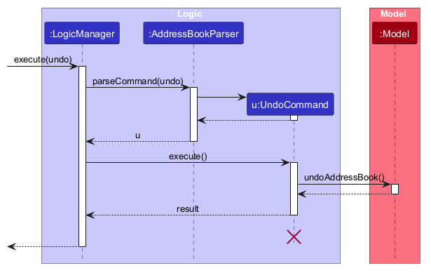

<div markdown="span" class="alert alert-info">:information_source: **Note:** The lifeline for `UndoCommand` should end at the destroy marker (X), but due to a limitation of PlantUML, it continues to the end of the diagram.

</div>

Similarly, how an undo operation goes through the `Model` component is shown below:

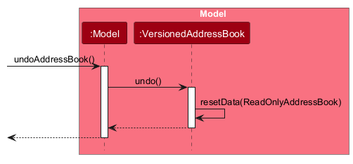

The `redo` command does the opposite — it calls `Model#redoAddressBook()`, which shifts the `currentStatePointer` once to the right, pointing to the previously undone state, and restores the address book to that state.

<div markdown="span" class="alert alert-info">:information_source: **Note:** If the `currentStatePointer` is at index `addressBookStateList.size() - 1`, pointing to the latest address book state, then there are no undone AddressBook states to restore. The `redo` command uses `Model#canRedoAddressBook()` to check if this is the case. If so, it will return an error to the user rather than attempting to perform the redo.

</div>

Step 5. The user then decides to execute the command `help`. Commands that do not modify the address book, such as `help`, will usually not call `Model#commitAddressBook()`, `Model#undoAddressBook()` or `Model#redoAddressBook()`. Thus, the `addressBookStateList` remains unchanged.


Step 6. The user executes `note 1 nt/Reviewed algebra.`, which calls `Model#commitAddressBook()`. Since the `currentStatePointer` is not pointing at the end of the `addressBookStateList`, all address book states after the `currentStatePointer` will be purged. Reason: It no longer makes sense to redo the earlier `add` command. This is the behavior that most modern desktop applications follow.

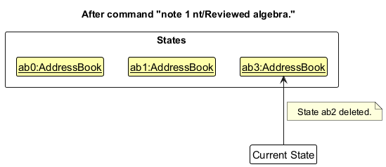

The following activity diagram summarizes what happens when a user executes a new command:


#### Design considerations:

**Aspect: How undo & redo execute:**

* **Alternative 1 (current choice):** Saves the entire address book.

  * Pros: Easy to implement.
  * Cons: May have performance issues in terms of memory usage.
* **Alternative 2:** Individual command knows how to undo/redo by
  itself.

  * Pros: Will use less memory (e.g. for `delete`, just save the person being deleted).
  * Cons: We must ensure that the implementation of each individual command is correct.

_{more aspects and alternatives to be added}_

### \[Proposed\] Data archiving

_{Explain here how the data archiving feature will be implemented}_


--------------------------------------------------------------------------------------------------------------------

## **Documentation, logging, testing, dev-ops**

* [Documentation guide](Documentation.md)
* [Testing guide](Testing.md)
* [Logging guide](Logging.md)
* [DevOps guide](DevOps.md)

--------------------------------------------------------------------------------------------------------------------

## **Appendix: Requirements**

### Product scope

**Target user profile**:

* is a private tutor managing a small active roster of students
* needs to keep each student's preparation context and chronological session notes together
* wants to find a student and record a short note immediately after each lesson
* prefers desktop apps over other types of applications
* can type fast
* prefers typing to mouse interactions
* is reasonably comfortable using CLI apps

**Value proposition**: TutorTrack lets a private tutor find a student, review the student's profile, and record or correct a session note faster than managing the same information in spreadsheets or a typical mouse-driven GUI application.

### User stories

Priorities: High (must have) - `* * *`, Medium (nice to have) - `* *`, Low (unlikely to have) - `*`


| Priority | As a …                                             | I want to …                                                                     | So that I can…                                                                            |
| ---------- | ----------------------------------------------------- | ---------------------------------------------------------------------------------- | -------------------------------------------------------------------------------------------- |
| `* * *`  | tutor new to TutorTrack                             | add a student to my roster                                                       | begin keeping their tutoring context in one place                                          |
| `* * *`  | tutor                                               | record a student's parent contact                                                | find the correct contact when I need it                                                    |
| `* * *`  | tutor                                               | record the subject I teach a student                                             | identify the context of their tuition                                                      |
| `* * *`  | tutor                                               | record a student's current level                                                 | prepare appropriately for them                                                             |
| `* * *`  | tutor who types fast                                | add a student with all their details in a single command                         | record a new student quickly between lessons                                               |
| `* * *`  | tutor                                               | be stopped from adding the same student twice                                    | avoid splitting one student's session notes across two entries in my roster                |
| `* * *`  | tutor teaching siblings                             | add each sibling as a separate student with the same parent phone                | keep their learning histories separate while retaining their shared parent contact         |
| `* * *`  | tutor                                               | see all the students in my roster                                                | keep track of all the students I am managing                                               |
| `* * *`  | tutor                                               | see how many session notes each student in my roster has                         | tell apart students who share the same name                                                |
| `* * *`  | tutor preparing for a lesson                        | view a student's subject, level, and parent contact together                     | orient myself before the lesson                                                            |
| `* * *`  | tutor preparing for a lesson                        | review a student's recent session notes                                          | continue from where the student previously left off                                        |
| `* * *`  | tutor                                               | see the date and time each session note was written                              | know when each lesson took place                                                           |
| `* * *`  | tutor who has just completed a lesson               | add a short session note about a student's progress, difficulties, or next steps | preserve what happened while it is still fresh                                             |
| `* * *`  | tutor                                               | delete a student from my roster                                                  | remove information I no longer need                                                        |
| `* * *`  | tutor                                               | see the student and session-note count before confirming a deletion              | verify the impact before removing data                                                      |
| `* * *`  | tutor                                               | confirm before a student is deleted                                              | avoid deleting the wrong student by accident                                               |
| `* * *`  | tutor                                               | be told exactly what is wrong when a command fails                               | fix the mistake without guessing or retyping the whole command                             |
| `* * *`  | tutor                                               | have my roster and session notes saved automatically after every change          | continue where I left off the next time I open TutorTrack                                  |
| `* * *`  | tutor new to TutorTrack                             | see usage instructions                                                           | refer to instructions when I forget how to use TutorTrack                                  |
| `* *`    | tutor trying TutorTrack for the first time          | see sample students and session notes                                            | understand how TutorTrack supports my tutoring work                                        |
| `* *`    | tutor ready to use TutorTrack for real              | remove all sample data at once                                                   | start my roster with only my own students                                                  |
| `* * *`  | tutor                                               | update a student's parent contact without losing the student's session notes     | keep the parent contact reliable when a parent changes their phone number or email         |
| `* * *`  | tutor                                               | remove a parent email that is no longer valid                                    | avoid contacting an address that no longer works                                           |
| `* * *`  | tutor                                               | correct a misspelled student name without losing the student's session notes     | keep my roster accurate                                                                    |
| `* * *`  | tutor                                               | update a student's level without losing the student's session notes              | keep the student's details in line with their current stage of learning                    |
| `* * *`  | tutor                                               | update the subject I teach a student without losing the student's session notes  | keep the student's details relevant when their tuition changes                             |
| `* *`    | tutor preparing for a lesson                        | find a student by name                                                           | retrieve their context without scanning my whole roster                                    |
| `* *`    | tutor with students in different subjects or levels | narrow my roster to students of a particular subject or level                    | focus on the students I am working with                                                    |
| `* *`    | tutor                                               | return to my full roster after a search                                          | select any student by their roster number again                                            |
| `* *`    | tutor                                               | undo my most recent change                                                       | recover from a mistaken change, such as deleting the wrong student                         |
| `* *`    | tutor new to TutorTrack                             | see the exact format of a specific command                                       | enter it correctly without trial and error                                                 |
| `* *`    | tutor                                               | enter a parent phone with spaces or hyphens                                      | copy numbers from messages without reformatting them                                       |
| `* *`    | tutor                                               | see my roster sorted by student name                                             | locate a student quickly                                                                   |
| `* *`    | tutor                                               | back up my roster and session notes by copying a single data file                | avoid losing my students' history if my computer fails                                     |
| `*`      | tutor who has used TutorTrack for a long time       | archive a student who is no longer receiving tuition                             | keep my current roster uncluttered                                                         |
| `*`      | tutor                                               | view an archived student's details and session notes                             | refer to their past context if I need it                                                   |
| `*`      | tutor whose former student resumes lessons          | restore an archived student to my roster                                         | continue teaching with their previous context available                                    |
| `*`      | tutor teaching siblings                             | link siblings to one shared parent contact                                       | update the parent contact once for all of them                                             |
| `*`      | tutor                                               | correct a mistake in a saved session note                                        | keep each student's history accurate                                                       |
| `*`      | tutor                                               | delete several students in one command                                           | remove students who have stopped lessons quickly                                           |
| `*`      | tutor who works on more than one computer           | access my roster from any of my computers                                        | prepare for lessons wherever I am                                                          |

### Use cases

The following use cases describe the TutorTrack MVP at the same level of
detail. Each use case focuses on the externally visible interaction between
the tutor and the system.

**System:** `TutorTrack`

**Actor:** `Tutor`

**Use case: Add a student**

**Preconditions:** The system is running and ready to accept requests.

**Guarantees:** A valid student record is saved locally and appears in the
student roster.

**MSS**

1. Tutor requests to add a student.
2. Tutor provides the student's name, parent or guardian phone number, subject,
   and current level, and optionally an email address.
3. Tutor submits the student details.
4. TutorTrack validates the details and creates the student record.
5. TutorTrack saves the record and displays the updated roster in
   case-insensitive alphabetical order.

   Use case ends.

**Extensions**

* 2a. One or more required details are missing or invalid.

  * 2a1. TutorTrack reports the relevant validation error and makes no changes.
  * 2a2. Tutor corrects the details.

    Use case resumes at step 2.
* 4a. A student with the same normalized name and normalized parent or guardian
  phone number already exists.

  * 4a1. TutorTrack reports the duplicate and does not add the student.

    Use case ends.
* 5a. TutorTrack cannot save the updated data.

  * 5a1. TutorTrack reports the storage error and does not create the record.

    Use case ends.

**Use case: Edit a student**

**Preconditions:** The system is running and the current roster index context is available.

**Guarantees:** A successful edit saves the supplied replacement details while preserving the student's stable identity and complete session history. A rejected edit changes nothing.

**MSS**

1. Tutor selects a student by roster index and supplies one or more replacement details.
1. TutorTrack validates the index and supplied details.
1. TutorTrack replaces the student record while retaining the stable student ID and every session note.
1. TutorTrack saves the record, refreshes the sorted roster and any open profile, and confirms the edit.

   Use case ends.

**Extensions**

* 1a. Tutor supplies `e/` without a value.

  * 1a1. TutorTrack removes the optional parent or guardian email and continues at step 2.
* 1b. Tutor supplies no field to edit, repeats a field, or supplies an unsupported field.

  * 1b1. TutorTrack reports the command error and makes no changes.

    Use case ends.
* 2a. The index or a supplied value is invalid.

  * 2a1. TutorTrack reports the validation error and makes no changes.

    Use case ends.
* 2b. The replacement name and phone duplicate another student.

  * 2b1. TutorTrack reports the duplicate and makes no changes.

    Use case ends.
* 4a. TutorTrack cannot save the updated data.

  * 4a1. TutorTrack reports the storage error and restores the complete original record.

    Use case ends.

**Use case: Display the student roster**

**Preconditions:** The system is running and the student roster is available.

**Guarantees:** The complete roster is displayed with stable indices that can
be used to select a student in a subsequent use case. No data is changed.

**MSS**

1. TutorTrack displays every student sorted by normalized name, together with
   an index, subject, current level, and session-note count.
2. TutorTrack establishes the displayed indices as the current selection
   context.

   Use case ends.

**Extensions**

* 2a. The roster is empty.

  * 2a1. TutorTrack reports that there are no students and shows how to add
    one.

    Use case ends.
**Use case: View a student profile**

**Preconditions:** The system is running and the current roster index context
is available.

**Guarantees:** The selected student's profile is displayed without changing
the roster or stored data.

**MSS**

1. Tutor selects a student by the student's roster index.
2. TutorTrack displays the student's name, parent or guardian contact details,
   subject, and current level.
3. TutorTrack displays all session notes for the student in newest-first order,
   including each note's saved date and time.
4. TutorTrack confirms that the student's profile is being shown.

   Use case ends.

**Extensions**

* 1a. The index is missing, invalid, or outside the roster.

  * 1a1. TutorTrack reports the index error and leaves any currently displayed
    profile unchanged.

    Use case ends.
* 3a. The student has no session notes.

  * 3a1. TutorTrack reports that no session notes have been recorded.

    Use case ends.

**Use case: Add a session note**

**Preconditions:** The system is running and the current roster index context
is available.

**Guarantees:** A valid session note is appended to the student's session
history and saved locally. No other student record is changed.

**MSS**

1. Tutor selects a student by the student's roster index and provides a short
   session note.
2. TutorTrack validates the note.
3. TutorTrack records the note with the current local date and time and saves
   it in the student's session history.
4. TutorTrack confirms that the note was added and updates the student's
   session-note count.

   Use case ends.

**Extensions**

* 1a. The index is missing, invalid, or outside the roster.

  * 1a1. TutorTrack reports the index error and makes no changes.

    Use case ends.
* 2a. The note is missing, empty, too long, or contains a line break or control
  character.

  * 2a1. TutorTrack reports the note validation error and makes no changes.

    Use case ends.
* 3a. TutorTrack cannot save the updated data.

  * 3a1. TutorTrack reports the storage error and does not retain the note.

    Use case ends.

**Use case: Delete a student or session note**

**Preconditions:** The system is running and the current roster index context is available. Deleting a session note also requires a note number from the student's displayed history.

**Guarantees:** A preview or rejected confirmation leaves the roster and local storage unchanged. A matching confirmation removes exactly the previewed student and complete history, or exactly the previewed note while retaining its student and other notes.

**MSS**

1. Tutor requests deletion using a student's roster index and, for one session note, its displayed note number.
1. TutorTrack displays the target, exact confirmation command, and instruction that any other command cancels the deletion.
1. Tutor submits the matching confirmation command next.
1. TutorTrack verifies that the index still identifies the same stable student ID and, for a note, that the displayed history is unchanged.
1. TutorTrack removes the previewed student and complete history, or removes only the previewed note, and saves the updated data.
1. TutorTrack reports the deleted target and refreshes the roster and any open profile.

   Use case ends.

**Extensions**

* 1a. A required index or note number is missing, malformed, or outside its displayed range.

  * 1a1. TutorTrack reports the applicable validation error and makes no changes.

    Use case ends.
* 3a. Tutor enters any other command.

  * 3a1. TutorTrack cancels the pending deletion and processes the new command normally.

    Use case ends.
* 3b. Tutor enters a direct, repeated, or mismatched confirmation.

  * 3b1. TutorTrack reports that the confirmation does not match or that no deletion is pending, and makes no deletion.

    Use case ends.
* 3c. Tutor duplicates or misplaces `/confirm` or adds extra arguments.

  * 3c1. TutorTrack reports the command-format error and makes no deletion.

    Use case ends.
* 4a. The roster or selected session history changes before confirmation.

  * 4a1. TutorTrack rejects the stale confirmation and makes no deletion.

    Use case ends.
* 5a. TutorTrack cannot save the updated data.

  * 5a1. TutorTrack reports the storage error, restores the complete pre-command data, and clears the pending deletion.

    Use case ends.

**Use case: Edit a session note**

**Preconditions:** The system is running, the current roster index context is available, and the selected student has the displayed note number.

**Guarantees:** A valid replacement text updates only the selected note. Its recorded date and time, chronological position, and note number remain unchanged, and the updated history is saved locally.

**MSS**

1. Tutor requests an edit using a student's roster index, a displayed note number, and replacement text.
1. TutorTrack validates the selectors and replacement text.
1. TutorTrack creates a replacement note with the original recorded date and time, updates the student's history, and saves the updated data.
1. TutorTrack reports that the note was edited and refreshes the student's open profile.

   Use case ends.

**Extensions**

* 1a. The student index or note number is missing, malformed, or outside the current displayed range.

  * 1a1. TutorTrack reports the applicable selector error and makes no changes.

    Use case ends.
* 1b. The `nt/` prefix is missing, duplicated, or followed by invalid note text.

  * 1b1. TutorTrack reports the note validation error and makes no changes.

    Use case ends.
* 3a. TutorTrack cannot save the updated data.

  * 3a1. TutorTrack reports the storage error, restores the complete pre-command data, and leaves the original note unchanged.

    Use case ends.

### Non-Functional Requirements

1. Should run on Windows, Linux, and macOS with Java `25` installed, without requiring an installer or a separate server.
2. Should support a tutor with 40 active students and at least 1000 archived or historical student records.
3. A roster search, filter, or student-profile view should respond within two seconds for a roster of up to 1000 student records.
4. Saving or loading the local data file should complete within five seconds for a roster of up to 1000 student records on a typical modern computer.
5. The application should start within ten seconds on a typical modern computer when loading a data file containing up to 1000 student records.
6. The user interface should be intuitive for users who generally prefer only using a keyboard.

### Glossary

* **Student**: A learner whose tutoring information is managed in TutorTrack.
* **Student roster**: The collection of active student records managed by the tutor.
* **Student profile**: A view containing one student’s details, parent or guardian contact, subject, current level, and session history.
* **Parent or guardian contact**: The required phone number and optional email address of the adult responsible for a student.
* **Current level**: The student’s current stage of study in the recorded subject.
* **Session note**: A timestamped record of the student’s progress, difficulties, or next steps from a lesson.
* **Session history**: All session notes belonging to one student, displayed newest first.
* **Roster index**: The positive, one-based number assigned to a student in the currently displayed roster.
* **Current selection context**: The mapping between the displayed roster indices and their students; it changes when the roster is redrawn.
* **Duplicate student**: Two student records whose normalized names and normalized parent phone numbers both match.
* **Normalized name**: A student's name after leading and trailing whitespace is removed and consecutive internal spaces are collapsed to one. Normalized names are compared case-insensitively for sorting and duplicate detection.
* **Normalized parent phone number**: A parent or guardian phone number after spaces and hyphens are removed.
* **Active student**: A student currently receiving tuition and included in the normal roster.
* **Archived student**: A former or inactive student whose details and session history are retained but excluded from the active roster.
* **Typical modern computer**: A computer that can run Java `25` comfortably
  and has at least 8 GB of memory.


---

## **Appendix: Instructions for manual testing**

Given below are instructions to test the app manually.

<div markdown="span" class="alert alert-info">:information_source: **Note:** These instructions only provide a starting point for testers to work on;
testers are expected to do more *exploratory* testing.

</div>

### Launch and shutdown

1. Initial launch

   1. Download the JAR file and copy it into an empty folder.
   2. Double-click the JAR file.
      Expected: The GUI opens with a set of sample contacts. The window size may not be optimal.
2. Saving window preferences

   1. Resize the window to an optimal size. Move the window to a different location. Close the window.
   2. Relaunch the app by double-clicking the JAR file.
      Expected: The most recent window size and location are retained.
3. _{ more test cases … }_

### UI theme and scaling

1. Launch TutorTrack and confirm that the window title is `TutorTrack`, the main surface is light, and teal accents are used for controls and selected roster entries.
2. Focus the command box, open the Help window with `F1`, and open an error dialog with an invalid command.
   Expected: Focus, hover, error, Help window, and dialog states remain readable and use the same light and teal visual system. The Help window shows the User Guide link `https://ay2627s1-cs2103t-f09-1.github.io/tp/UserGuide.html`.
3. Repeat the launch and the checks above at 1920x1080 with 100% scaling, 1920x1080 with 125% scaling, and 1280x720 with 150% scaling.
   Expected: The restored window fits within the usable screen area. The command box, result display, roster, profile, status bar, Help window, and standard controls remain reachable without clipped controls.

### Roster and profile workspace

1. Start with an empty data file.
   Expected: The roster displays `No students yet` with an instruction to use `add`, while the profile displays `No student selected` with an instruction to use `view INDEX`.
1. Enter `add n/Alicia Alexandra Lim Wei Xuan p/8000 0001 e/guardian.with.a.long.address@example.com sub/Additional Mathematics and Mathematical Modelling l/Secondary 4 Express`, followed by `add n/Blair Tan p/8000 0002 sub/English Literature l/JC 1`.
   Expected: Both roster cards remain within the left pane. Long values wrap vertically instead of being clipped or creating a horizontal scrollbar.
1. Enter `view 1`.
   Expected: Alicia's roster card has the teal profile-selection treatment. Her name, phone, email, subject, and level appear in the profile and wrap within the value column where needed.
1. Drag across text in Alicia's profile, press `Ctrl+C` on Windows/Linux or `Cmd+C` on macOS, and paste into a temporary plain-text document. Repeat with a wrapped session note after completing the note step below.
   Expected: Short and multi-line text can be selected and copied exactly. Typing while the profile text is selected does not edit the displayed content, and scrolling the session history still works normally.
1. Move the pointer over Blair's card, click it, then click the result/error display.
   Expected: Hovering or clicking Blair's card leaves it unchanged, and clicking the result/error display does not add a focus border. Neither region opens a profile or otherwise behaves like a clickable control.
1. Click the command box and type `view 2` without submitting it.
   Expected: The command box regains focus and accepts the text. The profile remains contained within the right pane and does not cover the command box or result display.
1. Enter a valid `note 1 nt/NOTE` command after replacing `NOTE` with one line of exactly 500 characters, then enter `view 1` again.
   Expected: The timestamp and note wrap inside one session-note card, the history scrolls vertically when needed, and no disruptive horizontal scrolling appears.
1. Enter `delete 1`.
   Expected: TutorTrack displays Alicia's name, note count, `delete 1 /confirm`, and `To cancel, enter any other command.` Alicia's profile and roster remain unchanged.
1. Enter `delete 1 /confirm`.
   Expected: Alicia's profile and profile-selection treatment both clear. Blair is reindexed to 1 and remains usable.
1. Repeat the populated-workspace checks at 1920x1080 with 100% and 125% scaling and at 1280x720 with 150% scaling.
   Expected: All fields, commands, feedback, scrollbars, and status information remain reachable. Content uses vertical wrapping or scrolling rather than clipping or horizontal expansion.

### Adding a student

1. Enter `add n/Alicia Lim p/+65 9123 4567 e/mrs.lim@example.com sub/Mathematics l/Secondary 3`.
   Expected: TutorTrack reports `Added student: Alicia Lim (Mathematics, Secondary 3).`
2. Repeat the command with `n/alicia lim` and `p/+65-9123-4567`.
   Expected: TutorTrack reports `Duplicate student: alicia lim already has this parent phone.` and preserves the existing record.
3. Enter `add n/Bea Lim p/+65 9123 4567 sub/English l/Secondary 2`.
   Expected: TutorTrack accepts the sibling because the student name differs.
4. Enter `add n/Alex Tan p/91234567 sub/Mathematics l/` and `add n/Alex Tan p/91234567 sub/Mathematics l/Secondary 3 x/value`.
   Expected: The first reports that `l/` is missing a value and the second reports `x/` as an unknown parameter. Both responses include the `add` format and neither changes the roster or data file.

### Editing a student

1. Add Alicia and Bea, add two session notes to Alicia, and enter `view 1` to open Alicia's profile.
1. Enter `edit 1 n/Zara Lim p/+65 8000 0000 sub/Physics l/Secondary 4`.
   Expected: TutorTrack reports `Edited student: Zara Lim (Physics, Secondary 4).` Zara moves to her new sorted position, retains both session notes and the same selected profile, and the saved JSON retains her original `studentId`.
1. Enter `edit 2 e/` for a student with an email.
   Expected: The email is removed, every omitted field and session note is unchanged, and an open profile displays `Not provided`.
1. Enter `edit 1`, `edit 1 l/`, `edit 1 n/Zara Lim n/Other Name`, and `edit 1 x/value`.
   Expected: Each command reports the applicable error and edit usage without changing the roster, profile, notes, or data file.
1. Try to edit one student so that both the normalized name and parent phone match the other student.
   Expected: TutorTrack reports the duplicate and leaves both students unchanged.
1. Make the data file unwritable and enter an otherwise valid edit, then restore write access.
   Expected: TutorTrack reports the save error and restores the original student, roster position, profile, notes, and data file.

### Rejecting inherited AB3 person commands

1. Add one student and add a session note for that student.
1. Enter `list`.
   Expected: TutorTrack reports `Unknown command.` and leaves the roster, session note, and saved data unchanged.
1. Enter each of `find Changed` and `clear`.
   Expected: Each input reports `Unknown command.` The student, session note, roster display, and saved data remain unchanged.
1. Enter `add n/Amy Bee p/11111111 e/amy@example.com a/Block 312, Amy Street 1 t/friend`.
   Expected: TutorTrack reports `a/` as an unknown parameter, lists the supported add parameters, and shows the add format. It does not create a hidden person or change the roster, session notes, or saved data.
1. Enter `add n/Bea Lim p/9876 5432 sub/English l/JC 1`.
   Expected: The valid student form still adds Bea Lim normally.

### Displaying the student roster

1. Empty roster

   1. Start TutorTrack with no student records.
      Expected: The roster panel shows a clear message explaining that there are no students and how to use `add`.
2. Populated roster

   1. Add students with different names, subjects, and levels.
      Expected: Cards appear in normalized alphabetical order and each card shows its index, name, subject, level, and session-note count.
   2. Resize the window or add enough students to exceed the panel height.
      Expected: The roster remains usable through its vertical scrolling.
   3. Add another student.
      Expected: The displayed roster refreshes and indices match the new alphabetical order.

### Adding a session note

1. Prerequisites: add at least two students.
1. Enter `note 1 nt/Reviewed factorisation.`
   Expected: TutorTrack reports `Added session note for <name of student 1>.` and that student's session-note count increases by one.
1. Close and relaunch TutorTrack.
   Expected: The student's session-note count is unchanged, and the data file contains the note under that student's `sessionNotes`.
1. Enter `note 1 nt/Next: 3 sub/topics`.
   Expected: The note is added with `sub/topics` as part of its text.
1. Enter each of `note`, `note 1`, `note nt/text`, and `note 1 2 nt/text`.
   Expected: Each shows an invalid command format error, and no note count changes.
1. Enter each of `note 0 nt/text`, `note x nt/text`, and `note 2147483648 nt/text`.
   Expected: Each reports that `INDEX` must be a positive integer and shows the `note` format, and no note count changes.
1. Enter `note 1 nt/` and `note 1 nt/a nt/b`.
   Expected: The first shows the note length rule and the second a duplicate prefix error; no note count changes.
1. Enter `note N nt/text`, where `N` is one more than the number of students.
   Expected: TutorTrack reports that the student index is invalid, and no note count changes.

### Editing a session note

1. Add one student, record two session notes, and enter `view 1`.
1. Enter `edit note 1 1 nt/Corrected oldest lesson summary.`
   Expected: TutorTrack reports `Successfully edited session note [1] for <name of student 1>.` The oldest note's text changes, while its timestamp, `[1]` number, and the student's note count remain unchanged.
1. Close and relaunch TutorTrack, then enter `view 1`.
   Expected: The corrected note remains saved with the same timestamp and number.
1. Enter each of `edit note`, `edit note 1`, `edit note 1 1`, `edit note 0 1 nt/text`, `edit note 1 0 nt/text`, `edit note x 1 nt/text`, `edit note 1 x nt/text`, and `edit note 1 1 nt/`.
   Expected: Each command reports the applicable format or validation error and leaves the note, profile, roster count, and data file unchanged.
1. Enter `edit note 1 1 nt/first nt/second`.
   Expected: TutorTrack reports a duplicate `nt/` prefix error and leaves the original note unchanged.

### Deleting a student

1. Add Ari Tan and Bea Tan, add two session notes to Ari, and open Ari's profile with `view 1`.
1. Enter `delete 1`.
   Expected: TutorTrack reports `Are you sure you want to delete Ari Tan and 2 session notes?`, shows `If yes, type: delete 1 /confirm`, and states `To cancel, enter any other command.` The roster, notes, profile, and data file remain unchanged.
1. Enter `help`, followed by `delete 1 /confirm`.
   Expected: `help` cancels the pending deletion and opens the help window. The confirmation is then rejected because no matching deletion is pending; Ari and the notes remain unchanged.
1. Enter `delete 1`, followed immediately by `delete 1 /confirm`.
   Expected: TutorTrack reports `Successfully deleted Ari Tan.` Ari and the two notes are removed, Bea becomes roster index 1, and Ari's open profile closes.
1. Enter `delete 1 /confirm` again.
   Expected: TutorTrack rejects the repeated confirmation because no matching deletion is pending, and Bea remains unchanged.
1. Close and relaunch TutorTrack.
   Expected: Ari and the notes remain absent, while Bea remains at index 1.
1. Enter each of `delete`, `delete 0`, `delete -1`, `delete x`, `delete 1 2`, `delete 1-2`, `delete 1/confirm`, `delete /confirm 1`, `delete 1 /Confirm`, `delete 1 /confirm /confirm`, and `delete 1 /confirm extra`.
   Expected: Each command reports an invalid command format and leaves the roster, notes, open profile, and data file unchanged.
1. Enter `delete N`, where `N` is one more than the number of students.
   Expected: TutorTrack reports that the student index is invalid and makes no changes.

### Deleting one session note

1. Start with an empty roster. Enter `add n/Ari Tan p/9123 4567 sub/Mathematics l/Secondary 3` and `add n/Bea Tan p/9876 5432 sub/English l/Secondary 3`.
1. Enter `note 1 nt/Oldest synthetic lesson note.`, `note 1 nt/Middle synthetic lesson note.`, and `note 1 nt/Newest synthetic lesson note.` in that order, pausing at least one second between submissions, and then enter `view 1`.
   Expected: Ari's profile shows `[3] Newest synthetic lesson note.` at the top, followed by `[2] Middle synthetic lesson note.` and `[1] Oldest synthetic lesson note.` Bea remains at roster index 2 with no session notes.
1. Enter `delete note 1 2`.
   Expected: TutorTrack asks whether to delete session note `[2]` for Ari Tan, shows `If yes, type: delete note 1 2 /confirm`, and states `To cancel, enter any other command.` All three notes, the roster, the profile, and the data file remain unchanged.
1. Enter `help`, followed by `delete note 1 2 /confirm`.
   Expected: `help` cancels the pending deletion and opens the help window. The confirmation is then rejected because no matching session-note deletion is pending, and all three notes remain.
1. Enter `delete note 1 2`, followed immediately by `delete 2 /confirm`.
   Expected: TutorTrack rejects the student confirmation because it does not match the pending session-note deletion. Ari, Bea, and all three notes remain unchanged, and the pending deletion is cleared.
1. Enter `delete note 1 2`, followed immediately by `delete note 1 1 /confirm`.
   Expected: TutorTrack rejects the confirmation because the note number does not match the preview. All three notes remain, and the pending deletion is cleared.
1. Enter `delete note 1 2`, followed immediately by `delete note 1 2 /confirm`.
   Expected: TutorTrack reports `Successfully deleted session note [2] for Ari Tan.` Ari and Bea remain in the roster. Ari's profile refreshes with the former newest note renumbered to `[2]` at the top and the oldest note still numbered `[1]`; the deleted middle note is absent.
1. Close and relaunch TutorTrack, and enter `view 1`.
   Expected: Ari still has exactly the two remaining notes in newest-first order as `[2]` and `[1]`. Ari's `sessionNotes` entries in `data/tutortrack.json` do not contain `noteNumber` fields.
1. Enter `delete note 2 1`.
   Expected: TutorTrack reports that Bea Tan has no session notes to delete and makes no changes.
1. Enter `delete note 1 3`.
   Expected: TutorTrack reports that session note `[3]` does not exist for Ari Tan and gives the current range from 1 to 2. No note is deleted.
1. Enter each of `delete note`, `delete note 1`, `delete note 0 1`, `delete note 1 0`, `delete note x 1`, `delete note 1 x`, `delete note 1 1 /Confirm`, `delete note /confirm 1 1`, `delete note 1 1 /confirm /confirm`, and `delete note 1 1 /confirm extra`.
   Expected: Each command reports the applicable session-note deletion format or validation error and leaves both students, both remaining notes, the open profile, and the data file unchanged.

### Navigating command history

1. Restart TutorTrack, type `unfinished command` without pressing `Enter`, and press `Up`.
   Expected: The draft remains unchanged because the new session has no command history.
1. Submit `help`, `invalid`, and `help` in that order, then type `unfinished command` without submitting it.
   Expected: The first and third submissions succeed, the second fails, and the draft remains in the command box.
1. Press `Up` repeatedly.
   Expected: The command box shows `help`, then `invalid`, then the older `help`; another `Up` leaves the oldest `help` displayed.
1. Press `Down` repeatedly.
   Expected: The command box moves through `invalid` and the newer `help`, then restores `unfinished command`; another `Down` leaves the draft displayed.
1. Press `Up`, change the recalled `help` to `exit`, submit it, and press `Up` again.
   Expected: `help` opens the help window and is recalled as the newest history entry.
1. Close and relaunch TutorTrack, then press `Up` in an empty command box.
   Expected: No command is recalled because history is kept only for the app session.

### Saving data

1. Dealing with missing/corrupted data files

   1. Replace the contents of `data/tutortrack.json` with invalid JSON, such as `invalid`.
   1. Start TutorTrack.
      Expected: TutorTrack starts with an empty roster, shows a data-load error, and preserves the original content in a uniquely named backup such as `data/tutortrack.json.backup-<unique>.bak`.
   1. Close TutorTrack without entering a command, replace the original data file with different invalid content, and start TutorTrack again.
      Expected: TutorTrack preserves the new content in a second uniquely named backup and leaves the first backup unchanged.
2. _{ more test cases … }_
