* Table of Contents
{:toc}

--------------------------------------------------------------------------------------------------------------------

## **Acknowledgements**

* TutorTrack is based on [AddressBook-Level3](https://github.com/se-edu/addressbook-level3) (AB3) by the [SE-EDU initiative](https://se-education.org). The code structure, much of the code, this Developer Guide's structure, the User Guide template, and the diagrams that have not been replaced are adapted from AB3.
* Libraries: [JavaFX](https://openjfx.io/) for the GUI, [Jackson](https://github.com/FasterXML/jackson) for JSON storage, and [JUnit 5](https://junit.org/junit5/) for testing.
* Diagrams are drawn with [PlantUML](https://plantuml.com/).
* AI tools [Codex](https://openai.com/codex/), [Claude Code](https://www.anthropic.com/claude-code), and [Kiro](https://kiro.dev/) were used to help write and review code, tests, and documentation.
* [Beryl](https://github.com/Praneeth-Suresh/Beryl) provided ideas and documentation that informed the development workflow.

--------------------------------------------------------------------------------------------------------------------

## **Setting up, getting started**

Refer to the guide [_Setting up and getting started_](SettingUp.md).

--------------------------------------------------------------------------------------------------------------------

## **Design**

<div markdown="span" class="alert alert-primary">

:bulb: **Tip:** The `.puml` files used to create diagrams are in `docs/diagrams`. Refer to the [_PlantUML Tutorial_ at se-edu/guides](https://se-education.org/guides/tutorials/plantUml.html) to learn how to create and edit diagrams.
</div>

### Architecture


The ***Architecture Diagram*** given above explains the high-level design of the App.

The following provides a quick overview of the main components and their interactions.

**Main components of the architecture**

**`Main`** (consisting of classes [`Main`](https://github.com/AY2627S1-CS2103T-F09-1/tp/tree/master/src/main/java/seedu/address/Main.java) and [`MainApp`](https://github.com/AY2627S1-CS2103T-F09-1/tp/tree/master/src/main/java/seedu/address/MainApp.java)) handles app launch and shut down.

* At app launch, it initializes the other components in the correct sequence, and connects them up with each other.
* At shut down, it shuts down the other components and invokes cleanup methods where necessary.

The bulk of the app's work is done by the following four components:

* [**`UI`**](#ui-component): The UI of the App.
* [**`Logic`**](#logic-component): The command executor.
* [**`Model`**](#model-component): Holds the data of the App in memory.
* [**`Storage`**](#storage-component): Reads data from, and writes data to, the hard disk.

[**`Commons`**](#common-classes) represents a collection of classes used by multiple other components.

**How the architecture components interact with each other**

The _Sequence Diagram_ below illustrates how the four main components interact when a student is added. It shows the successful path at the architecture level; parsing, validation, and other internal interactions are omitted.

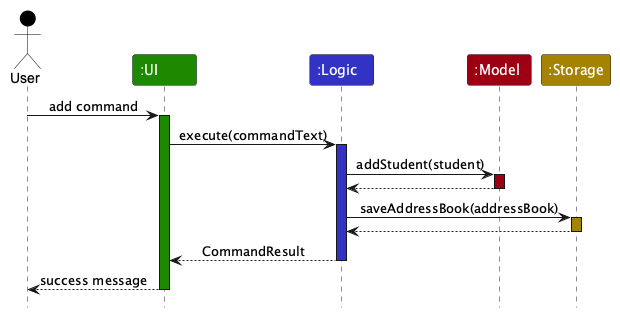

Each of the four main components (also shown in the diagram above),

* defines its *API* in an `interface` with the same name as the Component.
* provides its functionality through a concrete `{Component Name}Manager` class that implements the corresponding API interface.

For example, the `Logic` component defines its API in `Logic.java` and implements it in `LogicManager.java`. Other components interact with a component through its interface rather than its concrete class, preventing them from coupling to that component's implementation, as illustrated in the following partial class diagram.


The sections below give more details of each component.

### UI component

The **API** of this component is specified in [`Ui.java`](https://github.com/AY2627S1-CS2103T-F09-1/tp/tree/master/src/main/java/seedu/address/ui/Ui.java)

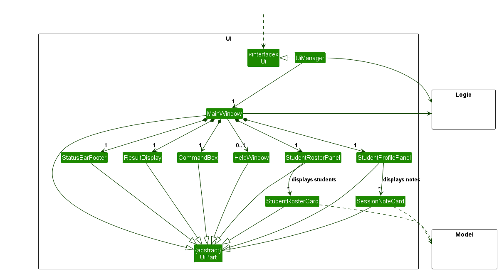

The UI consists of a `MainWindow` and its parts, such as `CommandBox`, `ResultDisplay`, `StudentRosterPanel`, and `StudentProfilePanel`. All of these, including `MainWindow`, inherit from the abstract `UiPart` class, which captures common behavior among classes that represent visible GUI parts. The diagram omits minor parts, such as `HelpWindow`, `StatusBarFooter`, and the cards inside the two panels.

The `UI` component uses the JavaFX UI framework. The layouts of these UI parts are defined in matching `.fxml` files in `src/main/resources/view`. For example, [`MainWindow.fxml`](https://github.com/AY2627S1-CS2103T-F09-1/tp/tree/master/src/main/resources/view/MainWindow.fxml) specifies the layout of [`MainWindow`](https://github.com/AY2627S1-CS2103T-F09-1/tp/tree/master/src/main/java/seedu/address/ui/MainWindow.java).

The `UI` component,

* executes user commands using the `Logic` component: `CommandBox` passes each command to `MainWindow`, which calls `Logic#execute()`.
* keeps a reference to the `Logic` component, because the `UI` relies on the `Logic` to execute commands.
* refreshes the roster and any open profile after each successful command, rather than listening for changes to `Model` data.
* depends on classes in the `Model` component, such as `StudentRosterEntry` and `SessionNote`, because it displays student data.

### Logic component

**API** : [`Logic.java`](https://github.com/AY2627S1-CS2103T-F09-1/tp/tree/master/src/main/java/seedu/address/logic/Logic.java)

Here's a (partial) class diagram of the `Logic` component:

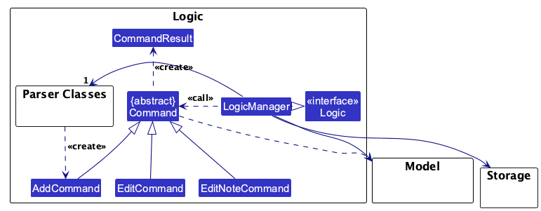

The sequence diagram below shows the interactions within the `Logic` component, taking the `execute("add ...")` API call as an example. `Model` and `Storage` are treated as black boxes.

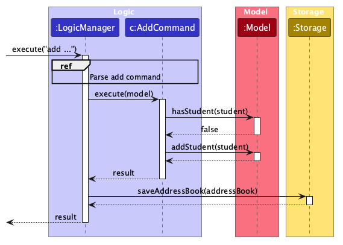

How the `Logic` component works:

1. When `Logic` is called upon to execute a command, the command is passed to an `AddressBookParser` object, which in turn creates a parser that matches the command (e.g., `AddCommandParser`) and uses it to parse the command. Commands without arguments, such as `help` and `exit`, are created directly by `AddressBookParser`.
1. This results in a `Command` object (more precisely, an object of one of its subclasses, e.g., `AddCommand`), which is executed by the `LogicManager`.
1. The command can communicate with the `Model` when it is executed (e.g., to check for a duplicate and add a student).
1. The result of the command execution is encapsulated as a `CommandResult` object, which is returned from `Logic` after any changed data is saved through `Storage`. If saving fails, `LogicManager` restores the previous data (see [Save-failure rollback](#save-failure-rollback)).

Deletions differ: `LogicManager` handles their preview and confirmation itself, as described under [Confirmed deletion](#confirmed-deletion).

The sequence diagram below shows how the `add` command is parsed:

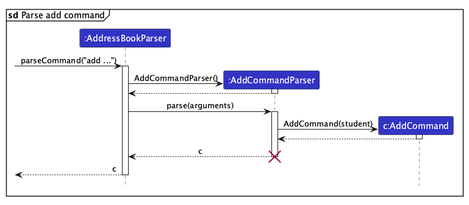

<div markdown="span" class="alert alert-info">:information_source: **Note:** The lifeline for `AddCommandParser` should end at the destroy marker (X), but due to a limitation of PlantUML, it continues to the end of the diagram.
</div>

The following partial class diagram expands the parser classes, using `AddCommandParser` as a representative example. `AddCommandParser` uses `ParserUtil` to tokenize the student fields into an `ArgumentMultimap`, with `CliSyntax` defining the `Prefix` values (such as `n/` and `p/`) that identify each field. It then validates the values and constructs an `AddCommand`.

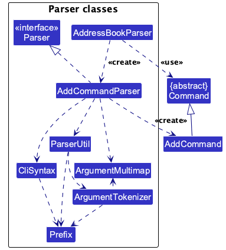

How the parsing works:

* For commands with a dedicated parser, `AddressBookParser` creates an `XYZCommandParser` (`XYZ` is a placeholder for the specific command name, e.g., `AddCommandParser`). The parser uses the helper classes shown above to parse the user command and create an `XYZCommand` object (e.g., `AddCommand`), which `AddressBookParser` returns as a `Command` object.
* All `XYZCommandParser` classes, such as `AddCommandParser` and `NoteCommandParser`, implement the `Parser` interface so that they can be treated similarly where appropriate, for example during testing.

### Model component

**API** : [`Model.java`](https://github.com/AY2627S1-CS2103T-F09-1/tp/tree/master/src/main/java/seedu/address/model/Model.java)

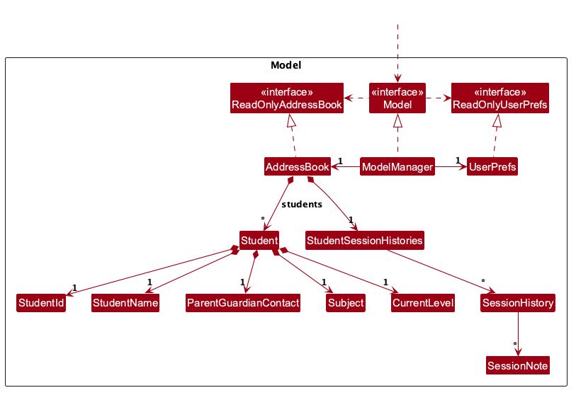

The `Model` component,

* stores the address book data, i.e., all `Student` records in `AddressBook`. Each student has a stable `StudentId`, name, parent or guardian contact, subject, and current level.
* stores each student's session notes in a `StudentSessionHistories` object beside the student list, rather than inside `Student`. It keeps one `SessionHistory` of `SessionNote`s per `StudentId` (see [Session note model and persistence](#session-note-model-and-persistence)).
* stores a `UserPrefs` object that represents the user’s preferences (currently, just the GUI settings). This is exposed to the outside as a `ReadOnlyUserPrefs` object.
* does not depend on any of the other three components (as the `Model` represents data entities of the domain, they should make sense on their own without depending on other components)

`AddressBook` also still holds a `UniquePersonList` of `Person` objects inherited from AB3. The diagram above omits it because no command uses it, although `Storage` still reads and writes it.

### Storage component

**API** : [`Storage.java`](https://github.com/AY2627S1-CS2103T-F09-1/tp/tree/master/src/main/java/seedu/address/storage/Storage.java)

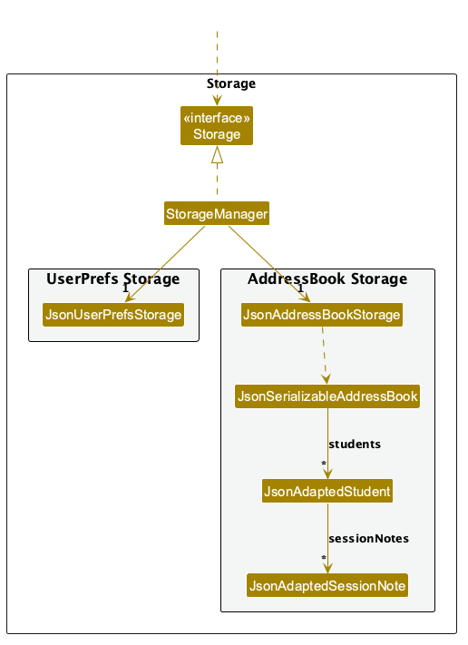

The `Storage` component,

* can save both address book data and user preference data in JSON format, and read them back into corresponding objects.
* is implemented by `StorageManager`, which delegates the actual JSON file access to `JsonAddressBookStorage` and `JsonUserPrefsStorage` (one class per data file).
* serializes students through `JsonSerializableAddressBook` and `JsonAdaptedStudent`, and each student's session notes through `JsonAdaptedSessionNote`.
* depends on some classes in the `Model` component (because the `Storage` component's job is to save/retrieve objects that belong to the `Model`)

`JsonSerializableAddressBook` also still reads and writes the `persons` list inherited from AB3 (through `JsonAdaptedPerson` and `JsonAdaptedTag`). The diagram above omits these classes because no command uses that list.

#### Data-file format and recovery

TutorTrack keeps its files in the _home folder_, the folder containing the JAR file, so they stay with the JAR wherever TutorTrack is launched from.

* `HomeFolder` locates the home folder and places the data file `data/tutortrack.json`, `preferences.json`, and the `tutortrack.log` files there.
* When TutorTrack is not running from a JAR, such as with `./gradlew run` or in tests, `HomeFolder` uses the working directory instead.
* If the home folder is not writable, TutorTrack still starts and logs to the console only, and saving data fails with the usual save error described in [Save-failure rollback](#save-failure-rollback).

In the data file:

* Each student record contains an immutable `studentId`, the student details, and an optional `sessionNotes` list.
* Each session note stores its `text` and `recordedAt` as an offset date-time, such as `2026-09-18T18:35:00+08:00`. An edited note also stores `lastEditedAt` in the same format.
* Displayed note numbers and pending deletion confirmations are transient UI and command state, so they are not persisted.

The storage adapter validates manually edited records by rebuilding the corresponding domain value types and rejects unknown top-level fields. A timestamp without a UTC offset, such as `2026-09-18T18:35:00`, or a misspelled `students` field is invalid. Any content other than whitespace after the first JSON value is also invalid, because otherwise `JsonUtil` would ignore that extra content and the next save would discard it. An invalid data file causes TutorTrack to start with an empty roster and show a data-load error. As later commands could replace that file, storage preserves the unreadable content in a uniquely named backup such as `data/tutortrack.json.backup-<unique>.bak`. Legacy files without `students` remain loadable.

Direct data-file editing is an advanced recovery or migration technique, not a normal user workflow. Any edit must preserve each student's unique `studentId` and the persisted field and validation rules; otherwise the file may fail to load or produce behavior that the command interface would have rejected.

### Common classes

The `seedu.address.commons` package contains cross-cutting services rather than domain rules:

* `HomeFolder` keeps data, preferences, and logs beside the JAR, or in the working directory during tests and Gradle runs.
* `LogsCenter` configures diagnostic logging, while `FileUtil` handles file checks and atomic replacement without exposing file details to the model or UI.
* `JsonUtil`, `CollectionUtil`, and the small exception types support serialization and defensive validation at component boundaries.

--------------------------------------------------------------------------------------------------------------------

## **Implementation**

This section describes noteworthy details on how certain features are implemented, grouped by feature. It starts with how commands are parsed, then covers student records, the roster and profile display, session notes, confirmed deletion, and save-failure rollback, and ends with a proposed feature.

### Parsing commands and reporting errors

Every command passes through `AddressBookParser`, which chooses the command's parser and reports input mistakes before anything runs. The [Logic component](#logic-component) shows how an `add` command is parsed; this section covers the routing and error reporting that all commands share.

The activity diagram below shows how `AddressBookParser` handles the command word.

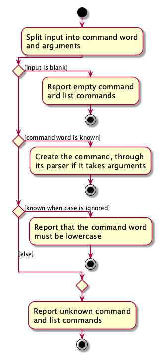

#### TutorTrack command routing

`AddressBookParser` is the command-routing boundary:

* It registers TutorTrack's `add`, `edit`, `edit note`, `view`, `note`, `delete`, `help`, and `exit` routes. Unsupported legacy commands receive the standard unknown-command error.
* After `edit`, it sends an exact lowercase `note` target to `EditNoteCommandParser` and any other arguments to `EditCommandParser`. A `note` target in another case, or a near-miss such as `notes`, is rejected by `AddressBookParser` itself with a targeted error and the `edit note` format, so a mistyped note edit is not parsed as a student edit.
* `AddCommandParser` and `EditCommandParser` accept only documented fields. Other prefix-like text, including the inherited `a/` and `t/`, is not treated as a parameter, so a name such as `Raj a/l Kumar` stays intact. Legacy person types remain only for persisted-data compatibility, not as part of the TutorTrack command surface.

#### Command error messages

Each rejected command names one specific problem so that the user can correct it without rereading the User Guide. The parser separates errors by responsibility:

* **Structure errors** describe the shape of the command: a missing index or prefix, an unknown or repeated prefix, text before the first prefix, or extra values. Parsers build these with `Messages#withFormat`, which appends a `Format:` line with the command's one-line `COMMAND_FORMAT` and an `Example:` line with its `COMMAND_EXAMPLE`, for example `Format: view INDEX` and `Example: view 1`.
* **Value errors** describe one value that breaks a rule, such as a short phone number or the index `0`. They show only that rule, so the problem stays visible in the result display.
* **Model-state errors** describe a well-formed command that does not fit the current data, such as an index past the end of the roster or an empty roster. They say what to do next instead of repeating the format.

Index handling is shared so every command reports index errors consistently:

* `ParserUtil#parseOnlyStudentIndex` checks that the arguments hold exactly one `INDEX`, and reports a missing or repeated value as a structure error. `view`, `note`, and `edit` use it.
* `ParserUtil#parseStudentIndex` and `ParserUtil#parseNoteNumber` report a value that is not a positive whole number, or that is above `Integer.MAX_VALUE`, as a value error named after the placeholder in the format, such as `STUDENT_INDEX` or `NOTE_NUMBER`.
* `Command#getRosterEntry` resolves an index against the current roster for every index-based command, and reports an empty roster or the valid range `1` to `N`.

Command words, parameter prefixes, the `note` target of `edit note` and `delete note`, and `/confirm` are case-sensitive. Prefix-like text in another case stays part of a field value. For student edits, a supported prefix in another case before the first field receives a targeted lowercase error; an unknown prefix receives an unknown-parameter error. This single accepted form keeps command routing predictable.

Because every parser finishes before `LogicManager` executes the command, a syntax error is reported without reading or changing the model. If an unknown command like `sort` is entered, `AddressBookParser` lists all the available commands. Otherwise, a word that matches a valid command only when case is ignored, such as `NOTE`, is instead reported as `Command words must be typed in lowercase. Did you mean note?`. The unknown word is shown to the user but never logged.

**Design considerations:**

**Aspect: How a command word typed in another case is handled**

* **Accept only lowercase, with a targeted error (current choice):** `NOTE` is rejected with a message naming `note`.
  * Pros: One accepted form keeps routing predictable, and the error tells the user the exact fix.
  * Cons: A user who types the wrong case must retype the command.
* **Accept any case:** `NOTE` would run `note`.
  * Pros: Fewer rejected commands.
  * Cons: Prefixes, the `note` target, and `/confirm` would need the same rule, or the case rules would differ between parts of a command.

### Student records

Each student is an immutable `Student` with a stable `StudentId`. `add` and `edit` share field parsing and validation, and one identity rule decides duplicates for commands and stored data alike.

#### Student identity

TutorTrack keeps identity rules in immutable domain values so command parsing and storage cannot disagree:

* `StudentIdentity` normalizes the name by trimming, collapsing internal whitespace, and ignoring case; it normalizes the parent or guardian phone by removing spaces, hyphens, and a valid Singapore `+65` prefix. Subject, current level, and parent email are not identity fields, so siblings may share a parent phone.
* `Student`, `StudentName`, `ParentGuardianContact`, `Subject`, and `CurrentLevel` validate their own values. `JsonAdaptedStudent` rebuilds these values when loading, then `JsonSerializableAddressBook` applies `Student#hasSameIdentity` to the loaded roster.
* `StudentId` is an immutable UUID-backed identity generated for new students and preserved across edits and reloads. A legacy record without an ID receives a deterministic migration ID derived from its normalized identity, keeping old data loadable.
* Session-note fields (`recordedAt`, `text`, and optional `lastEditedAt`) are validated by their own domain types; an edit time cannot precede the recorded time.

The command and storage layers therefore delegate normalization and validation to the domain instead of reproducing the rules.

**Design considerations:**

**Aspect: How a command identifies its target student**

* **Stable `StudentId` (current choice):** Commands resolve the displayed index once and then use the stable ID, so sorting cannot redirect the operation and histories can remain beside `Student`.
  * Pros: Keeps identity stable across edits, reloads, and profile refreshes; supports safe cross-context references.
  * Cons: Adds a persisted field and requires deterministic migration for older records.
* **Displayed roster index as identity:** The UI index would be the only selector and no extra field would be needed.
  * Pros: Simple to explain and easy to serialize.
  * Cons: A reorder could make an edit or deletion target the wrong student, and note histories would have no stable key.
* **Random IDs without a legacy migration rule:** New records would receive random IDs and old records would be handled separately.
  * Pros: Avoids deriving IDs from user data.
  * Cons: Older data would lose identity or need a destructive one-time migration; deterministic derivation keeps reload behavior compatible.

#### Adding a student

The activity diagram below shows the successful `add` path across the components. `AddressBookParser` delegates to `AddCommandParser`, `AddCommand` checks duplicate identity through the model, and `LogicManager` saves only after the model changes. Invalid, missing, repeated, or unsupported parameters fail before mutation; other prefix-like text remains in a value when the parser treats it as ordinary text.

A duplicate produces a command error. If saving fails, `LogicManager` restores its pre-command snapshot. After a successful save, the UI refreshes the roster.

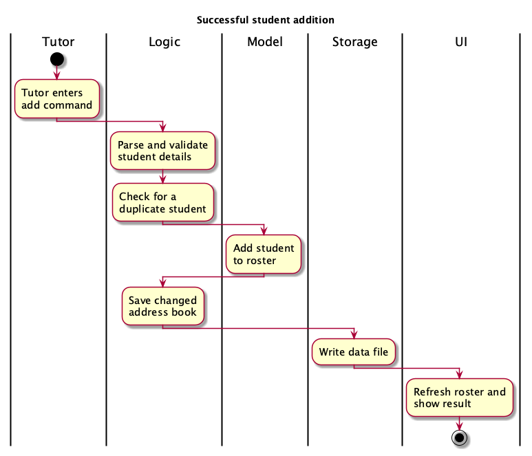

The class diagrams in [Logic](#logic-component), [Model](#model-component), [Storage](#storage-component), and [UI](#ui-component) show the corresponding relationships. A newly added student appears in `StudentRosterPanel` as a `StudentRosterCard`; `JsonAdaptedStudent` stores the student when the address book is saved.

#### Student editing

`edit INDEX [n/NAME] [p/PARENT_PHONE] [e/PARENT_EMAIL] [sub/SUBJECT] [l/CURRENT_LEVEL]` is parsed by `EditCommandParser`. It requires one positive roster index and at least one edit, rejects repeated or unsupported fields, and applies the same value-object validation used by addition and storage. `ParserUtil#tokenizeStudentFields` gives add and edit one shared tokenization rule, while other prefix-like text remains in its field value.

An empty `e/` has deliberate command semantics: the edit descriptor records that email was supplied separately from its optional value, so `e/` removes the email while an omitted email retains it. Empty values for required fields remain invalid.

The sequence below shows a successful student edit with that student's profile open. The command resolves the displayed roster index to a stable `StudentId`, updates the student, saves the address book, and refreshes the roster and open profile.

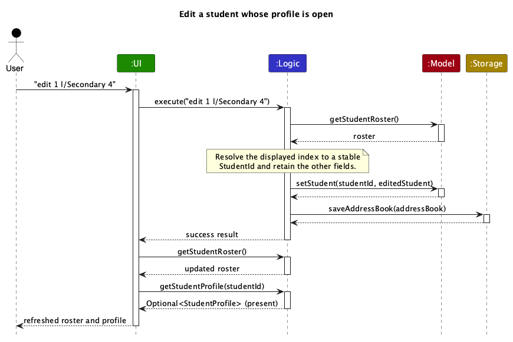

`EditCommand#execute` resolves the displayed index once through `Model#getStudentRoster()` and then works with the selected student's stable `StudentId`. It reads the immutable roster record through `Model#getStudent(StudentId)` rather than the presentation-facing `StudentProfile`, then composes a replacement immutable `Student` that retains every omitted field and the original ID. `Model#findConflictingStudent(StudentId, Student)` delegates to the roster's single duplicate-conflict lookup so the command can format a useful error without reproducing identity rules.

`Model#setStudent(StudentId, Student)` uses the same lookup authoritatively while also checking that the target exists and the replacement retains its ID. `AddressBook` replaces only the roster entry, so the session history keyed by the same ID is untouched.

Changing a name or phone may reorder the roster. A successful `edit` returns the target's stable ID, so `MainWindow` opens the updated profile and highlights the correct card at its new index. `LogicManager` uses its normal persistence snapshot and rollback path; a failed save restores the original student and session history. Edit command string representations and command-routing logs omit supplied field values because contact and lesson context can contain private information.

### Roster and profile display

TutorTrack shows a sorted roster beside the selected student's profile. Both are immutable snapshots that `MainWindow` requests through `Logic` after each successful command, and commands identify students by stable `StudentId`, so a reordered roster never changes which profile is shown.

#### Student roster contract and integration

`Model#getStudentRoster()` is the public projection boundary between the roster domain and JavaFX:

* It returns an immutable `StudentRoster` snapshot with one-based indices and immutable `StudentRosterEntry` values containing the stable ID, name, subject, current level, and note count.
* `StudentNameComparator` sorts by accent-insensitive name, natural numeric order, case-insensitive name, normalized parent or guardian phone, and stable ID as the final tie-breaker. Thus `Kid 2` precedes `Kid 10`, and equal-looking records still have deterministic indices.
* Note counts are projection data from each student's `SessionHistory`; the roster context does not own note storage.
* `Model#getStudent`, `Model#findConflictingStudent`, and `Model#setStudent` provide domain operations for editing without exposing mutable roster state or replacing the student's stable ID.

`MainWindow` creates the roster panel from a snapshot at launch and refreshes it after each successful command. `RosterListingIntegrationTest` protects the boundary by checking persisted reloads, normalized ordering, one-based indices, stable IDs, and projected note counts.

#### Student roster UI

`StudentRosterPanel` renders the immutable projection without owning roster rules:

* It copies entries into a scrolling JavaFX `ListView`; each cell creates a wrapping `StudentRosterCard` with the index, name, subject, current level, and note count.
* A width change refreshes virtualized cells so wrapped cards recalculate their height and remain visible in a narrow pane. An empty snapshot replaces the list with an actionable message explaining how to use `add`.
* Profile selection is keyed by stable `StudentId`, not the displayed index. The dedicated `profile-selected` state is separate from temporary pointer or keyboard focus, and CSS selectors are scoped to `student-roster-list` so note cards cannot inherit roster hover styling.

#### Student profile model

The profile feature separates temporary roster selection from stable student identity. The command resolves the displayed index once, while later profile retrieval and UI refreshes use the student's `StudentId`.

`Model#getStudentProfile(StudentId)` composes one immutable `StudentProfile` from the student record and that student's newest-first session history. The projection exposes domain value objects and an immutable note list, but no JavaFX controls, storage DTOs, or mutable collections. An unknown or deleted student ID returns an empty optional, allowing a displayed profile to be cleared safely when its student no longer exists.

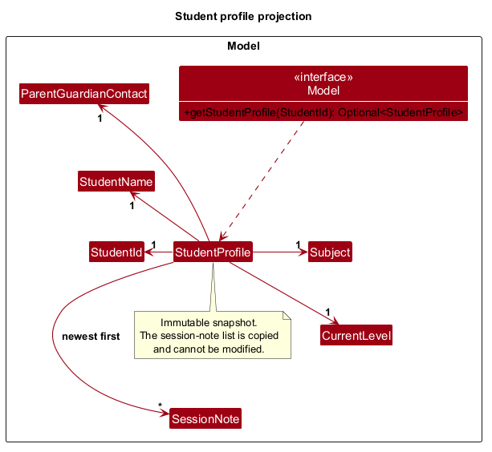

`Logic#getStudentProfile(StudentId)` delegates to the model so UI code stays behind the Logic boundary.

#### View command execution

The sequence below shows how `view INDEX` resolves a temporary position in the sorted roster to a stable `StudentId`. It shows the detailed interactions inside the Logic component while treating UI and Model as black boxes.

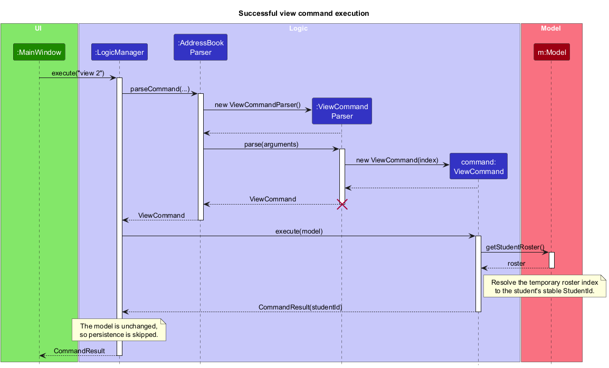

`ViewCommandParser` accepts exactly one positive index. `ViewCommand` checks through `Command#getRosterEntry` that the index identifies an entry in the current roster and returns that entry's name and `StudentId` in `CommandResult`. Because the command does not change the model, `LogicManager` detects unchanged data and does not ask Storage to save it. A malformed or out-of-range index fails before the UI refreshes, leaving any displayed profile and roster highlight unchanged.

#### Profile display and refresh

The next sequence shows the detailed UI interactions after Logic returns a successful view result. Logic remains a black box here; its command execution is described in [View command execution](#view-command-execution).

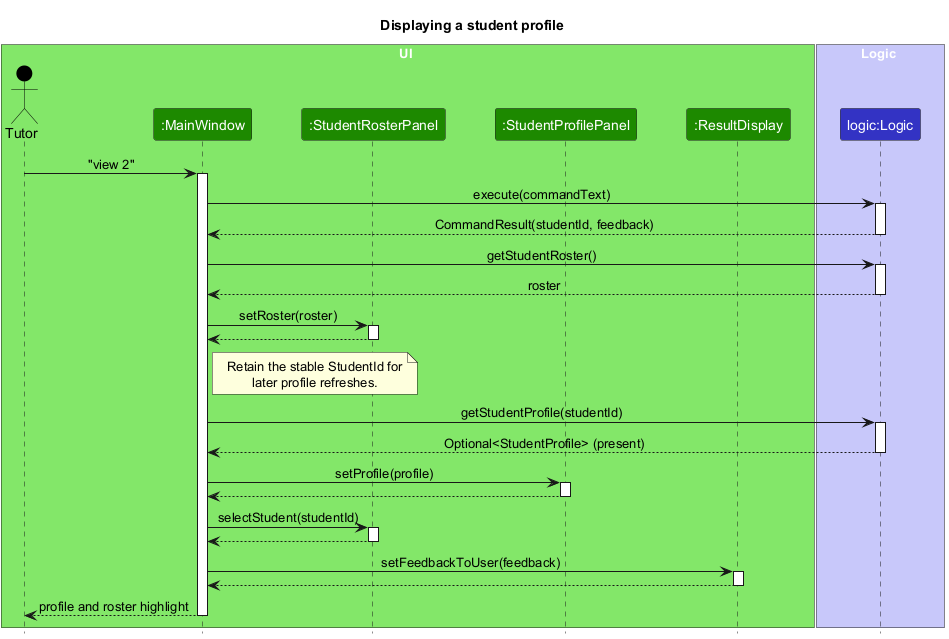

`MainWindow` retains the returned `StudentId`, asks `Logic` for a fresh profile snapshot after every successful command, passes it to `StudentProfilePanel`, and asks `StudentRosterPanel` to highlight the matching card. `view`, student `edit`, `note`, `edit note`, and the `delete` and `delete note` previews return that stable ID in `CommandResult`, so a successful command on another student or a deletion preview immediately opens the affected student's profile. A `delete note` preview also returns the note number, which `StudentProfilePanel` scrolls to and highlights while the preview is active. The command layer therefore does not depend on JavaFX, and the UI does not reach into storage or mutable model state.

A failed command leaves the rendered snapshot and roster highlight unchanged. If the retained ID no longer identifies a student after a successful command, `MainWindow` clears both states.

`StudentProfilePanel` preserves the model's newest-first note order. It labels the oldest note `[1]` and assigns each newer note the next number, so the newest note appears first with the history size as its number. These numbers are current-display selectors rather than persisted identifiers and are reassigned consecutively after a deletion. Its bounded label column and growing value column allow names, contact details, subjects, and current levels to wrap without forcing the profile wider.

Each `SessionNoteCard` shows the recorded time, and the latest edit time if any, as the saved clock reading without its UTC offset, so both times in a header read alike. Notes are still ordered by instant, so in the rare case of notes saved at different offsets, their displayed clock readings may not look in order. The notes use wrapping cards inside a `ListView`, so long timestamps and text remain within the profile column and longer histories scroll.

`MainWindow` clamps a restored window size to the usable bounds of the screen containing its saved origin, but does not impose a runtime maximum size on the stage. The operating system can therefore maximize or full-screen the window using the display's full bounds. The FXML keeps flexible result, roster, and profile constraints so the command box, feedback, workspace, and status bar remain reachable when the window is reduced for the supported high-scaling environment.

**Design considerations:**

**Aspect: How the UI stays up to date**

* **Request fresh snapshots after each successful command (current choice):** `MainWindow` asks `Logic` for a new roster and profile after every successful command.
  * Pros: The UI receives immutable projections and never observes mutable model collections.
  * Cons: The roster and profile are rebuilt after every successful command, even one that changes no data.
* **Observe model lists, as AB3 does:** The UI would listen for changes to observable lists in the model.
  * Pros: Updates happen without the UI asking.
  * Cons: The UI would depend on mutable model state, and the profile, which combines a student with its session history, has no single list to observe.

### Session notes

A tutor records, edits, and deletes short notes about each student's lessons. Notes are kept per student in an immutable `SessionHistory`, and commands select a note by its chronological number.

#### Session note types

Session notes live in `seedu.address.model.session`, separate from the student roster because the roster consumes note counts but does not own note data. The object diagram below shows a student's `SessionHistory` with three notes.

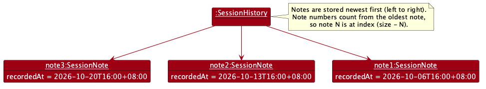

How note numbers map to the stored notes:

1. A `SessionHistory` keeps its notes newest first, so the newest note, `note3`, is at index 0.
1. Note numbers count from the oldest note, so note 1, `note1`, is last in the list.
1. To find note `N`, the history uses the index `history size - N`. For note 1 in this history of three notes, that is index 2.

The diagram does not show the rules each type enforces:

* `SessionNote` is immutable. It trims surrounding whitespace, preserves internal spaces, accepts 1 to 500 Unicode code points, rejects control characters and line or paragraph separators, and receives its `OffsetDateTime` from the caller so tests can control time.
* `SessionHistory` is immutable and exposes its notes through an unmodifiable list. Notes with equal timestamps keep their saved order.
* Editing a note keeps its recorded time and number while updating the text and latest edit time.
* `ParserUtil#parseNoteText` is shared by `NoteCommandParser` and `EditNoteCommandParser`, so both commands name the same empty, overlong, non-printable, and invisible-only value errors.

#### Session note model and persistence

`AddressBook` stores a `StudentSessionHistories` map from `StudentId` to `SessionHistory` beside the student list, as the [Model class diagram](#model-component) shows. The model boundary owns the lifecycle and keeps histories attached to existing students:

* `Model#addSessionNote` timestamps a new note through an injected `Clock` (see [Session note command](#session-note-command)); `getSessionHistory` returns a newest-first snapshot; `editSessionNote` and `deleteSessionNote` preserve the selected student's identity and unrelated notes.
* `Model#deleteStudent` removes the student and its history together, so a failed deletion cannot leave an orphaned student or history.
* `AddressBook#resetData` and `ReadOnlyAddressBook#getSessionHistory` copy or expose histories without returning mutable collections.

Each student's notes are saved inside its JSON record as a `sessionNotes` list, newest first, so the file remains hand-editable:

```json
"sessionNotes": [ { "recordedAt": "2026-09-18T18:35:00+08:00", "text": "Reviewed factorisation." } ]
```

When saving, `JsonSerializableAddressBook` writes each student's history through `ReadOnlyAddressBook#getSessionHistory`. The sequence diagram below shows how loading restores the histories. Duplicate checks and load errors are left out.

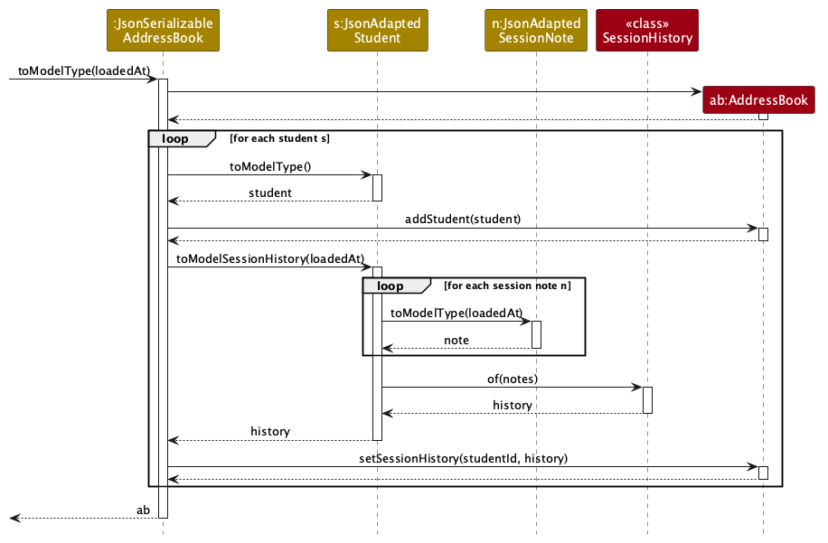

How loading works:

1. `JsonSerializableAddressBook` creates an empty `AddressBook`.
1. For each student, it rebuilds the `Student` from its `JsonAdaptedStudent` and adds it, so the student exists before its history.
1. The `JsonAdaptedStudent` rebuilds each note through its `JsonAdaptedSessionNote`, and `SessionHistory#of` then builds the whole history at once, keeping the saved order of notes with equal timestamps.
1. `AddressBook#setSessionHistory` attaches the history to the student.

The diagram does not show failures. Each note is rebuilt through `SessionNote`, so a missing field, a timestamp without an offset, a future timestamp, invalid text, or an empty entry is a load error. A missing `sessionNotes` field means an empty history, so data files created before session notes were introduced still load.

**Design considerations:**

**Aspect: Where session histories are stored**

* **Beside the student list, keyed by `StudentId` (current choice):** `AddressBook` holds a `StudentSessionHistories` map next to its students.
  * Pros: Adding, editing, or deleting a note does not replace `Student`, change student equality, or affect duplicate detection.
  * Cons: The model must keep histories in step with students, for example by removing both together when a student is deleted.
* **Inside each `Student`:** Each student would own its list of notes.
  * Pros: One object holds everything about a student, matching how the data file nests `sessionNotes` in each student record.
  * Cons: Every note change would replace the `Student`, and note data would take part in student equality.

#### Session note command

`note INDEX nt/NOTE` adds a note to a student's history. The sequence diagram below shows what happens inside the `Model` component when `NoteCommand` calls `Model#addSessionNote`. Logic and Storage are left out; the command's path through Logic is the same as the [`add` example](#logic-component).

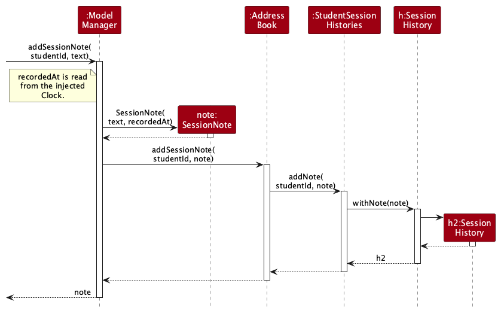

How adding a note works:

1. `ModelManager` reads `recordedAt` from its injected `Clock` and creates the `SessionNote`.
1. `AddressBook` checks that the student exists and passes the note to `StudentSessionHistories`.
1. Because `SessionHistory` is immutable, `withNote` returns a new history `h2` containing the note.
1. `StudentSessionHistories` replaces the student's old history with `h2`. The `Student` record is not touched.

The diagram does not show the steps before and after the model call:

* `NoteCommandParser` recognizes only `nt/`; a second prefix after a space is rejected, while `(nt/)` without a preceding space remains note text.
* It validates structure, the shared positive-index rules, and note text through `ParserUtil#parseNoteText` before creating a command. Empty, invisible-only, overlong, and non-printable values receive specific value errors.
* `NoteCommand#execute` resolves the displayed index to a `StudentId` before calling the model, and `LogicManager` saves the changed address book afterwards. The result carries the ID so `MainWindow` refreshes the count and opens the updated profile.
* `NoteCommand#toString` omits note text because lesson notes may contain private details.

#### Edit note command

The `edit note` command replaces the text of one existing session note without changing when it was recorded. Its format is `edit note STUDENT_INDEX NOTE_NUMBER nt/NEW_NOTE`, where `STUDENT_INDEX` selects a student in the current roster and `NOTE_NUMBER` selects a note in that student's displayed chronological numbering.

The activity diagram below shows how the command preserves the selected note's timestamp while saving the replacement text and refreshing the displayed profile.

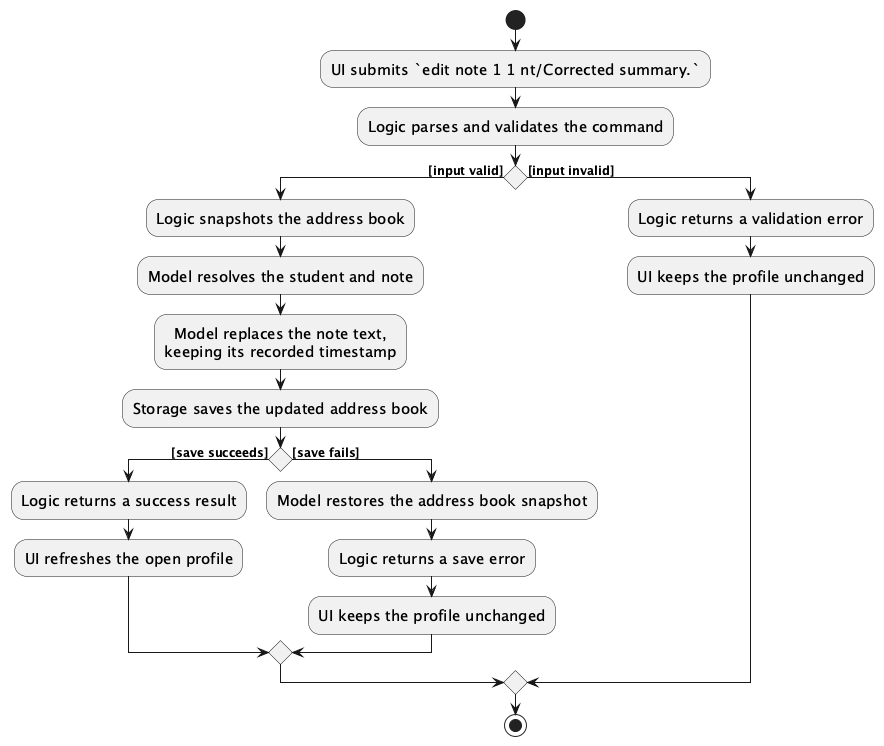

`EditNoteCommandParser` validates the student index, note number, `nt/` prefix, and new note text before creating an `EditNoteCommand`. It recognizes the lowercase `nt/` prefix. When no lowercase prefix is recognized, it checks for a wrong-case form and reports a lowercase correction if it finds one. The parser rejects a missing or malformed selector, an empty or overlong replacement, control characters, and duplicate `nt/` prefixes without changing the model. The command resolves the roster index to the student's stable `StudentId`, just as the existing note and deletion commands do.

The model operation creates a new immutable `SessionNote` with the replacement text and the original note's `recordedAt` value, then replaces the selected entry in the student's immutable `SessionHistory`. Keeping the original timestamp preserves the note's chronological position and means that editing does not renumber the remaining notes or alter the roster's note count. The operation crosses the model boundary through the student's `StudentId`; command code does not mutate a history or a storage DTO directly.

`LogicManager` snapshots the address book before the edit, saves the updated data through the existing persistence path, and restores the snapshot if saving fails. The existing `sessionNotes` entry is rewritten with the same `recordedAt`, the new `text`, and the latest `lastEditedAt`; an omitted `lastEditedAt` remains backward-compatible. After a successful edit, `MainWindow` refreshes the open profile so the updated text and edit time are visible while the note number and recorded timestamp remain unchanged. A failed validation or save leaves the profile, roster, in-memory model, and data file unchanged.

**Design considerations:**

**Aspect: How editing treats the note's recorded time**

* **Preserve the original timestamp (current choice):** Editing corrects the note's text while retaining its lesson context and chronological position. The replacement is reconstructed with the old `recordedAt` value rather than being treated as a new lesson note.
  * Pros: The note keeps its number and its place in the history, and an edit is not mistaken for a new lesson.
  * Cons: Needs its own model operation instead of reusing the add and delete operations.
* **Delete and add a new note:** The edit would remove the old note and record the new text as a new note.
  * Pros: Reuses existing operations.
  * Cons: Assigns a new timestamp, can move the edited note in the history, and makes an edit look like a second lesson.

Selecting a note by its chronological number rather than a persistent note ID is discussed under [Confirmed deletion](#confirmed-deletion).

### Confirmed deletion

`DeleteCommandParser` supports `delete STUDENT_INDEX [/confirm]` for a whole student and `delete note STUDENT_INDEX NOTE_NUMBER [/confirm]` for one session note. `/confirm` is an exact, case-sensitive terminal token. Duplicated, misplaced, differently cased, concatenated, or value-bearing confirmation tokens are rejected during parsing, before the model can change.

`DeleteCommandParser` handles these common input errors:

* **Wrong-case confirmation flag:** `/CONFIRM` produces `/confirm must be typed in lowercase.` in both deletion forms. This check runs before the argument count is validated.
* **Wrong-case target:** `delete NOTE 1 1` produces `note must be typed in lowercase.`, followed by the `delete note` format, as `edit` does for `edit note`.
* **Mistyped target:** A likely typo such as `delete notes 1 1` produces `Unknown delete target` and suggests `delete note`. The parser uses the same `ParserUtil#isMistypedTarget` check as `edit note`.

For valid input, the parser creates a `DeleteCommand` or `DeleteSessionNoteCommand` containing the parsed selectors and whether confirmation was supplied.

The activity diagrams below show the preview and confirmation flows for deleting one session note. The explanations also cover whole-student deletion.

#### Preview and pending target

The preview validates the selected student and note, then shows the note and confirmation command without changing saved data.

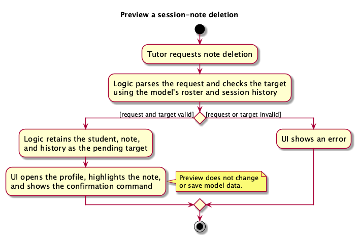

For `delete STUDENT_INDEX`, `DeleteCommand#execute` resolves the index against `Model#getStudentRoster()`, the same sorted snapshot displayed by the roster panel. Its `CommandResult` contains the student's stable `StudentId` alongside the student's name, session-note count, exact confirmation command, and the instruction `To cancel, enter another valid command. Typos keep this preview.` without changing or saving the model. After a successful preview, `LogicManager` retains a `PendingStudentDeletion` containing the displayed index and resolved stable `StudentId`.

`MainWindow` uses the result's ID to load the target profile and select the matching roster card through the [profile display flow](#profile-display-and-refresh), even if another profile was previously open. An invalid preview returns no result, leaving the displayed profile and selection unchanged.

For `delete note STUDENT_INDEX NOTE_NUMBER`, `DeleteSessionNoteCommand#execute` resolves the same sorted roster and checks that the selected student has the displayed note number. Its `CommandResult` carries the student's stable `StudentId` and the previewed `NOTE_NUMBER` alongside the prompt and exact confirmation command. `MainWindow` uses that result to open the student's profile; `StudentProfilePanel` marks and scrolls to the numbered note.

After returning the preview, `LogicManager` retains a `PendingSessionNoteDeletion` containing the student index, stable `StudentId`, chronological note number, and exact immutable `SessionHistory` snapshot. The note number maps to the internal newest-first list position with `history size - NOTE_NUMBER`; because it is a display selector rather than a stored note ID, the remaining notes are numbered consecutively after deletion.

Both pending types occupy the same single `PendingDeletion` slot in `LogicManager`. Starting either valid preview after another preview consumes the earlier pending state and replaces it with the new target. Pending state contains no private student fields, is not part of the model or JSON schema, and is never persisted.

#### Confirmation, cancellation, and mutation

The next input either keeps the preview pending, cancels it, or attempts confirmation. A matching confirmation deletes the note and saves the updated data; a save failure restores the model.

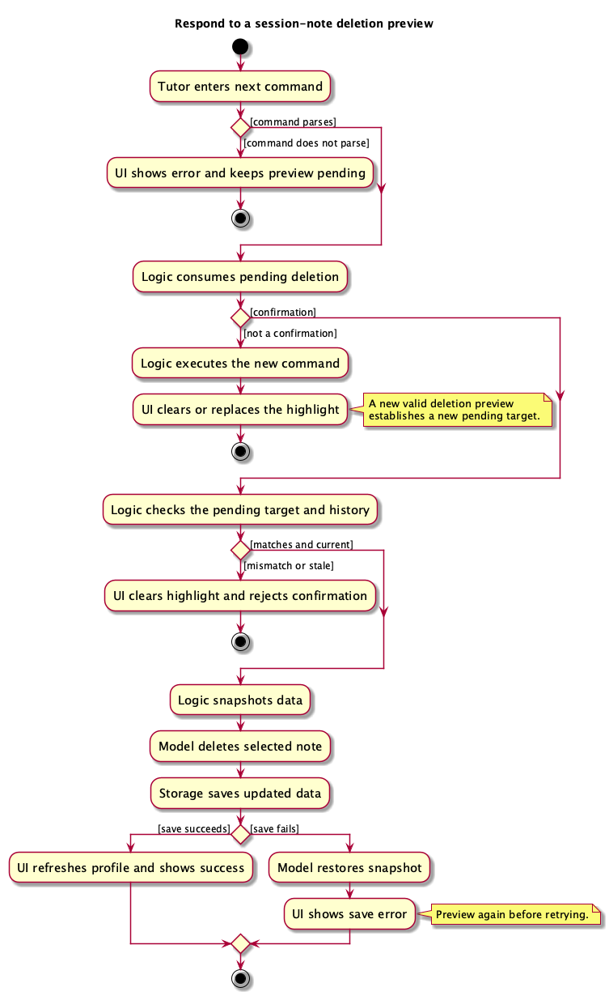

`LogicManager#execute` parses the new input before copying and clearing the pending deletion. A `ParseException` therefore leaves the preview active; `MainWindow` keeps the temporary note highlight so the tutor can correct the input and confirm the same target. Any input that parses into a command consumes the pending deletion before execution, even if the command later fails validation; `MainWindow` then clears the highlight.

The selected profile remains open unless a successful new command changes it. A direct or repeated confirmation has no pending target and is rejected. A confirmation for the wrong deletion type or different selectors is a mismatch and is also rejected without mutation.

A student confirmation must use the pending index, and that index must still resolve to the pending stable `StudentId`. A session-note confirmation must additionally use the pending note number and find the same immutable history object for that student. These checks prevent a roster reorder or session-history change from redirecting confirmation to a different target even when the displayed numbers are reused.

After a match, `LogicManager` snapshots the address book and calls either `Model#deleteStudent(StudentId)` or `Model#deleteSessionNote(StudentId, Index)`. Student deletion removes the student and complete history atomically; session-note deletion removes only the selected note and preserves the student and every other note. `LogicManager` then saves the complete address book.

A save failure restores the snapshot and leaves no confirmation pending, so the user must preview again. No storage-schema change is needed because the existing `sessionNotes` list stores the updated history, while note numbers and pending state remain transient.

After a successful student deletion, `MainWindow` requests a fresh roster snapshot, assigns consecutive student indices, and closes the previewed student's profile and roster selection. After a successful note deletion, it refreshes the open profile so the remaining newest-first notes and their reassigned numbers are visible. A student preview changes only the displayed profile and roster selection; a note preview also scrolls to and highlights the selected note.

Neither preview changes model or saved data. A rejected confirmation keeps the displayed profile and roster selection, clears any temporary note highlight, and leaves saved data unchanged.

**Design considerations:**

**Aspect: How a deletion is confirmed**

* **Trailing `/confirm` flag (current choice):** The confirmation repeats the complete destructive command and target in the same keyboard-first workflow.
  * Pros: Requires no extra command vocabulary, lets the parser reject malformed placement, and keeps the exact target visible.
  * Cons: The tutor must retype or recall the complete command.
* **Standalone `confirm` and `cancel` commands:** Separate commands would operate on the pending target.
  * Pros: Shorter confirmation and cancellation commands.
  * Cons: Requires extra parser routes, help text, and a way to show which target `confirm` means.
* **JavaFX confirmation dialog:** A modal dialog would confirm the pending operation outside the command path.
  * Pros: Makes the destructive action visually prominent.
  * Cons: Duplicates state, introduces mouse-oriented workflow, and makes parser and end-to-end testing less representative.
**Aspect: How a session note is selected**

* **Chronological note number (current choice):** A note is selected by its displayed number, oldest first.
  * Pros: Needs no storage-schema change, and the numbers match what the profile shows.
  * Cons: Numbers are reassigned after a deletion, so a confirmation must be checked against the history it previewed.
* **Persistent session-note IDs:** A stored ID would replace chronological note selectors.
  * Pros: Gives each note a durable selector.
  * Cons: Requires a schema and migration change; the current immutable-history binding already makes stale display numbers fail safely.
**Aspect: Where pending deletions are managed**

* **One pending-deletion slot in `LogicManager` (current choice):** Student and note deletions share a single pending state.
  * Pros: Both deletion types share one save and rollback path, and only one confirmation can be pending at a time.
  * Cons: `LogicManager` holds state specific to deletions.
* **Separate student and note coordinators:** Each deletion type would own its preview and confirmation lifecycle.
  * Pros: Keeps the two command classes independent.
  * Cons: Duplicates pending-state, matching, save, and rollback logic; one pending-deletion slot already prevents ambiguous confirmations.

### Save-failure rollback

A failed save must leave the model unchanged, so that a command reported as failed does not take effect and is not written to the file by a later save. `LogicManager` handles this in one place for every command on the persistence path, so individual commands do not need their own recovery code.

The activity diagram below shows how `LogicManager` decides whether to save, skip saving, or roll back after a command runs.

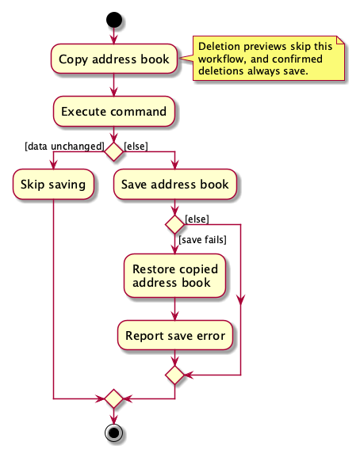

* **Copy address book:** Before running the command, `LogicManager` copies the address book with `new AddressBook(model.getAddressBook())`. The copy is made after parsing, so input that fails to parse never copies anything.
* **Skip saving:** After the command runs, `LogicManager` compares the copy with the model's address book and skips saving when they are equal. Commands that change no data, such as `view`, `help`, and `exit`, therefore still work when the data file cannot be written, and never overwrite a data file that failed to load.
* **Save address book:** Otherwise, `LogicManager` saves the changed address book with `Storage#saveAddressBook`.
* **Restore copied address book and report save error:** If saving throws an `IOException`, `LogicManager` restores the copy with `Model#setAddressBook`, logs a warning without any student data, and throws a `CommandException`. The error names the data file from `Storage#getAddressBookFilePath()`, because the exception itself may name the temporary file used for the write.

<div markdown="span" class="alert alert-info">:information_source: **Note:** The diagram is a simplified view. It leaves out a command that fails with a `CommandException`, which reaches the user without any save. Deletions also follow their own path: a deletion preview neither changes nor saves data, and a confirmed deletion always saves without the unchanged-data check.

</div>

Because `Student`, `SessionHistory`, and `SessionNote` are immutable, copying the address book only copies its lists and map, and the cost is small for a tutor's roster.

**Design considerations:**

**Aspect: How the model is restored after a failed save**

* **Snapshot restore in `LogicManager` (current choice):** `LogicManager` copies the address book before persistence-path commands and restores it when saving fails.
  * Pros: Covers current and future persisted commands in one place while allowing non-mutating previews to opt out.
  * Cons: Copies and compares the address book for commands that ultimately do not change it.
* **Command-specific undo:** Each command would reverse its own model mutation after a save failure.
  * Pros: Avoids a snapshot for commands that do not change data.
  * Cons: Every command needs a correct undo operation, and a missing undo path could silently keep failed changes.
* **Reload from disk after failure:** The logic layer would discard in-memory data and reload the previous file.
  * Pros: Uses persistence as the source of truth instead of copying the model.
  * Cons: A partial write could make reload unsafe, and it would lose unsaved in-memory state unrelated to the failed command.

Restoring the model does not by itself protect the data file from a write that fails partway through. `FileUtil#writeToFile` rejects an existing target that is not writable before creating a temporary file, then writes the serialized content in the data file's parent directory and atomically replaces the target. A failed permission check, temporary write, or replacement leaves the previous data file and its permissions intact, and the temporary file is removed.

### \[Proposed\] Student archiving

Student archiving is planned for v2.0 and is not implemented. It covers archiving a student who has stopped lessons, viewing archived details, and restoring the student without losing contact details or session history. The User Guide lists it under [Archiving students](UserGuide.md#archiving-students-coming-soon).

The proposed design keeps archived students in the same `AddressBook` and data file: an archived-ID set sits beside `StudentSessionHistories`, `Model#getStudentRoster()` excludes those IDs, duplicate detection still includes them, and an optional `archived` field keeps older files active by default. A separate archived roster, with its own one-based indices, would list archived students so that the tutor can view or restore one by its index.

The sequence diagram below shows the proposed `archive 2` command inside the `Logic` component, with `Model` and `Storage` as black boxes. Parsing is left out, as it follows the [`add` example](#logic-component).

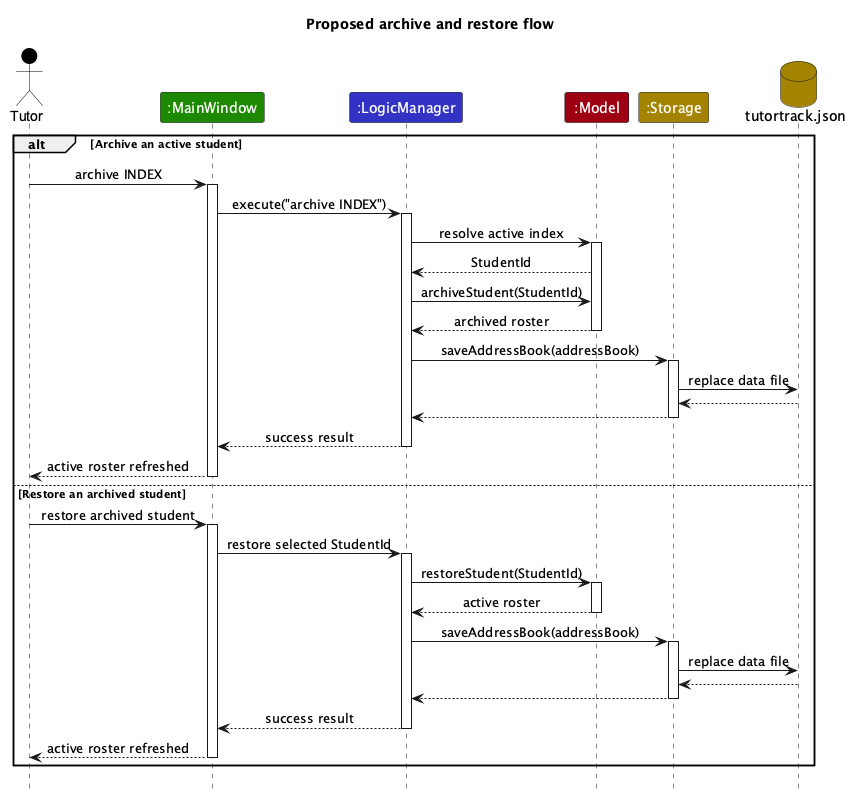

How archiving would work:

1. `LogicManager` executes the `ArchiveCommand`, like any other command.
1. The command resolves the displayed index against `Model#getStudentRoster()` to the student's stable `StudentId`, as existing commands do through `Command#getRosterEntry`.
1. The command calls `Model#archiveStudent(studentId)`, which adds the ID to the archived-ID set. The student's details and session history are not changed.
1. `LogicManager` saves the changed address book through the usual [save-failure rollback](#save-failure-rollback) path.

`restore INDEX` would follow the same flow, resolving the index against the archived roster and calling `Model#restoreStudent(studentId)`.

**Design considerations:**

**Aspect: Where archived students are kept**

* **In the same `AddressBook`, marked by an archived-ID set (current proposal):** Archiving only adds the student's ID to a set.
  * Pros: Keeps one data file, keeps each student's stable ID and session history attached, lets duplicate detection still see archived students, and reuses the existing save and rollback path.
  * Cons: Every roster query must leave out archived IDs.
* **In a separate archive file:** Archiving would move the student's record to another file.
  * Pros: The main data file holds only active students.
  * Cons: Moving a student needs two file writes, which could fail halfway, and duplicate detection would have to check both files.

--------------------------------------------------------------------------------------------------------------------

## **Documentation, logging, testing, dev-ops**

* [Documentation guide](Documentation.md)
* [Testing guide](Testing.md)
* [Logging guide](Logging.md)
* [DevOps guide](DevOps.md)

--------------------------------------------------------------------------------------------------------------------

## **Appendix: Requirements**

### Product scope

**Target user profile**:

* is a private tutor managing a small active roster of students
* needs to keep each student's preparation context and chronological session notes together
* wants to find a student and record a short note immediately after each lesson
* prefers desktop apps over other types of applications
* can type fast
* prefers typing to mouse interactions
* is reasonably comfortable using CLI apps

**Value proposition**: TutorTrack lets a private tutor find a student, review the student's profile, and record or correct a session note faster than managing the same information in spreadsheets or a typical mouse-driven GUI application.

### User stories

Priorities: High (must have) - `* * *`, Medium (nice to have) - `* *`, Low (unlikely to have) - `*`

The current MVP stories are listed first. Future user stories follow in a separate table.

#### Current MVP user stories

| Priority | As a …                                             | I want to …                                                                     | So that I can…                                                                            |
| ---------- | ----------------------------------------------------- | ---------------------------------------------------------------------------------- | -------------------------------------------------------------------------------------------- |
| `* * *`  | tutor new to TutorTrack                             | add a student to my roster                                                       | begin keeping their tutoring context in one place                                          |
| `* * *`  | tutor                                               | record a student's parent contact                                                | find the correct contact when I need it                                                    |
| `* * *`  | tutor                                               | record the subject I teach a student                                             | identify the context of their tuition                                                      |
| `* * *`  | tutor                                               | record a student's current level                                                 | prepare appropriately for them                                                             |
| `* * *`  | tutor who types fast                                | add a student with all their details in a single command                         | record a new student quickly between lessons                                               |
| `* * *`  | tutor                                               | be stopped from adding the same student twice                                    | avoid splitting one student's session notes across two entries in my roster                |
| `* * *`  | tutor teaching siblings                             | add each sibling as a separate student with the same parent phone                | keep their learning histories separate while retaining their shared parent contact         |
| `* * *`  | tutor                                               | see all the students in my roster                                                | keep track of all the students I am managing                                               |
| `* * *`  | tutor                                               | see how many session notes each student in my roster has                         | spot students I have not written notes for yet                                            |
| `* * *`  | tutor preparing for a lesson                        | view a student's subject, level, and parent contact together                     | orient myself before the lesson                                                            |
| `* * *`  | tutor preparing for a lesson                        | review a student's recent session notes                                          | continue from where the student previously left off                                        |
| `* * *`  | tutor                                               | see the date and time each session note was written                              | know when each lesson took place                                                           |
| `* * *`  | tutor who has just completed a lesson               | add a short session note about a student's progress, difficulties, or next steps | preserve what happened while it is still fresh                                             |
| `* * *`  | tutor                                               | correct a mistake in a saved session note                                        | keep each student's history accurate                                                       |
| `* * *`  | tutor                                               | delete one session note                                                         | remove an incorrect record while keeping the rest of the history                          |
| `* * *`  | tutor                                               | delete a student from my roster                                                  | remove information I no longer need                                                        |
| `* * *`  | tutor                                               | see the student and session-note count before confirming a deletion              | verify the impact before removing data                                                      |
| `* * *`  | tutor                                               | confirm before a student is deleted                                              | avoid deleting the wrong student by accident                                               |
| `* * *`  | tutor                                               | be told exactly what is wrong when a command fails                               | fix the mistake without guessing or retyping the whole command                             |
| `* * *`  | tutor                                               | have my roster and session notes saved automatically after every change          | continue where I left off the next time I open TutorTrack                                  |
| `* * *`  | tutor new to TutorTrack                             | see usage instructions                                                           | refer to instructions when I forget how to use TutorTrack                                  |
| `* * *`  | tutor                                               | update a student's parent contact without losing the student's session notes     | keep the parent contact reliable when a parent changes their phone number or email         |
| `* * *`  | tutor                                               | remove a parent email that is no longer valid                                    | avoid contacting an address that no longer works                                           |
| `* * *`  | tutor                                               | correct a misspelled student name without losing the student's session notes     | keep my roster accurate                                                                    |
| `* * *`  | tutor                                               | update a student's level without losing the student's session notes              | keep the student's details in line with their current stage of learning                    |
| `* * *`  | tutor                                               | update the subject I teach a student without losing the student's session notes  | keep the student's details relevant when their tuition changes                             |
| `* *`    | tutor new to TutorTrack                             | see the exact format of a specific command                                       | enter it correctly without trial and error                                                 |
| `* *`    | tutor                                               | enter a parent phone with spaces or hyphens                                      | copy numbers from messages without reformatting them                                       |
| `* *`    | tutor                                               | see my roster sorted by student name                                             | locate a student quickly                                                                   |
| `* *`    | tutor who types fast                                | recall my previous commands                                                      | fix or repeat a command without retyping it                                                |
| `* *`    | tutor preparing for a lesson                        | scroll a long session-note history from the keyboard                             | read past notes without reaching for the mouse                                             |
| `* *`    | tutor                                               | back up my roster and session notes by copying a single data file                | avoid losing my students' history if my computer fails                                     |

#### Future user stories

| Priority | As a …                                             | I want to …                                                                     | So that I can…                                                                            |
| ---------- | ----------------------------------------------------- | ---------------------------------------------------------------------------------- | -------------------------------------------------------------------------------------------- |
| `* *`    | tutor preparing for a lesson                        | find a student by name                                                           | retrieve their context without scanning my whole roster                                    |
| `* *`    | tutor with students in different subjects or levels | narrow my roster to students of a particular subject or level                    | focus on the students I am working with                                                    |
| `* *`    | tutor                                               | return to my full roster after a search                                          | select any student by their roster number again                                            |
| `* *`    | tutor                                               | undo my most recent change                                                       | recover from a mistaken change, such as deleting the wrong student                         |
| `*`      | tutor who has used TutorTrack for a long time       | archive a student who is no longer receiving tuition                             | keep my current roster uncluttered                                                         |
| `*`      | tutor                                               | view an archived student's details and session notes                             | refer to their past context if I need it                                                   |
| `*`      | tutor whose former student resumes lessons          | restore an archived student to my roster                                         | continue teaching with their previous context available                                    |
| `*`      | tutor teaching siblings                             | link siblings to one shared parent contact                                       | update the parent contact once for all of them                                             |
| `*`      | tutor                                               | delete several students in one command                                           | remove students who have stopped lessons quickly                                           |
| `*`      | tutor who works on more than one computer           | access my roster from any of my computers                                        | prepare for lessons wherever I am                                                          |

### Use cases

The following use cases describe the TutorTrack MVP at the same level of
detail. Each use case focuses on the externally visible interaction between
the tutor and the system.

**System:** `TutorTrack`

**Actor:** `Tutor`

**Use case: Add a student**

**Preconditions:** The system is running and ready to accept requests.

**Guarantees:** A valid student record is saved locally and appears in the student roster.

**MSS**

1. Tutor requests to add a student.
2. Tutor provides the student's name, parent or guardian phone number, subject, and current level, and optionally an email address.
3. Tutor submits the student details.
4. TutorTrack validates the details and creates the student record.
5. TutorTrack saves the record and displays the updated roster in case-insensitive alphabetical order.

   Use case ends.

**Extensions**

* 4a. One or more required details are missing or invalid.

  * 4a1. TutorTrack reports the relevant validation error and makes no changes.
  * 4a2. Tutor corrects the details.

    Use case resumes at step 2.
* 4b. A student with the same normalized name and normalized parent or guardian phone number already exists.

  * 4b1. TutorTrack reports the duplicate and does not add the student.

    Use case ends.
* 5a. TutorTrack cannot save the updated data.

  * 5a1. TutorTrack reports the storage error and does not create the record.

    Use case ends.

**Use case: Edit a student**

**Preconditions:** The system is running and the current roster index context is available.

**Guarantees:** A successful edit saves the supplied replacement details while preserving the student's stable identity and complete session history. A rejected edit changes nothing.

**MSS**

1. Tutor selects a student by roster index and supplies one or more replacement details.
1. TutorTrack validates the index and supplied details.
1. TutorTrack replaces the student record while retaining the stable student ID and every session note.
1. TutorTrack saves the record, refreshes the sorted roster and any open profile, and confirms the edit.

   Use case ends.

**Extensions**

* 1a. Tutor asks to remove the optional parent or guardian email.

  * 1a1. TutorTrack marks the email for removal.

    Use case resumes at step 2.
* 1b. Tutor supplies no field to edit, repeats a field, or supplies an unsupported field.

  * 1b1. TutorTrack reports the command error and makes no changes.

    Use case ends.
* 2a. The index or a supplied value is invalid.

  * 2a1. TutorTrack reports the validation error and makes no changes.

    Use case ends.
* 2b. The replacement name and phone duplicate another student.

  * 2b1. TutorTrack reports the duplicate and makes no changes.

    Use case ends.
* 4a. TutorTrack cannot save the updated data.

  * 4a1. TutorTrack reports the storage error and restores the complete original record.

    Use case ends.

**Use case: Display the student roster**

**Preconditions:** None.

**Guarantees:** The complete roster is displayed with stable indices that can
be used to select a student in a subsequent use case. No data is changed.

**MSS**

1. Tutor launches TutorTrack.
2. TutorTrack displays every student sorted by normalized name, together with an index, subject, current level, and session-note count.
3. TutorTrack establishes the displayed indices as the current selection context.

   Use case ends.

**Extensions**

* 2a. The roster is empty.

  * 2a1. TutorTrack reports that there are no students and shows how to add one.

    Use case ends.

**Use case: View a student profile**

**Preconditions:** The system is running and the current roster index context
is available.

**Guarantees:** The selected student's profile is displayed without changing
the roster or stored data.

**MSS**

1. Tutor selects a student by the student's roster index.
2. TutorTrack displays the student's name, parent or guardian contact details,
   subject, and current level.
3. TutorTrack displays all session notes for the student in newest-first order,
   including each note's saved date and time.
4. TutorTrack confirms that the student's profile is being shown.

   Use case ends.

**Extensions**

* 1a. The index is missing, invalid, or outside the roster.

  * 1a1. TutorTrack reports the index error and leaves any currently displayed
    profile unchanged.

    Use case ends.
* 3a. The student has no session notes.

  * 3a1. TutorTrack reports that no session notes have been recorded.

    Use case ends.

**Use case: Add a session note**

**Preconditions:** The system is running and the current roster index context
is available.

**Guarantees:** A valid session note is appended to the student's session
history and saved locally. No other student record is changed.

**MSS**

1. Tutor selects a student by the student's roster index and provides a short
   session note.
2. TutorTrack validates the note.
3. TutorTrack records the note with the current local date and time and saves
   it in the student's session history.
4. TutorTrack confirms that the note was added and updates the student's
   session-note count.

   Use case ends.

**Extensions**

* 1a. The index is missing, invalid, or outside the roster.

  * 1a1. TutorTrack reports the index error and makes no changes.

    Use case ends.
* 1b. The note is missing or given more than once.

  * 1b1. TutorTrack reports the command-format error and makes no changes.

    Use case ends.
* 2a. The note is empty, too long, or contains a line break or control character.

  * 2a1. TutorTrack reports the note validation error and makes no changes.

    Use case ends.
* 3a. TutorTrack cannot save the updated data.

  * 3a1. TutorTrack reports the storage error and does not retain the note.

    Use case ends.

**Use case: Delete a student or session note**

**Preconditions:** The system is running and the current roster index context is available. Deleting a session note also requires a note number from the student's displayed history.

**Guarantees:** A preview or rejected confirmation leaves the roster and local storage unchanged. A matching confirmation removes exactly the previewed student and complete history, or exactly the previewed note while retaining its student and other notes.

**MSS**

1. Tutor requests deletion using a student's roster index and, for one session note, its displayed note number.
1. TutorTrack displays the target, exact confirmation command, and instruction that another correctly formatted command cancels the deletion. It also opens the selected student's profile and, for a note, highlights the targeted note.
1. Tutor submits the matching confirmation as the next correctly formatted command.
1. TutorTrack verifies that the index still identifies the same stable student ID and, for a note, that the displayed history is unchanged.
1. TutorTrack removes the previewed student and complete history, or removes only the previewed note, and saves the updated data.
1. TutorTrack reports the deleted target and refreshes the roster and any open profile.

   Use case ends.

**Extensions**

* 1a. A required index or note number is missing, malformed, or outside its displayed range.

  * 1a1. TutorTrack reports the applicable validation error and makes no changes.

    Use case ends.
* 3a. Tutor enters a different correctly formatted command.

  * 3a1. TutorTrack cancels the pending deletion, clears any note highlight, and processes the new command, which may report its own execution error.

    Use case ends.
* 3b. Tutor enters a direct, repeated, or mismatched confirmation.

  * 3b1. TutorTrack reports that the confirmation does not match or that no deletion is pending, and makes no deletion.

    Use case ends.
* 3c. Tutor submits a malformed confirmation, such as one with the confirmation given twice, in the wrong place, or with extra arguments.

  * 3c1. TutorTrack reports the command-format error, makes no deletion, and keeps the preview pending so the tutor can correct the command.

    Use case ends.
* 4a. The roster or selected session history changes before confirmation.

  * 4a1. TutorTrack rejects the stale confirmation and makes no deletion.

    Use case ends.
* 5a. TutorTrack cannot save the updated data.

  * 5a1. TutorTrack reports the storage error, restores the complete pre-command data, and clears the pending deletion.

    Use case ends.

**Use case: Edit a session note**

**Preconditions:** The system is running, the current roster index context is available, and the selected student has the displayed note number.

**Guarantees:** A valid replacement text updates only the selected note. Its recorded date and time, chronological position, and note number remain unchanged, and the updated history is saved locally.

**MSS**

1. Tutor requests an edit using a student's roster index, a displayed note number, and replacement text.
1. TutorTrack validates the selectors and replacement text.
1. TutorTrack creates a replacement note with the original recorded date and time, updates the student's history, and saves the updated data.
1. TutorTrack reports that the note was edited and refreshes the student's open profile.

   Use case ends.

**Extensions**

* 1a. The student index or note number is missing, malformed, or outside the current displayed range.

  * 1a1. TutorTrack reports the applicable selector error and makes no changes.

    Use case ends.
* 1b. The replacement text is missing or given more than once.

  * 1b1. TutorTrack reports the command format error and makes no changes.

    Use case ends.
* 1c. The replacement text is invalid.

  * 1c1. TutorTrack reports the note validation error and makes no changes.

    Use case ends.
* 3a. TutorTrack cannot save the updated data.

  * 3a1. TutorTrack reports the storage error, restores the complete pre-command data, and leaves the original note unchanged.

    Use case ends.

### Non-Functional Requirements

1. Should run on Windows, Linux, and macOS with Java `25` installed, without requiring an installer or a separate server.
2. Should support a tutor with 40 active students and at least 1000 archived or historical student records.
3. A roster search, filter, or student-profile view should respond within two seconds for a roster of up to 1000 student records.
4. Saving or loading the local data file should complete within five seconds for a roster of up to 1000 student records on a typical modern computer.
5. The application should start within ten seconds on a typical modern computer when loading a data file containing up to 1000 student records.
6. A user who types at least 40 words per minute should be able to add a student with all required fields, open that student's profile, and add a session note to that student, each within 30 seconds using only the keyboard.
7. Should store its data locally in a human-editable JSON file, so that an advanced user can back up or correct the data with a text editor.
8. Should work without an internet connection.
9. Is intended for a single user on one computer; concurrent use by several users is not supported.

### Glossary

* **Student**: A learner whose tutoring information is managed in TutorTrack.
* **Student roster**: The collection of active student records managed by the tutor.
* **Student profile**: A view containing one student’s details, parent or guardian contact, subject, current level, and session history.
* **Parent or guardian contact**: The required phone number and optional email address of the adult responsible for a student.
* **Current level**: The student’s current stage of study in the recorded subject.
* **Session note**: A timestamped record of the student’s progress, difficulties, or next steps from a lesson.
* **Session history**: All session notes belonging to one student, displayed newest first.
* **Note number**: The positive, one-based number of a session note in a student's history, counting from the oldest note. Note numbers are reassigned after a note is deleted.
* **Roster index**: The positive, one-based number assigned to a student in the currently displayed roster.
* **Current selection context**: The mapping between the displayed roster indices and their students; it changes when the roster is redrawn.
* **Duplicate student**: Two student records whose normalized names and normalized parent phone numbers both match.
* **Normalized name**: A student's name after leading and trailing whitespace is removed and consecutive internal spaces are collapsed to one. Normalized names are compared case-insensitively for sorting and duplicate detection.
* **Normalized parent phone number**: A parent or guardian phone number after spaces and hyphens are removed. A valid Singapore number beginning with `+65` has that prefix removed too.
* **Active student**: A student currently receiving tuition and included in the normal roster.
* **Archived student**: A former or inactive student whose details and session history are retained but excluded from the active roster.
* **Home folder**: The folder containing the TutorTrack JAR file, where TutorTrack keeps its data file, preferences, and log files wherever it is launched from.
* **Typical modern computer**: A computer that can run Java `25` comfortably and has at least 8 GB of memory.

---

## **Appendix: Instructions for manual testing**

Given below are instructions to test the app manually.

<div markdown="span" class="alert alert-info">:information_source: **Note:** These instructions only provide a starting point for testers to work on;
testers are expected to do more *exploratory* testing.

</div>

### Launch and shutdown

1. Initial launch

   1. Download the JAR file and copy it into an empty folder.
   1. Double-click the JAR file.
      Expected: The GUI opens with an empty student roster and profile, with instructions to use `add` and `view INDEX`. The window size may not be optimal.
1. Saving window preferences

   1. Resize the window to an optimal size. Move the window to a different location. Close the window.
   1. Relaunch the app by double-clicking the JAR file.
      Expected: The most recent window size and location are retained.
1. Launching from another folder

   1. Copy the JAR file into an empty folder A. Open a terminal in a different folder B.
   1. Run `java -jar "<path to folder A>/tutortrack.jar"`, enter `add n/Dev Patel p/91234567 sub/Mathematics l/Secondary 3`, and close the window.
      Expected: Folder A contains `preferences.json`, `tutortrack.log.0`, and `data/tutortrack.json`. Folder B contains no new files. The status bar shows `./data/tutortrack.json`.
   1. Launch TutorTrack again from folder B with the same command.
      Expected: Dev Patel is still in the roster.
1. Launching from a write-protected folder

   1. Copy the JAR file into an empty folder and make the folder read-only. On Linux or macOS, run `chmod a-w <folder>`. On Windows PowerShell, run `icacls <folder> /deny "${env:USERNAME}:(WD,AD,DC)"`, and undo it later with `icacls <folder> /remove:d $env:USERNAME`.
   1. Run `java -jar tutortrack.jar` from that folder.
      Expected: The GUI opens with an empty roster, the terminal shows one-line warnings that the file handler could not be added and that the preference file could not be saved, without a crash. The folder contains no new files.
   1. Enter `add n/Dev Patel p/91234567 sub/Mathematics l/Secondary 3`.
      Expected: TutorTrack reports `Could not save data to file` followed by the data file path and an insufficient-permissions explanation. Dev Patel is not added to the roster.
   1. Restore write access to the folder.

### UI theme and scaling

1. Launch TutorTrack and confirm that the window title is `TutorTrack`, the main surface is light, and teal accents are used for controls and selected roster entries.
2. Focus the command box, open the Help window with `F1`, and enter an invalid command.
   Expected: The invalid command appears in the result display and the command box shows its failed-command styling. Focus, hover, error, and Help window states remain readable and use the same light and teal visual system. The Help window shows the User Guide link `https://ay2627s1-cs2103t-f09-1.github.io/tp/UserGuide.html`.
3. Enter `add n/`.
   Expected: The complete error message and add-command format wrap within the result display without a horizontal scrollbar.
4. Repeat the launch and the checks above at 1920x1080 with 100% scaling, 1920x1080 with 125% scaling, and 1280x720 with 150% scaling.
   Expected: The restored window fits within the usable screen area. The command box, result display, roster, profile, status bar, Help window, and standard controls remain reachable without clipped controls.

### Roster and profile workspace

When manually testing roster resizing, start with a populated roster containing enough long names to require scrolling, resize the main window from a normal width to a narrow supported width, and scroll to the final card. Expected: the cards reflow to the new width, remain readable, and the final card remains reachable. The automated JavaFX test checks the corresponding layout change; the manual step remains useful because virtualized JavaFX layout can vary across headless and desktop environments.

1. Start with an empty data file.
   Expected: The roster displays `No students yet` with an instruction to use `add`, while the profile displays `No student selected` with an instruction to use `view INDEX`.
1. Enter `add n/Alicia Alexandra Lim Wei Xuan p/8000 0001 e/guardian.with.a.long.address@example.com sub/Additional Mathematics in addition to Elementary Mathematics l/Secondary 4 Express`, followed by `add n/Blair Tan p/8000 0002 sub/English Literature l/JC 1`.
   Expected: Both roster cards remain within the left pane. Long values wrap vertically instead of being clipped or creating a horizontal scrollbar.
1. Enter `view 1`.
   Expected: Alicia's roster card has the teal profile-selection treatment. Her name, phone, email, subject, and level appear in the profile and wrap within the value column where needed. The `Parent/guardian phone` and `Parent/guardian email` labels are shown in full.
1. Resize the window from its minimum width to a wider layout and back.
   Expected: Both parent or guardian field labels remain fully visible throughout, while long values wrap within the remaining profile width.
1. Drag across text in Alicia's profile, press `Ctrl+C` on Windows/Linux or `Cmd+C` on macOS, and paste into a temporary plain-text document. Repeat with a wrapped session note after completing the note step below.
   Expected: Short and multi-line text can be selected and copied exactly. Typing while the profile text is selected does not edit the displayed content, and scrolling the session history still works normally.
1. Move the pointer over Blair's card, click it, then click the result/error display.
   Expected: Hovering or clicking Blair's card leaves it unchanged, and clicking the result/error display does not add a focus border. Neither region opens a profile or otherwise behaves like a clickable control.
1. Click the command box and type `view 2` without submitting it.
   Expected: The command box regains focus and accepts the text. The profile remains contained within the right pane and does not cover the command box or result display.
1. Clear the command box. Enter a valid `note 1 nt/NOTE` command where `NOTE` is one line of 500 characters, then enter `view 1` again.
   Expected: The timestamp and note wrap inside one session-note card, the last wrapped line is fully visible above the bottom edge of the card at narrow and wide window widths, the history scrolls vertically when needed, and no disruptive horizontal scrolling appears.
1. Enter the same `note 1 nt/NOTE` command with one more character, then `edit note 1 1 nt/NOTE` with that 501-character text.
   Expected: Both commands show `Session note has 501 characters, more than the 500-character limit. Shorten it to 500 characters or fewer.` No note is added or changed.
1. Enter `delete 1`.
   Expected: TutorTrack displays Alicia's name, note count, `delete 1 /confirm`, and `To cancel, enter another valid command. Typos keep this preview.` All three lines are visible in the result box without scrolling. Alicia's profile and roster remain unchanged.
1. Enter `delete 1 /confirm`.
   Expected: Alicia's profile and profile-selection treatment both clear. Blair is reindexed to 1 and remains usable.
1. Repeat the populated-workspace checks at 1920x1080 with 100% and 125% scaling and at 1280x720 with 150% scaling.
   Expected: Profile field labels remain fully visible at each supported resolution and scaling configuration. All fields, commands, feedback, scrollbars, and status information remain reachable. Content uses vertical wrapping or scrolling rather than clipping or horizontal expansion.

### Adding a student

1. Enter `add n/Alicia Lim p/+65 9123 4567 e/mrs.lim@example.com sub/Mathematics l/Secondary 3`.
   Expected: TutorTrack reports `Added student: Alicia Lim (Mathematics, Secondary 3).`
1. Confirm that Alicia's displayed phone is `91234567`, then repeat the command with `n/alicia lim` and `p/9123-4567`.
   Expected: TutorTrack reports `Duplicate student: alicia lim already has this parent phone. Use a different name or phone, or edit the existing student.` and preserves the existing record.
1. Enter `add n/Bea Lim p/+65 9123 4567 sub/English l/Secondary 2`.
   Expected: TutorTrack accepts the sibling because the student name differs.
1. Enter `add n/Alex Tan p/91234567 sub/Mathematics l/`.
   Expected: TutorTrack reports `Missing l/CURRENT_LEVEL.` followed by the `add` format and example, and does not change the roster or data file.
1. Enter `add n/Alex Tan p/91234567 sub/Mathematics l/Secondary 3 x/value`.
   Expected: TutorTrack reports `Added student: Alex Tan (Mathematics, Secondary 3 x/value).` Prefix-like text that is not a recognized parameter stays part of the value before it, as the User Guide describes.
1. Enter `add n/Raj a/l Kumar p/91234568 sub/English l/JC 1`.
   Expected: TutorTrack reports `Added student: Raj a/l Kumar (English, JC 1).` The name keeps `a/l` because `a/` is not a recognized parameter.
1. Enter `add aaaaaa` and `add n/Alex Tan p/12 sub/Mathematics l/Secondary 3`.
   Expected: The first reports `Unexpected text before the first parameter: aaaaaa.` followed by the `add` format and example. The second reports only the phone-number rule, without them. Neither changes the roster or data file.
1. Enter `add n/Alex Tan p/10101010 sub/Mathematics l/Secondary 3`, then enter `edit 1 p/10101010` for an existing student.
   Expected: Both report only the phone-number rule and leave the roster, profile, session notes, and data file unchanged. A valid local number such as `9123 4567` and international number such as `+65 9123 4567` remain accepted.

### Alpha validation feedback

1. Enter `add n/Raj s/o Kumar p/91234567 sub/C++ l/P6+ e/guardian@example.com`.
   Expected: TutorTrack adds the student. Names may contain slashes, and subject and level values must each contain a letter or number.
1. Enter `ADD n/Raj s/o Kumar p/91234567 sub/C++ l/P6+`, `HELP`, and `veiw 1`.
   Expected: The first two report `Command words must be typed in lowercase. Did you mean add?` and `Command words must be typed in lowercase. Did you mean help?`. `veiw 1` reports `Unknown command: veiw.` followed by the list of available commands. None changes the roster or data file.
1. Enter `edit 1 sub/Math P/81234567`.
   Expected: The subject becomes `Math P/81234567`; the phone does not change because `P/` is not a recognized parameter prefix.
1. Enter `add n/Bob p/91234567 sub/!!! l/???` and `add n/Bob p/91234567 e/a@b sub/Math l/Sec 1`.
   Expected: Both report their respective value rules and leave the roster and data file unchanged.

### Editing a student

1. Add Alicia and Bea, add two session notes to Alicia, and enter `view 2` to open Bea's profile.
1. Enter `edit 1 n/Zara Lim p/+65 8000 0000 sub/Physics l/Secondary 4`.
   Expected: TutorTrack reports `Edited student: Zara Lim (Physics, Secondary 4).` Zara moves to her new sorted position, retains both session notes, and replaces Bea in the profile and roster highlight; the saved JSON retains Zara's original `studentId`.
1. Enter `edit 2 e/` for a student with an email.
   Expected: The email is removed, every omitted field and session note is unchanged, and the target's profile opens and displays `Not provided`.
1. Enter `edit 1`, `edit 1 l/`, `edit 1 n/Zara Lim n/Other Name`, and `edit 1 x/value`.
   Expected: Each command reports the applicable error without changing the roster, profile, notes, or data file. `edit 1`, the repeated `n/`, and `x/` also show the `edit` format and example, while `edit 1 l/` shows only the level rule.
1. Enter `edit 1 hello n/Zara Lim`, `edit 1 2 n/Zara Lim`, and `edit x hello n/Zara Lim`.
   Expected: The first reports `Unexpected text before the first parameter: hello.` The second reports `edit takes only one INDEX.`, and the third reports that `INDEX` must be a positive whole number. All but the last are followed by the `edit` format and example, and the roster, profile, notes, and data file stay unchanged.
1. Enter `edit 1 em/parent@example.com` and `edit 1 P/81234567`.
   Expected: The first reports `Unknown parameter: em/.` followed by the supported parameters. The second reports `Parameter prefixes must be typed in lowercase: P/ should be p/.` Both show the `edit` format and example. The roster, profile, notes, and data file stay unchanged.
1. Enter `edit n/Bob` and `edit a n/Bob`.
   Expected: The first reports `Missing INDEX.` followed by the `edit` format and example. The second reports `INDEX must be a positive whole number, e.g. 1.` Neither suggests `edit note`.
1. Try to edit one student so that both the normalized name and parent phone match the other student.
   Expected: TutorTrack reports the duplicate and leaves both students unchanged.
1. Make the data file unwritable and enter an otherwise valid edit, then restore write access.
   Expected: TutorTrack reports the save error and restores the original student, roster position, profile, notes, and data file.

### Rejecting inherited AB3 person commands

1. Add one student and add a session note for that student.
1. Enter `list`.
   Expected: TutorTrack reports `Unknown command: list. Available commands: add, delete, edit, exit, help, note, view.` and leaves the roster, session note, and saved data unchanged.
1. Enter each of `find Changed` and `clear`.
   Expected: Each input names its unknown command word and lists the available commands. The student, session note, roster display, and saved data remain unchanged.
1. Enter `add n/Amy Bee p/11111111 e/amy@example.com a/Block 312, Amy Street 1 t/friend`.
   Expected: TutorTrack reports `Missing sub/SUBJECT.` followed by the `add` format and example. It does not create a hidden person or change the roster, session notes, or saved data.
1. Enter `add n/Bea Lim p/9876 5432 sub/English l/JC 1`.
   Expected: The valid student form still adds Bea Lim normally.

### Reporting invalid student indices

1. Start with an empty roster and enter `view 1`.
   Expected: TutorTrack reports `There are no students in the roster yet. Add a student with add first.` and the profile stays empty.
1. Add two students, then enter `view 3`.
   Expected: TutorTrack reports `Student index 3 is outside the roster. Enter a student index from 1 to 2.`
1. Enter each of `view 0`, `view -1`, and `view abc`.
   Expected: Each reports `INDEX must be a positive whole number, e.g. 1.` without a format line.
1. Enter `view`, then `view 1 2`.
   Expected: The first reports `Missing INDEX.` and the second `view takes only one INDEX.`, each followed by `Format: view INDEX` and `Example: view 1`.
1. Enter `view 99999999999`.
   Expected: TutorTrack reports `INDEX is too large. Enter a student index shown in the roster.` In every step, the open profile, roster highlight, and data file remain unchanged.

### Displaying the student roster

1. Empty roster

   1. Start TutorTrack with no student records.
      Expected: The roster panel shows a clear message explaining that there are no students and how to use `add`.
2. Populated roster

   1. Add students with different names, subjects, and levels.
      Expected: Cards appear sorted by name, ignoring case and accents, with numbers in names compared by value, and each card shows its index, name, subject, level, and session-note count.
   2. Resize the window or drag the roster/profile divider to make the roster pane narrow, or add enough students to exceed the panel height.
      Expected: Wrapped cards are recalculated and every student remains reachable through vertical scrolling.
   3. Add another student.
      Expected: The displayed roster refreshes and indices match the new sorted order.

### Adding a session note

1. Adding a note to a student

   1. Prerequisites: Start with an empty roster. Enter `add n/Ari Tan p/9123 4567 sub/Mathematics l/Secondary 3` and `add n/Bea Tan p/9876 5432 sub/English l/Secondary 3`, then enter `view 2` to open Bea's profile.
   1. Test case: `note 1 nt/Reviewed factorisation.`<br>
      Expected: TutorTrack reports `Added session note for Ari Tan.` Ari's session-note count increases by one, and Ari's profile replaces Bea's with the new note at the top and Ari's roster card highlighted.
   1. Test case: Close and relaunch TutorTrack, then enter `view 1`.<br>
      Expected: The note is still shown, and `data/tutortrack.json` contains it under Ari's `sessionNotes`.

1. Note text that looks like a parameter

   1. Test case: `note 1 nt/Next: 3 sub/topics`<br>
      Expected: The note is added with `sub/topics` as part of its text.
   1. Test case: `note 1 nt/Remember (nt/) notation`<br>
      Expected: The note is added with the text `Remember (nt/) notation`, because `nt/` without a space before it is not a prefix.
   1. Test case: Copy two lines, `First line` and `Second line`, from a text editor. Type `note 1 nt/`, paste them, and press Enter.<br>
      Expected: The note is added with the text `First line Second line`; the words are not joined.

1. Rejecting invalid notes

   1. Test case: `note 1`<br>
      Expected: TutorTrack reports `Missing nt/NOTE.` followed by `Format: note INDEX nt/NOTE` and `Example: note 1 nt/Reviewed factorisation.`
   1. Test case: `note 0 nt/text`<br>
      Expected: TutorTrack reports `INDEX must be a positive whole number, e.g. 1.` without the format.
   1. Test case: `note 3 nt/text`<br>
      Expected: TutorTrack reports `Student index 3 is outside the roster. Enter a student index from 1 to 2.`
   1. Test case: `note 1 nt/`<br>
      Expected: TutorTrack reports `Session note is empty. Enter the note text after nt/.`

   For each invalid note, no note is added and no session-note count changes. Other incorrect inputs to try: a repeated `nt/`, a prefix in another case such as `NT/`, and a note longer than 500 characters.

### Editing a session note

1. Add one student, record two session notes, and enter `view 1`.
1. Enter `edit note 1 1 nt/Corrected oldest lesson summary.`
   Expected: TutorTrack reports `Successfully edited session note [1] for <name of student 1>.` The oldest note's text changes, while its timestamp, `[1]` number, and the student's note count remain unchanged.
1. Close and relaunch TutorTrack, then enter `view 1`.
   Expected: The corrected note remains saved with the same timestamp and number.
1. Enter each of `edit note`, `edit note 1`, `edit note 1 1`, `edit note 0 1 nt/text`, `edit note 1 0 nt/text`, `edit note x 1 nt/text`, `edit note 1 x nt/text`, `edit note 99999999999 1 nt/text`, `edit note 1 99999999999 nt/text`, and `edit note 1 1 nt/`.
   Expected: Each command reports the applicable format or validation error and leaves the note, profile, roster count, and data file unchanged.
1. Enter `edit note 1 1 NT/text` and `edit note 1 1 Nt/text`.
   Expected: Both report `Parameter prefixes must be typed in lowercase:` naming the prefix as typed, such as `NT/ should be nt/.`, followed by the same `edit note` format and example, and leave the note unchanged.
1. Enter `edit notes 1 1 nt/text`.
   Expected: TutorTrack says `Unknown edit target: notes. Did you mean edit note?`, followed by `Format: edit note STUDENT_INDEX NOTE_NUMBER nt/NEW_NOTE` and `Example: edit note 1 2 nt/Corrected lesson summary.`, and leaves the note unchanged.
1. Enter `edit NOTE 1 1 nt/text` and `edit Note 1 1 nt/text`.
   Expected: Both report `note must be typed in lowercase.` followed by the same `edit note` format and example, and leave the note unchanged.
1. Add another student into the roster, then enter `edit note 3 1 nt/text`.
   Expected: TutorTrack reports `Student index 3 is outside the roster. Enter a student index from 1 to 2.` and leaves all data unchanged.
1. Enter `edit note 1 nt/text`.
   Expected: TutorTrack reports the missing NOTE_NUMBER and explains that it is the number shown beside the note in the profile.
1. Enter `edit note 1 1 nt/first nt/second`.
   Expected: TutorTrack reports a duplicate `nt/` prefix error and leaves the original note unchanged.

### Deleting a student

1. Add Ari Tan and Bea Tan, add two session notes to Ari, and open Ari's profile with `view 1`.
1. Enter `delete 2`.
   Expected: TutorTrack previews deletion of Bea Tan with 0 session notes and shows `delete 2 /confirm`. Bea's profile opens and her roster card is highlighted instead of Ari's. The roster, notes, and data file remain unchanged.
1. Enter `delete 3`.
   Expected: TutorTrack reports that index 3 is outside the roster and cancels the pending deletion. Bea's profile and roster highlight remain visible, and no data changes.
1. Enter `view 1`.
   Expected: Ari's profile and roster highlight return.
1. Enter `delete 1`.
   Expected: TutorTrack reports `Are you sure you want to delete Ari Tan and 2 session notes?`, shows `If yes, type: delete 1 /confirm`, and states `To cancel, enter another valid command. Typos keep this preview.` Ari's profile and roster highlight remain visible; the roster, notes, and data file remain unchanged.
1. Enter `help`, followed by `delete 1 /confirm`.
   Expected: `help` cancels the pending deletion and opens the help window. The confirmation is then rejected because no matching deletion is pending; Ari and the notes remain unchanged.
1. Enter `delete 1`, followed immediately by `delete 1 /confirm`.
   Expected: TutorTrack reports `Successfully deleted Ari Tan.` Ari and the two notes are removed, Bea becomes roster index 1, and Ari's open profile closes.
1. Enter `delete 1 /confirm` again.
   Expected: TutorTrack rejects the repeated confirmation because no matching deletion is pending, and Bea remains unchanged.
1. Close and relaunch TutorTrack.
   Expected: Ari and the notes remain absent, while Bea remains at index 1.
1. Enter each of `delete`, `delete 0`, `delete -1`, `delete x`, `delete 1 2`, `delete 1-2`, `delete 1/confirm`, `delete /confirm 1`, `delete 1 /Confirm`, `delete 1 /CONFIRM`, `delete 1 /confirm /confirm`, `delete 1 /confirm extra`, `delete notes 1 1`, `delete NOTE 1 1`, and `delete Note 1 1`.
   Expected: `delete` reports `Missing INDEX.`; `delete 0`, `delete -1`, `delete x`, `delete 1-2`, and `delete 1/confirm` report that `INDEX` must be a positive whole number; `delete 1 2` reports that `delete` takes only one `INDEX`; `delete 1 /Confirm` and `delete 1 /CONFIRM` report `/confirm must be typed in lowercase.`; `delete notes 1 1` reports `Unknown delete target: notes. Did you mean delete note?` and `delete NOTE 1 1` and `delete Note 1 1` report `note must be typed in lowercase.`, each followed by the `delete note` format and example; and the remaining inputs report that `/confirm` must appear at most once and at the end. Apart from these `note` errors and the invalid-index ones, every error ends with `Format: delete INDEX [/confirm]` and `Example: delete 1`. None changes the roster, notes, open profile, or data file.
1. Enter `delete N`, where `N` is one more than the number of students.
   Expected: TutorTrack reports that student index `N` is outside the roster, gives the valid range, and makes no changes.
1. Enter `delete 1`, then `delete 1 /confir`, then `delete 1 /confirm`.
   Expected: The misspelled flag reports a format error and does not delete Bea or cancel the preview. The corrected confirmation then deletes Bea without another preview.

### Deleting one session note

1. Start with an empty roster. Enter `add n/Ari Tan p/9123 4567 sub/Mathematics l/Secondary 3` and `add n/Bea Tan p/9876 5432 sub/English l/Secondary 3`.
1. Enter `note 1 nt/Oldest synthetic lesson note.`, `note 1 nt/Middle synthetic lesson note.`, and `note 1 nt/Newest synthetic lesson note.` in that order, pausing at least one second between submissions, and then enter `view 1`.
   Expected: Ari's profile shows `[3] Newest synthetic lesson note.` at the top, followed by `[2] Middle synthetic lesson note.` and `[1] Oldest synthetic lesson note.` Bea remains at roster index 2 with no session notes.
1. Enter `view 2`.
   Expected: Bea's profile is open and shows no session notes.
1. Enter `delete note 1 2`.
   Expected: Ari's profile is open with note `[2]` scrolled into view and highlighted. TutorTrack asks whether to delete session note `[2]` for Ari Tan, shows `If yes, type: delete note 1 2 /confirm`, and states `To cancel, enter another valid command. Typos keep this preview.` All three lines are visible in the result box without scrolling. All three notes, the roster, and the data file remain unchanged.
1. Enter `help`, followed by `delete note 1 2 /confirm`.
   Expected: `help` cancels the pending deletion, removes the note highlight while Ari's profile remains open, and opens the help window. The confirmation is then rejected because no matching session-note deletion is pending, and all three notes remain.
1. Enter `delete note 1 2`, followed immediately by `delete 2 /confirm`.
   Expected: TutorTrack rejects the student confirmation because it does not match the pending session-note deletion. Ari, Bea, and all three notes remain unchanged, and the pending deletion is cleared.
1. Enter `delete note 1 2`, followed immediately by `delete note 1 1 /confirm`.
   Expected: TutorTrack rejects the confirmation because the note number does not match the preview. All three notes remain, and the pending deletion is cleared.
1. Enter `delete note 1 2`, followed immediately by `delete note 1 2 /confirm`.
   Expected: TutorTrack reports `Successfully deleted session note [2] for Ari Tan.` Ari and Bea remain in the roster. Ari's profile refreshes without a highlight, with the former newest note renumbered to `[2]` at the top and the oldest note still numbered `[1]`; the deleted middle note is absent.
1. Close and relaunch TutorTrack, and enter `view 1`.
   Expected: Ari still has exactly the two remaining notes in newest-first order as `[2]` and `[1]`. Ari's `sessionNotes` entries in `data/tutortrack.json` do not contain `noteNumber` fields.
1. Enter `delete note 2 1`.
   Expected: TutorTrack reports `Bea Tan has no session notes to delete. Add one with note INDEX nt/NOTE first.` and makes no changes.
1. Enter `delete note 1 3`.
   Expected: TutorTrack reports that session note `[3]` does not exist for Ari Tan and gives the current range from 1 to 2. No note is deleted.
1. Enter `delete note 1 2 3`, `delete note 1 /confirm 2`, and `delete note 1 2 /confirm extra`.
   Expected: The first reports `delete note takes only one STUDENT_INDEX and one NOTE_NUMBER.` and the others report that `/confirm` must appear at most once and at the end. Each is followed by `Format: delete note STUDENT_INDEX NOTE_NUMBER [/confirm]` and `Example: delete note 1 2`, and no note is deleted.
1. Enter each of `delete note`, `delete note 1`, `delete note 0 1`, `delete note 1 0`, `delete note x 1`, `delete note 1 x`, `delete note 1 1 /Confirm`, `delete note 1 1 /CONFIRM`, `delete note /confirm 1 1`, `delete note 1 1 /confirm /confirm`, and `delete note 1 1 /confirm extra`.
   Expected: Each command reports the applicable session-note deletion format or validation error, and `delete note 1 1 /Confirm` and `delete note 1 1 /CONFIRM` report `/confirm must be typed in lowercase.` None of them changes either student, the remaining notes, the open profile, or the data file.
1. Enter `delete note 1 2`, then `delete note 1 2 /confir`, then `delete note 1 2 /confirm`.
   Expected: The misspelled flag reports a format error and keeps the preview pending with note `[2]` highlighted. The corrected confirmation deletes only note `[2]`, clears the highlight, and leaves Ari and note `[1]` intact.

### Navigating command history

1. Prerequisites: at least one student in the roster. Restart TutorTrack, type `unfinished command` without pressing `Enter`, and press `Up`.
   Expected: The draft remains unchanged because the new session has no command history.
1. Clear the command box and submit `view 1`. Then submit `invalid`.
   Expected: `view 1` succeeds and the command box empties. `invalid` fails and stays in the command box.
1. Clear the command box and submit `view 1` again, then type `unfinished command` without submitting it.
   Expected: `view 1` succeeds, and the draft remains in the command box.
1. Press `Up` repeatedly.
   Expected: The command box shows `view 1`, then `invalid`, then the older `view 1`; another `Up` leaves the oldest `view 1` displayed.
1. Press `Down` repeatedly.
   Expected: The command box moves through `invalid` and the newer `view 1`, then restores `unfinished command`; another `Down` leaves the draft displayed.
1. Press `Up` twice to recall `invalid`, change it to `view 1`, submit it, and press `Up` again.
   Expected: `view 1` succeeds and is recalled as the newest history entry.
1. Press `Up` twice more.
   Expected: The command box shows the earlier `view 1`, then `invalid`, because editing a recalled command adds a new entry and keeps the original.
1. Close and relaunch TutorTrack, then press `Up` in an empty command box.
   Expected: No command is recalled because history is kept only for the app session.

### Scrolling session notes with the keyboard

1. Add notes to the first student with `note 1 nt/Reviewed algebra.` until the session-note history is taller than the profile panel, then run `view 1`.
   Expected: The newest note is at the top and the history shows a vertical scroll bar.
1. Type `note 1 nt/draft` without pressing `Enter`, then press `PageUp`.
   Expected: The history stays at the top and the draft remains in the command box.
1. Press `PageDown` repeatedly.
   Expected: Each press scrolls the history down by about one visible page until the oldest note `[1]` is shown; the command box keeps focus and the draft is unchanged.
1. Press `PageUp` repeatedly.
   Expected: The history scrolls back to the newest note and stops at the top.
1. Restart TutorTrack and press `PageDown` before opening any profile.
   Expected: Nothing scrolls and no error is shown.
1. Shrink the window until the profile fields push the session-note history below the visible area, then press `PageDown` repeatedly.
   Expected: The profile pane scrolls down first until the history is fully visible, then the history pages; `PageUp` reverses this and returns to the top of the profile.

### Saving data

1. Dealing with a missing data file

   1. Prerequisites: Close TutorTrack and move `data/tutortrack.json` out of the `data` folder.
   1. Test case: Start TutorTrack.<br>
      Expected: TutorTrack starts with an empty roster and no error. The data file is created again when the first change is saved, such as after an `add`.

1. Dealing with a corrupted data file

   1. Prerequisites: Close TutorTrack and keep a copy of `data/tutortrack.json`.
   1. Test case: Replace the contents of `data/tutortrack.json` with `invalid`, then start TutorTrack.<br>
      Expected: TutorTrack starts with an empty roster and reports `TutorTrack could not load your data file. A copy was kept at` followed by the backup path, which ends in `data/tutortrack.json.backup-<unique>.bak`. The backup holds the original content.
   1. Test case: Close TutorTrack without entering a command, replace the data file with `{"students":[]}` on one line and `{"students":[]}` again on the next, then start TutorTrack.<br>
      Expected: TutorTrack again starts with an empty roster and reports the data-load error, because content after the first JSON value is not allowed. The content is kept in a new backup, and the earlier backup is unchanged.

1. Saving fails while TutorTrack is running

   1. Prerequisites: At least one student in the roster, so that `data/tutortrack.json` exists. With TutorTrack still running, open a terminal in the folder containing the JAR file and make the data file read-only: `chmod a-w data/tutortrack.json` on Linux or macOS, or `attrib +r data\tutortrack.json` on Windows.
   1. Test case: `note 1 nt/Reviewed factorisation.`<br>
      Expected: TutorTrack reports `Could not save data to file ./data/tutortrack.json because TutorTrack cannot write to the file or its folder. The command was cancelled and no data was changed.` Student 1's session-note count is unchanged.
   1. Test case: `view 1`<br>
      Expected: Student 1's profile opens without the rejected note and without a save error, because commands that change no data are not saved.
   1. Test case: Restore write access with `chmod u+w data/tutortrack.json` or `attrib -r data\tutortrack.json`, then enter `note 1 nt/Reviewed factorisation.` again.<br>
      Expected: The note is added and student 1's session-note count increases by one.

---

## **Appendix: Effort**

TutorTrack required more design effort than a direct AB3 extension because the product keeps the brownfield command and storage boundaries while introducing a tutor-specific student roster, profile, and session-history model. The following summary is qualitative rather than a claim of exact hours.

### Difficulty

* The main difficulty was changing the meaning of the application without breaking the supplied JavaFX, persistence, testing, and build structure.
* The most demanding work crossed boundaries: a displayed roster index is temporary, while `StudentId` must remain stable across sorting, editing, deletion, and reload.
* Session notes add a second entity type and a chronological selector model, so UI numbering, immutable histories, JSON order, and command parsing must agree.

### Challenges

* Keeping duplicate identity in one domain value object while accepting hand-edited JSON and migrating legacy records required validation at both command and storage boundaries.
* Confirmed deletion had to preview without saving, bind the confirmation to the original stable target and immutable note history, and recover safely when a later command or save fails.
* The JavaFX UI had to refresh profiles after cross-student commands while separating the open-profile identity from temporary list focus and preserving keyboard-first scrolling.
* Documentation and diagrams had to explain these decisions to a new developer without repeating every method or storage field already visible in the source.

### Effort and achievements compared with AB3

* The AB3 baseline supplied the component structure, command routing, JavaFX shell, JSON adapter pattern, and test harness. TutorTrack work extended those foundations with `StudentId`, parent or guardian contact validation, subjects, current levels, profile projections, and session histories.
* The team added domain and integration coverage for stable identity, natural roster ordering, note chronology, persistence and reload, malformed data recovery, confirmed deletion, save rollback, and profile refresh. These checks protect interactions that a simple contact list does not need.
* The resulting product supports the tutor's core loop: maintain a roster, retrieve one student's lesson context, and record what mattered after a session. The remaining proposed archive flow is documented separately so future work has a bounded design rather than an undocumented promise.
