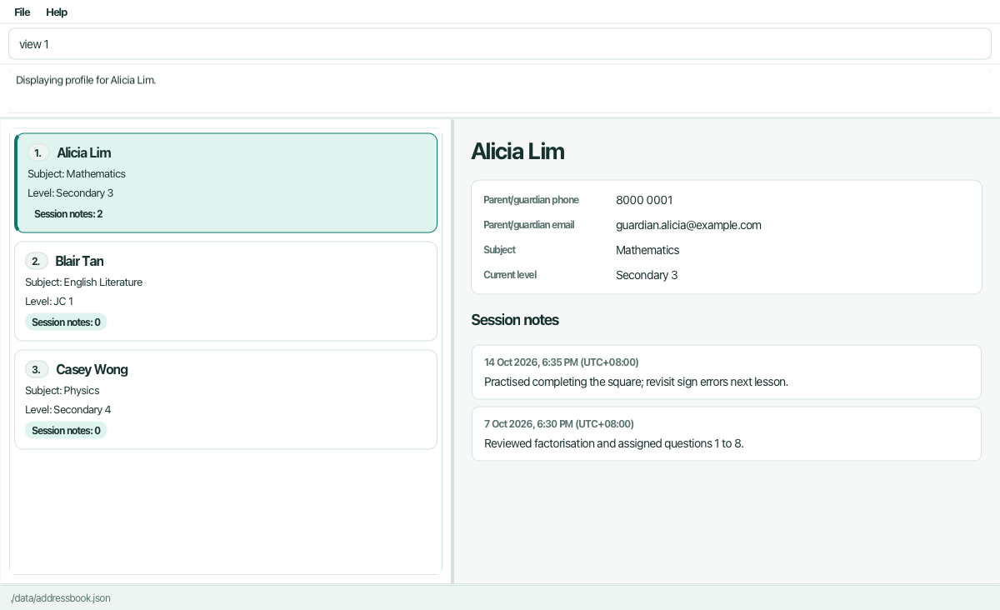

TutorTrack is a **desktop application for private tutors managing a student roster, optimized for use through a Command Line Interface (CLI)** while retaining the benefits of a Graphical User Interface (GUI). The light interface uses neutral surfaces and teal accents so roster, profile, command, and feedback areas remain easy to scan while you type quickly.

* Table of Contents
{:toc}

--------------------------------------------------------------------------------------------------------------------

## Quick start

1. Ensure that Java `25` or later is installed on your computer. 
   **Mac users:** Ensure you have the precise JDK version prescribed [here](https://se-education.org/guides/tutorials/javaInstallationMac.html).

1. Download the latest `.jar` file from the [TutorTrack releases page](https://github.com/AY2627S1-CS2103T-F09-1/tp/releases).

1. Copy the file to the folder you want to use as the _home folder_ for TutorTrack. This folder will contain the data file that stores your student roster and session notes. Rename the downloaded file to `tutortrack.jar` if it has a different name.

1. Open a terminal, `cd` to the folder containing the JAR file, and run `java -jar tutortrack.jar`. 
   A GUI similar to the one below should appear in a few seconds. On a first launch, the student roster is empty. 
   

1. Type a command in the command box and press Enter to execute it. For example, type **`help`** and press Enter to open the help window. 
   Some example commands you can try:

   * `add n/John p/98765432 sub/Math l/Sec 3` : Adds a student named `John` to TutorTrack.

   * `edit 1 l/Sec 4` : Updates the current level of the first student while keeping the rest of that student's record and session notes.

   * `note 1 nt/Review trigo next session.` : Adds a session note to the first student shown in the current roster.

   * `edit note 1 1 nt/Corrected lesson summary.` : Replaces the first student's first session note without changing its timestamp.

   * `delete 1` : Shows a confirmation prompt for deleting the first student and all of that student's session notes. Enter `delete 1 /confirm` next to complete the deletion.

   * `delete note 1 2` : Shows a confirmation prompt for deleting session note `[2]` from the first student. Enter `delete note 1 2 /confirm` next to complete the deletion.

   * `exit` : Exits the app.

1. Refer to the [Features](#features) section below for details of each command.

--------------------------------------------------------------------------------------------------------------------

## Features

**:information_source: Notes about the command format:** 

* Words in `UPPER_CASE` are the parameters to be supplied by the user. 
  For example, in `add n/NAME`, replace `NAME` with a value such as `John Doe`.

* Items in square brackets are optional. 
  For example, `[e/PARENT_EMAIL]` means the parent email can be included or omitted when adding a student.

* Parameters can be in any order. 
  For example, if the command specifies `n/NAME p/PHONE_NUMBER`, `p/PHONE_NUMBER n/NAME` is also acceptable.

* Extraneous parameters for commands that take no parameters, such as `help` and `exit`, are ignored. 
  For example, `help 123` is interpreted as `help`.

* If you are using a PDF version of this document, be careful when copying and pasting commands that span multiple lines as space characters surrounding line-breaks may be omitted when copied over to the application.

### Recalling earlier commands

TutorTrack keeps the latest 100 non-blank commands from the current app session, including unsuccessful commands and duplicates. This history is kept in memory only and is cleared when the app closes.

* Press `Up` in the command box to recall older commands. Navigation stops at the oldest retained command.
* Press `Down` to move toward newer commands. Moving past the newest command restores any draft that was in the command box before history navigation started.
* Edit a recalled command and press `Enter` to run it and add the edited command as a new history entry.

### Viewing help: `help`

Shows a message explaining how to access the help page.

Format: `help`

### Adding a student: `add`

Adds a student with the responsible parent or guardian's contact details, subject, and current level.

Format: `add n/NAME p/PARENT_PHONE sub/SUBJECT l/CURRENT_LEVEL [e/PARENT_EMAIL]`

The name, parent phone, subject, and current level are required. Parent email is optional. TutorTrack preserves each student's identity when the data file is saved and reloaded. A duplicate is a student whose normalized name and parent phone both match an existing student; spaces and hyphens in a parent phone do not make a distinct student. A successful addition reports the student's name, subject, and level. Duplicate students, missing values, invalid values, and unknown parameters explain the problem and then show this command's format. The only supported parameters are `n/`, `p/`, `sub/`, `l/`, and optional `e/`.

Examples:

* `add n/Alicia Lim p/+65 9123 4567 e/mrs.lim@example.com sub/Mathematics l/Secondary 3`
* `add sub/English Literature l/JC 1 n/Dev Patel p/91234567`

### Editing a student: `edit`

Edits one or more details for an existing student without deleting the student or their session notes.

Format: `edit INDEX [n/NAME] [p/PARENT_PHONE] [e/PARENT_EMAIL] [sub/SUBJECT] [l/CURRENT_LEVEL]`

* `INDEX` is the student's number in the currently displayed roster. It must be a positive whole number that refers to an existing student.
* Supply at least one field. Details you omit keep their existing values.
* Use `e/` without a value to remove the parent or guardian email. Other supplied fields cannot be empty.
* The supported parameters are `n/`, `p/`, `e/`, `sub/`, and `l/`. Each parameter can appear at most once and can be supplied in any order.
* Changing the name or phone can move the student to a different roster index. TutorTrack still edits the student selected when the command starts, preserves that student's internal identity and session notes, and keeps an open profile selected on that student.

Examples:

* `edit 2 p/9123 4567 l/Secondary 4`
* `edit 1 e/`
* `edit 3 n/Devika Patel sub/English Literature`

A successful edit reports the student's updated name, subject, and current level, refreshes the roster and any open profile, and saves the change. TutorTrack rejects an edit that would give the student the same normalized name and parent phone as another student. Invalid indices, missing edit fields, repeated or unknown parameters, and invalid values leave the student, session notes, open profile, and saved data unchanged. If saving fails, TutorTrack restores the complete original record.

### Viewing the student roster

TutorTrack displays all students in normalized alphabetical order when the application launches and after each successful command. When the roster is empty, TutorTrack shows that there are no students and suggests using the `add` command.

Each student card shows the roster index, student name, subject, current academic level, and number of session notes. Long names, subjects, and levels wrap within their cards, and the roster can be scrolled when it contains more students than fit in the window.

### Adding a session note: `note`

Adds a short note about a lesson to a student, such as what was covered, where the student struggled, or what to do next time. TutorTrack records the current date and time with the note and adds one to the student's session-note count in the roster.

If that student's profile is open, the new note appears there immediately after the command succeeds.

Format: `note INDEX nt/NOTE`

* `INDEX` is the student's number in the currently displayed roster. It must be a positive whole number, such as 1, 2, or 3.
* `NOTE` must be 1 to 500 characters on one line. Spaces at the start and end are removed; spaces inside the note are kept as typed.
* Only `nt/` is treated as a prefix, so text such as `sub/` or `n/` inside a note is saved as part of the note.
* You can add the same note text more than once, because each note records a separate lesson.

Examples:

* `note 1 nt/Reviewed factorisation; revise negative coefficients next lesson.`
* `note 3 nt/Completed past-year paper 2 (scored 34/40).`

If the index is missing, not a positive whole number, or larger than the number of students in the roster, or if the note is empty or too long, TutorTrack shows an error and does not add the note.

### Editing a session note: `edit note`

Replaces the text of one existing session note. The note's recorded date and time, chronological position, number, and the student's note count remain unchanged. If that student's profile is open, it refreshes after the command succeeds.

Format: `edit note STUDENT_INDEX NOTE_NUMBER nt/NEW_NOTE`

* `STUDENT_INDEX` is the student's number in the currently displayed roster.
* `NOTE_NUMBER` is the number shown beside the note in the student's profile. The oldest note is `[1]`.
* `NEW_NOTE` must be 1 to 500 characters on one line. Spaces at the start and end are removed; spaces inside the note are kept as typed.
* Only `nt/` is treated as a prefix, so text such as `sub/` or `n/` inside the replacement is saved as part of the note.

Example: `edit note 1 2 nt/Corrected lesson summary.`

If either selector is missing, invalid, or outside the current range, or if the replacement is empty or too long, TutorTrack shows an error and leaves the note unchanged. A failed save also restores the original note.

### Viewing a student profile: `view`

Displays one student's profile beside the roster. The profile shows the student's name, parent or guardian phone and email, subject, current academic level, and session notes. If no email was recorded, TutorTrack displays `Not provided`.

Session notes are shown newest first with the saved date, time, and UTC offset. Each note also has a number in square brackets. The oldest note is `[1]`, and each newer note has the next number, so the newest note appears at the top with the largest number. These numbers are selectors for the current display; they are not saved with the notes and are reassigned consecutively after a deletion. Long profile fields and notes wrap within the panel, and the history can be scrolled. You can select profile values, session-note headers, and note text and copy them with `Ctrl+C` on Windows/Linux or `Cmd+C` on macOS; the displayed text remains read-only. A student without notes displays `No session notes yet` and the command for recording the first note.

The roster card belonging to the open profile remains highlighted even if the roster is refreshed or its indices change. Hovering over or clicking a card does not add a highlight or open another profile. The open profile refreshes after each successful command and closes, together with its highlight, if that student is deleted; a failed command leaves both unchanged.

Format: `view INDEX`

* `INDEX` is the student's number in the currently displayed roster.
* `INDEX` must be a positive whole number and must refer to a student currently in the roster.

Example: `view 2`

If the index is missing, invalid, or larger than the number of students in the roster, TutorTrack shows an error and keeps the current display unchanged.

### Deleting a student: `delete`

Starts a confirmation workflow for deleting the specified student and all session notes belonging to that student.

Preview format: `delete INDEX`

Confirmation format: `delete INDEX /confirm`

* `INDEX` is the student's number in the currently displayed sorted roster.
* `INDEX` must be a positive whole number and must refer to a student currently in the roster.
* The preview identifies the student, shows how many session notes would be removed, and displays the exact confirmation command. It does not delete or save anything.
* To complete the deletion, enter the displayed `delete INDEX /confirm` command immediately after the preview. `/confirm` is case-sensitive and must appear once, after the index.
* To cancel, enter any other command. The pending deletion is cleared before that command is processed. Starting another `delete INDEX` preview replaces the earlier pending deletion.
* A direct, repeated, or mismatched `/confirm` command is rejected without deleting data.
* After a matching confirmation, TutorTrack reports `Successfully deleted STUDENT_NAME.` The roster is redrawn with new consecutive indices. If the deleted student's profile was open, it closes and its roster highlight is cleared.

Example:

1. Enter `delete 2`.
1. Check the student name and session-note count in the prompt.
1. Enter `delete 2 /confirm` as the next command to delete that student, or enter any other command to cancel.

If the index is missing, invalid, contains more than one value, or is larger than the roster, TutorTrack shows an error and does not change the roster, session notes, open profile, or saved data. If TutorTrack cannot save a confirmed deletion, it restores the student and session notes and clears the pending deletion.

### Deleting one session note: `delete note`

Starts a confirmation workflow for deleting one session note while keeping the student and every other note.

Preview format: `delete note STUDENT_INDEX NOTE_NUMBER`

Confirmation format: `delete note STUDENT_INDEX NOTE_NUMBER /confirm`

* `STUDENT_INDEX` is the student's positive whole-number index in the displayed roster.
* `NOTE_NUMBER` is the positive number in square brackets beside the note in that student's profile.
* The preview identifies the student and note number and displays the exact confirmation command. It does not delete or save anything.
* Enter the displayed confirmation command immediately after the preview. To cancel, enter any other command; starting another deletion preview replaces the earlier pending deletion.
* Direct, repeated, stale, or mismatched confirmations are rejected. This includes a student or session-history change between the preview and confirmation.
* After a matching confirmation, TutorTrack removes only that note, reports `Successfully deleted session note [NOTE_NUMBER] for STUDENT_NAME.`, refreshes an open profile, and numbers the remaining notes consecutively.

Example:

1. Enter `view 1` and check the displayed note numbers.
1. Enter `delete note 1 3`.
1. Check the student name and note number in the prompt.
1. Enter `delete note 1 3 /confirm` as the next command to delete that note, or enter any other command to cancel.

If either number is missing or not a positive whole number, extra arguments are supplied, the student does not exist, the student has no notes, or the note number is outside the displayed range, TutorTrack shows a specific error and changes nothing. If saving fails, TutorTrack restores the complete original history and clears the pending deletion.

### Exiting the program: `exit`

Exits the program.

Format: `exit`

### Saving the data

TutorTrack automatically saves data-changing commands. You do not need to save manually. Student and session-note deletion previews do not save because they do not change any data.

If TutorTrack cannot save the data, for example because the data file is read-only, it shows an error and cancels the command, so the roster, session notes, and previously saved data file stay as they were before the command.

### Editing the data file

TutorTrack data is saved automatically as a JSON file `[JAR file location]/data/addressbook.json`. Student records include an internal `studentId` that should be preserved when manually editing the data file and must be unique for every student. Each student's session notes are stored in that student's `sessionNotes` list, and each note has a `recordedAt` date and time with a time-zone offset, such as `2026-09-18T18:35:00+08:00`, and its `text`. Displayed note numbers and pending confirmations are not saved. A `recordedAt` without the offset (for example `2026-09-18T18:35:00`) makes the data file invalid. Advanced users are welcome to update data directly by editing that data file.

:exclamation: **Caution:**
If your changes make the data file invalid, TutorTrack starts with an empty student roster at the next run and shows an error. Before a command can replace the invalid file, TutorTrack keeps a uniquely named copy such as `[JAR file location]/data/addressbook.json.backup-<unique>.bak`. Correct the original file and restart TutorTrack before running a command that saves data. Still, we recommend backing up the file before editing it. 
Furthermore, certain edits can cause TutorTrack to behave in unexpected ways (e.g., if a value entered is outside of the acceptable range). Therefore, edit the data file only if you are confident that you can update it correctly.

### Archiving data files `[coming in v2.0]`

_Details coming soon ..._

--------------------------------------------------------------------------------------------------------------------

## FAQ

**Q**: How do I transfer my data to another computer? 
**A**: Install the app on the other computer and overwrite the data file it creates with the data file from your previous TutorTrack home folder.

--------------------------------------------------------------------------------------------------------------------

## Known issues

1. **When using multiple screens**, if you move the application to a secondary screen, and later switch to using only the primary screen, the GUI will open off-screen. The remedy is to delete the `preferences.json` file created by the application before running the application again.
1. **If you minimize the Help Window** and then run the `help` command (or use the `Help` menu, or the keyboard shortcut `F1`) again, the original Help Window will remain minimized, and no new Help Window will appear. The remedy is to manually restore the minimized Help Window.

--------------------------------------------------------------------------------------------------------------------

## Command summary

Action | Format, Examples
--------|------------------
**Add** | `add n/NAME p/PARENT_PHONE sub/SUBJECT l/CURRENT_LEVEL [e/PARENT_EMAIL]`  e.g., `add n/James Ho p/91234567 sub/Mathematics l/Secondary 3`
**Edit** | `edit INDEX [n/NAME] [p/PARENT_PHONE] [e/PARENT_EMAIL] [sub/SUBJECT] [l/CURRENT_LEVEL]`  e.g., `edit 2 p/9123 4567 l/Secondary 4`; use `edit 2 e/` to remove the email
**Delete student** | Preview: `delete INDEX` Confirm: `delete INDEX /confirm`  e.g., `delete 3`, then `delete 3 /confirm`
**Delete note** | Preview: `delete note STUDENT_INDEX NOTE_NUMBER` Confirm: `delete note STUDENT_INDEX NOTE_NUMBER /confirm`  e.g., `delete note 1 3`, then `delete note 1 3 /confirm`
**Note** | `note INDEX nt/NOTE`  e.g., `note 1 nt/Reviewed factorisation.`
**Edit note** | `edit note STUDENT_INDEX NOTE_NUMBER nt/NEW_NOTE`  e.g., `edit note 1 2 nt/Corrected summary.`
**View** | `view INDEX`  e.g., `view 2`
**Help** | `help`
**Exit** | `exit`
